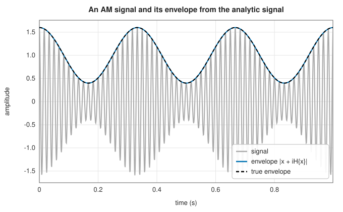
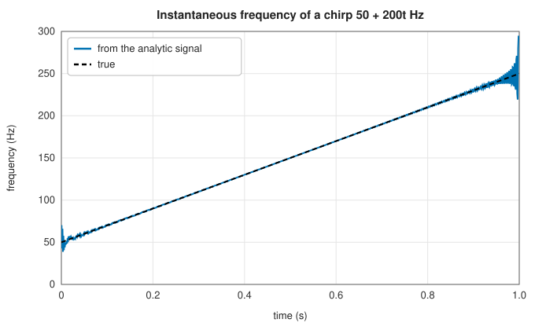

# The Hilbert transform and the analytic signal

<div class="entry-summary">

| | |
|---|---|
| **Problem** | Form the complex signal whose real part is a given real signal and whose spectrum has no negative frequencies; read off the instantaneous amplitude, phase and frequency |
| **Devised by** | David Hilbert (1905), the integral transform; Dennis Gabor (1946), the analytic signal; Lawrence Marple (1999), the discrete-time construction by the DFT |
| **Accuracy** | Agrees with SciPy's `hilbert` to $10^{-16}$ |
| **Cost** | Two FFTs of the signal length |
| **API** | [`analytic_signal`](../../api/lib_jsl_dsp/discrete/spectral/hilbert/fn.analytic_signal.html), [`hilbert_transform`](../../api/lib_jsl_dsp/discrete/spectral/hilbert/fn.hilbert_transform.html), [`instantaneous_attributes`](../../api/lib_jsl_dsp/discrete/spectral/hilbert/fn.instantaneous_attributes.html) ([`InstantaneousAttributes`](../../api/lib_jsl_dsp/discrete/spectral/hilbert/struct.InstantaneousAttributes.html)) |

</div>

## Overview

A real signal's spectrum is symmetric: every positive frequency has a negative twin carrying the same information. Discarding the negative
half and doubling the positive half gives the **analytic signal** $z = x + i\mathcal Hx$, whose imaginary part is the **Hilbert transform** of $x$, the signal with every component shifted by
90°: $\cos \to \sin$, $\sin \to -\cos$. For a narrow-band signal $a(t)\cos\phi(t)$, the analytic signal is $a(t)e^{i\phi(t)}$, so its magnitude is the **envelope** and the derivative of its phase is the **instantaneous frequency**.
Demodulation, envelope detection, single-sideband modulation and the analysis of chirps and vibrations all rest on it.

## History

David Hilbert studied the integral transform $\mathcal Hf(t) = \frac1\pi\,\mathrm{p.v.}\int f(\tau)/(t - \tau)\,d\tau$ in 1905 in connection with boundary-value problems for analytic functions, whose real and imaginary parts on the
boundary are Hilbert transforms of each other. Dennis Gabor (1946) introduced the analytic signal in his "Theory of communication", defining
the instantaneous amplitude and frequency of a real signal. Lawrence Marple (1999) gave the discrete-time analytic signal computed with the
DFT, the construction used by MATLAB and SciPy.

## The idea

### Removing negative frequencies

The Hilbert transform multiplies each frequency component by $-i\,\mathrm{sgn}(f)$. The analytic signal $x + i\mathcal Hx$ therefore has spectrum $X(f)(1 + \mathrm{sgn}(f))$: twice $X$ for $f > 0$, $X$ at $f = 0$, and zero for $f < 0$. In discrete time, with
an $N$-point DFT, the recipe is:

$$
Z_k = \begin{cases} X_k, & k = 0 \text{ or } k = N/2, \\ 2X_k, & 0 < k < N/2, \\ 0, & k > N/2, \end{cases} \qquad z = \mathrm{IDFT}(Z).
$$

The DC and Nyquist bins are their own negatives and are kept once. The real part of $z$ is exactly $x$.

### Envelope and instantaneous frequency



For an amplitude-modulated carrier, $|z|$ recovers the modulation, here exactly, because the modulation (3 Hz) is far below the carrier (60 Hz) and the record holds
whole periods of both. The instantaneous frequency is $\frac1{2\pi}\frac{d}{dt}\arg z$, computed from phase differences between samples:



The estimate follows the chirp's linear sweep except at the ends. There the DFT's implicit periodic extension joins the high-frequency
end to the low-frequency start, and the Gibbs ripple of that discontinuity disturbs the phase. Taper or pad the signal if the ends matter.

### When it makes sense

The envelope and instantaneous frequency are meaningful only for **narrow-band** signals. For a sum of two tones, the analytic signal's phase
advances at a rate that beats between them, and the instantaneous frequency can even be negative. The decomposition of a signal into amplitude and phase is not unique,
and the analytic signal is one particular, well-behaved choice; Bedrosian's theorem says when it separates them correctly.

## Algorithm

1. FFT the real signal.
2. Double bins $1, \ldots, \lceil N/2\rceil - 1$, keep DC (and Nyquist for even $N$), zero the rest.
3. Inverse FFT; the imaginary part is the Hilbert transform.
4. Attributes: envelope $|z|$, unwrapped phase $\arg z$, frequency $\Delta\phi\,f_s/2\pi$ between samples.

## Implementation

```rust,ignore
{{#include ../../../crates/dsp/src/discrete/spectral/hilbert.rs:analytic_signal}}
```

- The transform is circular: it assumes the record is one period of a periodic signal.
- `instantaneous_attributes` returns frequencies one sample shorter than the signal, at the midpoints between samples.
- An FIR Hilbert transformer for streaming use can be designed with [`remez`](../filters/fir-design.md#parks-mcclellan-equiripple-design) and `RemezFilterType::Hilbert`.

## In practice

```rust,ignore
{{#include ../../../crates/dsp/examples/dsp_hilbert.rs}}
```

```text
cos → analytic signal at n = 0, 5: 1.000+0.000i, 0.000+1.000i
envelope at t = 0.5 s: 1.0000 (true 1.0000)
instantaneous frequency: mean 100.000 Hz
```

**Strengths**

- Exact, fast, and parameter-free envelope and phase extraction for narrow-band signals.

**Weaknesses**

- Circular edge effects; meaningless "instantaneous" quantities for broadband or multi-component signals.

## Exercises

1. Show that the Hilbert transform of $\cos\omega t$ is $\sin\omega t$ for $\omega > 0$, and that $\mathcal H(\mathcal Hx) = -x$ for signals without a DC component.
2. Show that the analytic signal of $a(t)\cos(\omega_0t)$ is $a(t)e^{i\omega_0t}$ when the spectrum of $a$ lies below $\omega_0$ (Bedrosian's theorem).
3. Compute the instantaneous frequency of $\cos t + 0.5\cos 3t$ and find where it is negative.
4. Explain why the analytic signal's DC and Nyquist bins must not be doubled.

## Further reading

- D. Gabor, "Theory of communication", *Journal of the IEE, Part III* 93 (1946) 429–457.
- S. L. Marple, "Computing the discrete-time analytic signal via FFT", *IEEE Transactions on Signal Processing* 47 (1999) 2600–2603.
- B. Boashash, "Estimating and interpreting the instantaneous frequency of a signal", *Proceedings of the IEEE* 80 (1992) 520–568.
