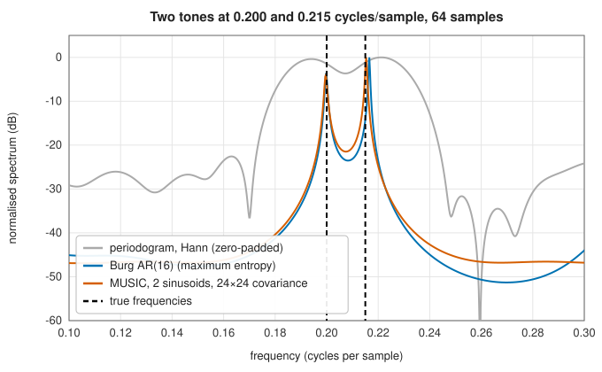

# Parametric spectra: linear prediction, Burg and MUSIC

<div class="entry-summary">

| | |
|---|---|
| **Problem** | Estimate a spectrum by fitting a model, an autoregressive filter driven by white noise or a sum of sinusoids in noise, to resolve detail finer than the record's DFT bins |
| **Devised by** | George Udny Yule (1927) and Gilbert Walker (1931), autoregressive models; Norman Levinson (1947) and James Durbin (1960), the fast recursion; John Burg (1967), maximum entropy spectra; Ralph Schmidt (1979, 1986), MUSIC |
| **Accuracy** | Levinson-Durbin agrees with SciPy's `solve_toeplitz` to $10^{-15}$; estimation accuracy depends on the model order and the data (tables below) |
| **Cost** | Levinson-Durbin $O(p^2)$ after $O(Np)$ for the autocorrelation; Burg $O(Np)$; MUSIC $O(m^3)$ for an $m \times m$ covariance plus $O(m^2)$ per frequency |
| **API** | [`autocorrelation`](../../api/lib_jsl_dsp/discrete/spectral/linear_predictive_coding/fn.autocorrelation.html), [`levinson_durbin`](../../api/lib_jsl_dsp/discrete/spectral/linear_predictive_coding/fn.levinson_durbin.html), [`linear_predictive_coding`](../../api/lib_jsl_dsp/discrete/spectral/linear_predictive_coding/fn.linear_predictive_coding.html), [`lpc_residual`](../../api/lib_jsl_dsp/discrete/spectral/linear_predictive_coding/fn.lpc_residual.html), [`lpc_synthesize`](../../api/lib_jsl_dsp/discrete/spectral/linear_predictive_coding/fn.lpc_synthesize.html), [`burg`](../../api/lib_jsl_dsp/discrete/spectral/maximum_entropy/fn.burg.html), [`ar_psd`](../../api/lib_jsl_dsp/discrete/spectral/maximum_entropy/fn.ar_psd.html), [`maximum_entropy_spectrum`](../../api/lib_jsl_dsp/discrete/spectral/maximum_entropy/fn.maximum_entropy_spectrum.html), [`music`](../../api/lib_jsl_dsp/discrete/spectral/music/fn.music.html), [`music_real`](../../api/lib_jsl_dsp/discrete/spectral/music/fn.music_real.html), [`music_doa`](../../api/lib_jsl_dsp/discrete/spectral/music/fn.music_doa.html) |

</div>

## Overview

A periodogram assumes nothing about the signal and resolves no finer than one DFT bin, $f_s/N$. If the signal is known to have structure, a model
with a few parameters can be fitted and its spectrum computed exactly, at any resolution. Two models dominate:

- **Autoregressive** (AR): the signal is white noise passed through an all-pole filter, $x_n = -\sum_{k=1}^pa_kx_{n-k} + e_n$. Fitting the $a_k$ is **linear prediction**. The **Levinson-Durbin** recursion does it from the
  autocorrelation, and **Burg's method** does it directly from the data. The fitted spectrum $\sigma^2/|A(e^{i\omega})|^2$ is smooth with sharp peaks, and Burg called it the **maximum entropy** spectrum.
- **Sinusoids in white noise**: the signal's covariance matrix splits into a signal subspace and an orthogonal noise subspace. **MUSIC**
  finds the frequencies whose steering vectors are orthogonal to the noise subspace.

Both resolve tones far closer than a bin when the model fits. Both mislead when it doesn't.

## History

George Udny Yule (1927) fitted an autoregression to sunspot numbers, and Gilbert Walker (1931) generalised it. Their normal equations bear
both names. Norman Levinson (1947) solved Toeplitz systems in $O(p^2)$, and James Durbin (1960) adapted the method to autoregressions. Linear prediction became the core
of speech coding (Bishnu Atal and Manfred Schroeder; Fumitada Itakura and Shuzo Saito, late 1960s). John Burg (1967), working on
seismic data, proposed the maximum entropy method, which estimates the reflection coefficients from forward and backward prediction
errors and always gives a stable model. Ralph Schmidt's MUSIC (multiple signal classification, 1979, published 1986) introduced subspace methods
for frequency and direction-of-arrival estimation.

## The idea

### Linear prediction and the Yule-Walker equations

**The model.** The periodogram assumes nothing about the signal, and pays for it with limited
resolution. A **parametric** method assumes a model, fits its few parameters to the data, and
computes the spectrum of the fitted model. The most useful model is **autoregressive** (AR): each
sample is a linear combination of the $p$ previous samples plus a new random input $e_n$,

$$
x_n = -\sum_{k=1}^pa_kx_{n-k} + e_n .
$$

Equivalently, the signal is white noise passed through the all-pole filter $1/A(z)$, with
$A(z) = 1 + a_1z^{-1} + \cdots + a_pz^{-p}$. Poles near the unit circle give sharp peaks in the
spectrum, so a low-order model can describe a resonant signal very compactly.

**Fitting it.** The coefficients are found by **linear prediction**: choose them so that
$\hat x_n = -\sum_{k=1}^pa_kx_{n-k}$ predicts $x_n$ from its past with the smallest mean squared
error. Setting the derivative of the error with respect to each coefficient to zero gives the
**Yule-Walker** equations

$$
\sum_{k=1}^pa_kr_{|j-k|} = -r_j, \qquad j = 1, \ldots, p,
$$

where $r_k$ is the **autocorrelation** of the signal at lag $k$, the average of $x_nx_{n+k}$.
These are the [normal equations](../linear_algebra/least-squares.md#the-normal-equations) of the
prediction problem.

**Solving them fast.** The matrix of the system has entries $r_{|j-k|}$ that depend only on the
difference of the indices: it is constant along each diagonal, a **Toeplitz** matrix. This
structure allows a solution in $O(p^2)$ operations instead of $O(p^3)$. The
**Levinson-Durbin** recursion builds the predictor of order $m$ from the predictor of order
$m - 1$, adding one new number $k_m$ at each stage:

$$
k_m = -\frac{r_m + \sum_{j=1}^{m-1}a_j^{(m-1)}r_{m-j}}{E_{m-1}}, \qquad a_j^{(m)} = a_j^{(m-1)} + k_ma_{m-j}^{(m-1)}, \qquad E_m = E_{m-1}(1 - k_m^2).
$$

Here $E_m$ is the prediction error power of the order-$m$ predictor, which can only decrease as
the order grows. The **reflection coefficients** $k_m$ have magnitude below one exactly when the autocorrelation is positive definite, which guarantees a stable synthesis filter $1/A(z)$.
They are also the coefficients of a lattice filter, a model of the vocal tract as a tube of uniform sections in speech coding. The prediction error power $E_p$
is the driving noise variance, and the AR spectrum is $\sigma^2/|A(e^{i\omega})|^2$.

### Burg's method

The autocorrelation method uses the biased estimate $r_k = \frac1N\sum x_nx_{n+k}$, which implicitly pads the data with zeros and biases the fit. Burg's method skips the autocorrelation. At
each order it chooses the reflection coefficient that minimises the sum of the forward and backward prediction error powers,

$$
k_m = \frac{-2\sum_nf_n^{(m-1)}b_{n-1}^{(m-1)}}{\sum_n\big((f_n^{(m-1)})^2 + (b_{n-1}^{(m-1)})^2\big)},
$$

then updates the errors and the predictor by Levinson's step. By the Cauchy-Schwarz inequality $|k_m| \le 1$, with strict inequality unless the signal is perfectly predictable, so the model is stable (a reflection
coefficient of magnitude 1 would put a pole on the unit circle). For sharply resonant processes,
Burg's estimates are far better than the autocorrelation method's:

<p class="caption" id="tab-15-7"><strong>Table 15.7.</strong> Autocorrelation and Burg estimates of a resonant AR(4) process.</p>

{{#include ../generated/spectral/ar_estimation.md}}

The process is Marple's classic test case, $A(z) = 1 - 2.7607z^{-1} + 3.8106z^{-2} - 2.6535z^{-3} + 0.9238z^{-4}$, with poles at radius 0.98. The table shows the RMS error of the four coefficients, averaged over 50 records.
The autocorrelation method's zero-padding bias dominates even at 1024 samples.

### Resolution beyond the periodogram

Two tones 0.015 cycles per sample apart, in 64 samples, are less than one bin apart ($1/64 = 0.0156$):



<p class="caption" id="fig-15-8"><strong>Figure 15.8.</strong> Parametric resolution.</p>

The Hann periodogram shows a single broad hump. A Burg AR(16) model resolves two peaks, and MUSIC places sharp peaks almost exactly on the true frequencies:
{{#include ../generated/spectral/music_peaks.md}}

### MUSIC

MUSIC (multiple signal classification) is built for a narrower model: a few pure tones in white
noise. It exploits the algebraic structure that this model gives to the covariance matrix of the
data, and finds the frequencies from its eigenvectors.

Take vectors of $m$ consecutive samples. A complex exponential of frequency $\omega$ contributes
to each such vector a multiple of the **steering vector**
$\mathbf a(\omega) = (1, e^{i\omega}, \ldots, e^{i(m-1)\omega})$. With $q$ tones, the signal part of every
data vector is a combination of only $q$ fixed vectors: it lies in a $q$-dimensional
**signal subspace** of the $m$-dimensional space. The noise, by contrast, is spread equally over
all $m$ dimensions. This shows in the covariance matrix. For $q$ complex exponentials in white noise, the $m \times m$ covariance matrix of the data is $R = \sum_i P_i\,\mathbf a(\omega_i)\mathbf a(\omega_i)^{\mathsf H} + \sigma^2I$, with **steering vectors** $\mathbf a(\omega) = (1, e^{i\omega}, \ldots, e^{i(m-1)\omega})$. The first term has rank $q$ and the second adds $\sigma^2$ to every eigenvalue. So $R$ has $q$
large eigenvalues, whose eigenvectors span the signal subspace, and $m - q$ eigenvalues equal to
$\sigma^2$, whose eigenvectors $E_n$ span the **noise subspace**. Eigenvectors of a Hermitian
matrix belonging to different eigenvalues are orthogonal, so the noise subspace is orthogonal to
the signal subspace, and in particular to the steering vector of every true frequency.

That gives a test for a candidate frequency $\omega$: project its steering vector onto the noise
subspace. If $\omega$ is one of the true frequencies the projection is zero; otherwise it is not.
The MUSIC **pseudospectrum** is the reciprocal of the squared length of the projection,

$$
P(\omega) = \frac{1}{\lVert E_n^{\mathsf H}\mathbf a(\omega)\rVert^2}
$$

which peaks sharply at the true frequencies. It is not a power spectrum: its height says nothing about power. A real sinusoid is two complex
exponentials, so `music_real` uses a signal subspace of dimension $2q$. The same pseudospectrum, with array steering vectors, estimates directions of arrival (`music_doa`).
The covariance eigenvalues confirm the model order: a gap after the $q$-th (or $2q$-th) separates signal from noise.

## Algorithm

**Levinson-Durbin**, from the autocorrelations $r_0, \ldots, r_p$.

1. Set $E_0 = r_0$ and start with no coefficients.
2. For $m = 1, \ldots, p$:
   - compute the reflection coefficient
     $k_m = -\big(r_m + \sum_{j=1}^{m-1}a_jr_{m-j}\big)/E_{m-1}$;
   - if $|k_m| \ge 1$, the autocorrelation is not positive definite: stop with an error;
   - update the coefficients: $a_j \leftarrow a_j + k_ma_{m-j}$ for $j = 1, \ldots, m - 1$ (using
     the old values on the right), and $a_m = k_m$;
   - update the error power: $E_m = E_{m-1}(1 - k_m^2)$.
3. Return the coefficients $a_1, \ldots, a_p$ and the noise variance $E_p$.

Cost: $O(p^2)$.

**Burg's method**, from the samples themselves.

1. Initialise the forward and backward prediction errors to the signal, $f = b = x$.
2. For each order $m = 1, \ldots, p$:
   - compute $k_m$ from the inner product of $f$ with $b$ delayed by one sample, and their
     energies;
   - update the errors: $f_n \leftarrow f_n + k_mb_{n-1}$ and $b_n \leftarrow b_{n-1} + k_mf_n$,
     both from the old values;
   - update the coefficients and the error power by Levinson's step.

Cost: $O(Np)$.

**The AR spectrum**: for each requested frequency, evaluate the polynomial
$A(e^{i\omega}) = 1 + \sum_ka_ke^{-ik\omega}$ and return $\sigma^2/|A|^2$.

**MUSIC**, for $q$ exponentials and windows of $m$ samples.

1. Slide a window of length $m$ along the signal and average the outer products of the
   windows with themselves to estimate the covariance matrix. Average it with its
   forward-backward mirror image, which uses each window a second time, reversed and
   conjugated.
2. Compute the eigendecomposition; the eigenvectors of the $m - q$ smallest eigenvalues form
   $E_n$.
3. Evaluate the pseudospectrum on a grid of frequencies.
4. Locate its $q$ highest peaks and refine each by fitting a parabola through the peak and its
   two neighbours.

## Implementation

```rust,ignore
{{#include ../../../crates/dsp/src/discrete/spectral/linear_predictive_coding.rs:levinson}}
```

```rust,ignore
{{#include ../../../crates/dsp/src/discrete/spectral/maximum_entropy.rs:burg}}
```

```rust,ignore
{{#include ../../../crates/dsp/src/discrete/spectral/music.rs:music}}
```

- `levinson_durbin` returns $A(z) = 1 + \sum a_kz^{-k}$; SciPy's `solve_toeplitz` solves for the predictor coefficients, which have the opposite sign.
- `lpc_residual` filters by $A(z)$ (the whitening, analysis filter); `lpc_synthesize` by $1/A(z)$.

## In practice

```rust,ignore
{{#include ../../../crates/dsp/examples/dsp_parametric.rs}}
```

```text
LPC   A(z) = [1.0000, -1.5921, 0.8912], reflection [-0.8419, 0.8912]
Burg  A(z) = [1.0000, -1.5934, 0.8921], noise variance 0.08145 (true 0.08333)
prediction gain 12.3 dB
MUSIC peaks [0.1000, 0.1300, 0.3100]
largest covariance eigenvalues [8.10, 7.89, 7.87, 7.55, 7.10, 6.32, 0.00, 0.00]
```

For a moderately resonant AR(2) process and 2000 samples, both fits are close to the true $1 - 1.6z^{-1} + 0.9z^{-2}$. MUSIC finds the three tones, and the eigenvalues fall off sharply after
the sixth, the signal subspace of three real sinusoids.

**Strengths**

- Resolution beyond the DFT bin width from short records; smooth spectra with few parameters.
- Linear prediction is the basis of speech coding; MUSIC extends directly to sensor arrays.

**Weaknesses**

- The model order must be chosen: too low merges peaks, too high produces spurious ones.
- Model mismatch (coloured noise, non-sinusoidal signals) gives confidently wrong answers; MUSIC's pseudospectrum carries no power information.

## Exercises

1. Derive the Yule-Walker equations from the orthogonality of the prediction error to the past samples.
2. Show that $E_m = E_{m-1}(1 - k_m^2)$, and deduce $|k_m| < 1$ for a positive definite autocorrelation.
3. Show that Burg's reflection coefficient minimises the sum of forward and backward error powers, and that $|k_m| \le 1$.
4. Show that the steering vector of a true frequency is orthogonal to the noise subspace of $R$.
5. Fit AR models of orders 2 to 30 to the two-tone example and plot the spectra. Where do spurious peaks appear?

<details>
<summary>Hints and answers</summary>

1. The error $e_n = x_n + \sum a_kx_{n-k}$ is orthogonal to $x_{n-j}$ for $j = 1, \ldots, p$ at the optimum. Taking expectations gives $r_{j} + \sum_ka_kr_{j-k} = 0$, the Yule-Walker equations.
2. The Levinson update $E_m = E_{m-1}(1 - |k_m|^2)$ follows from the order update of the prediction error. For a positive definite autocorrelation, all $E_m > 0$ so $|k_m| < 1$.
3. Burg minimises $\sum(f_m^2 + b_m^2)$ over $k_m$ with $f' = f + kb$, $b' = b + kf$; setting the derivative to zero gives $k = -2\sum fb/\sum(f^2 + b^2)$, and by the Cauchy-Schwarz inequality $|2\sum fb| \le \sum(f^2 + b^2)$, so $|k| \le 1$.
4. The signal subspace is spanned by the steering vectors of the true frequencies, and the noise subspace is its orthogonal complement.
5. Spurious peaks appear when the order is too high relative to the data length, especially for noisy data; compare against the true tones' positions.

</details>

## Further reading

- S. L. Marple, *Digital Spectral Analysis with Applications*, Prentice Hall, 1987 (2nd ed., Dover, 2019).
- J. P. Burg, "Maximum entropy spectral analysis", PhD thesis, Stanford University, 1975.
- R. O. Schmidt, "Multiple emitter location and signal parameter estimation", *IEEE Transactions on Antennas and Propagation* 34 (1986) 276–280.
- J. Makhoul, "Linear prediction: a tutorial review", *Proceedings of the IEEE* 63 (1975) 561–580.
- P. Stoica and R. Moses, *Spectral Analysis of Signals*, Prentice Hall, 2005.
