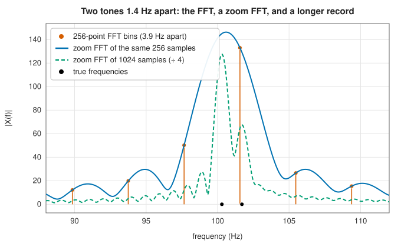

# Partial fractions, zoom FFT and waveforms

<div class="entry-summary">

| | |
|---|---|
| **Problem** | Expand a rational transfer function into partial fractions and back; undo a convolution; convert between transfer-function, state-space and zero-pole-gain forms; compute the spectrum on a narrow band; generate standard test waveforms; approximate a time delay |
| **Devised by** | Oliver Heaviside (1890s), the cover-up method for partial fractions; J. F. Mahoney and B. D. Sivazlian (1983), the deflation algorithm SciPy uses; Lawrence Rabiner, Ronald Schafer and Charles Rader (1969), the chirp z-transform; Henri Padé (1892), rational approximation |
| **Accuracy** | Agrees with SciPy to $10^{-14}$ relative (chirps to $10^{-13}$), including repeated and complex poles |
| **Cost** | Partial fractions: an $n \times n$ eigenproblem for the poles and $O(n^2)$ per residue. Zoom FFT: three FFTs of length $\ge n + m - 1$ |
| **Read first** | [Spectra at chosen frequencies](chosen-frequencies.md), [Continuous-time systems](../comms/continuous-time.md) |
| **API** | [`residue`](../../api/lib_jsl_dsp/discrete/partial_fractions/fn.residue.html), [`residuez`](../../api/lib_jsl_dsp/discrete/partial_fractions/fn.residuez.html), [`invres`](../../api/lib_jsl_dsp/discrete/partial_fractions/fn.invres.html), [`invresz`](../../api/lib_jsl_dsp/discrete/partial_fractions/fn.invresz.html), [`unique_roots`](../../api/lib_jsl_dsp/discrete/partial_fractions/fn.unique_roots.html), [`deconvolve`](../../api/lib_jsl_dsp/discrete/partial_fractions/fn.deconvolve.html), [`tf2zpk`](../../api/lib_jsl_dsp/discrete/partial_fractions/fn.tf2zpk.html), [`zpk2tf`](../../api/lib_jsl_dsp/discrete/partial_fractions/fn.zpk2tf.html), [`ss2zpk`](../../api/lib_jsl_dsp/continuous/lti/fn.ss2zpk.html), [`zpk2ss`](../../api/lib_jsl_dsp/continuous/lti/fn.zpk2ss.html), [`pade_delay`](../../api/lib_jsl_dsp/continuous/lti/fn.pade_delay.html), [`zoom_fft`](../../api/lib_jsl_dsp/discrete/signal_tools/fn.zoom_fft.html), [`chirp`](../../api/lib_jsl_dsp/discrete/waveforms/fn.chirp.html), [`sweep_poly`](../../api/lib_jsl_dsp/discrete/waveforms/fn.sweep_poly.html), [`gausspulse`](../../api/lib_jsl_dsp/discrete/waveforms/fn.gausspulse.html), [`sawtooth`](../../api/lib_jsl_dsp/discrete/waveforms/fn.sawtooth.html), [`square_wave`](../../api/lib_jsl_dsp/discrete/waveforms/fn.square_wave.html) |

</div>

## Overview

The last group of `scipy.signal` tools covered by the library:

- **Partial fractions.** `residue` writes $b(s)/a(s)$ as a sum of simple terms $r_i/(s - p_i)$ plus a polynomial. Each term is a mode of the system, whose
  inverse Laplace transform is $r_ie^{p_it}$. `residuez` does the same in powers of $z^{-1}$ for digital filters, where each term contributes $r_ip_i^n$
  to the impulse response. `invres` and `invresz` go back.
- **Deconvolution.** `deconvolve` divides one polynomial by another, recovering $x$ from $y = h * x$.
- **Zero-pole-gain form.** `tf2zpk`, `zpk2tf`, `ss2zpk` and `zpk2ss` complete the conversions between the three representations of a linear system.
  `default_response_times` gives the time grid SciPy uses for step and impulse responses, and `pade_delay` approximates a time delay by a rational function.
- **Zoom FFT.** `zoom_fft` evaluates the DFT on a narrow band of frequencies with fine spacing.
- **Waveforms.** `chirp`, `sweep_poly`, `gausspulse`, `sawtooth`, `square_wave` and `unit_impulse` generate standard test signals.

## History

Partial fractions are as old as calculus: Leibniz and Johann Bernoulli used them to integrate rational functions. Oliver Heaviside's operational
calculus of the 1890s made them the standard way to solve circuit equations, with his "cover-up" rule for the residue at a simple pole. For
repeated poles the residues involve derivatives. J. F. Mahoney and B. D. Sivazlian's review (1983) compared the algorithms, and SciPy uses their
"deflation through subtraction".

Lawrence Rabiner, Ronald Schafer and Charles Rader (1969) introduced the chirp z-transform, which evaluates the z-transform on a spiral. The zoom
FFT is its special case on an arc of the unit circle. Henri Padé (1892) studied the rational approximants that bear his name. In control
engineering they became the standard way to fit a pure delay $e^{-sT}$ into a rational model.

## The idea

### Partial fractions

With the poles $p_i$ (roots of $a$) and the polynomial part removed by division, a simple pole has residue

$$
r_i = \frac{b(p_i)}{a'(p_i)} = \frac{b(p_i)}{a_0\prod_{j\ne i}(p_i - p_j)},
$$

Heaviside's cover-up rule. A pole of multiplicity $m$ contributes $\sum_{j=1}^m r_{ij}/(s - p_i)^j$. **Deflation through subtraction** finds these one
power at a time. Divide the numerator and the product of the other factors by $(s - p_i)$. The ratio of the remainders gives the coefficient
of the current power, and subtracting its contribution leaves a numerator with one fewer power.

Numerically, a repeated pole is never computed as repeated. The eigenvalues of a companion matrix with a triple root spread by about $\varepsilon^{1/3} \approx 6 \times 10^{-6}$.
So poles closer than `tol` ($10^{-3}$ by default) are grouped by `unique_roots` and replaced by their mean. The expansion is then that of the
grouped denominator, and the choice of `tol` can change the result. Poles are returned ordered by magnitude, with each conjugate pair listed with
the positive imaginary part first. The companion matrix of a real polynomial is real, so its eigenvalues come in exact conjugate pairs. This
matters: if the pairs are conjugate only to rounding, their order by magnitude depends on the last bit.

`residuez` applies the same algorithm to the reversed coefficients, in the variable $z^{-1}$. It then rescales each residue by $(-p_i)^j$ to obtain the form $\sum r_{ij}/(1 - p_iz^{-1})^j$.

### Deconvolution

If $y = h * x$, then $y(z) = h(z)x(z)$, and $x$ is the quotient of a polynomial division. `deconvolve` computes it as the impulse response of
$y(z)/h(z)$ for $\operatorname{len}(y) - \operatorname{len}(h) + 1$ samples:

$$
q_n = \frac{1}{h_0}\Big(y_n - \sum_{k=1}^{\min(n, L-1)}h_kq_{n-k}\Big),
$$

with the remainder $y - h * q$. This is exact for exact data. With noise, the division is a recursive filter with poles at the zeros of $h$. If any
lie outside the unit circle, the errors grow exponentially: deconvolution by division is only stable for minimum-phase $h$.

### Zoom FFT

The $N$-point DFT samples the spectrum every $f_s/N$. Evaluating $M$ points on a narrow band $[f_1, f_2)$ is a chirp z-transform with starting point
$A = e^{2\pi if_1/f_s}$ and ratio $W = e^{-2\pi i(f_2 - f_1)/(f_sM)}$. Bluestein's algorithm computes it with three FFTs of length about $N + M$, far
cheaper than an FFT zero-padded to the same spacing. A zoom FFT only **interpolates** the spectrum of the data, though: it cannot separate two tones
closer than about $f_s/N$. That takes a longer record (Figure 15.12).



<p class="caption" id="fig-15-12"><strong>Figure 15.12.</strong> Two tones at 100.3 and 101.7 Hz sampled at 1 kHz. The 256-point FFT has bins 3.9 Hz apart. The zoom FFT of the same 256 samples traces the spectrum between the bins but shows one broad peak. With 1024 samples the two peaks separate.</p>

### Waveforms and delays

A **chirp** $\cos(\varphi(t) + \varphi_0)$ has instantaneous frequency $\varphi'(t)/2\pi$, so the phase is the integral of the frequency law. A linear
sweep from $f_0$ to $f_1$ over $t_1$ has phase $2\pi(f_0t + \tfrac12\beta t^2)$ with $\beta = (f_1 - f_0)/t_1$. A logarithmic (geometric) sweep has phase
$2\pi f_0t_1\big((f_1/f_0)^{t/t_1} - 1\big)/\ln(f_1/f_0)$. `sweep_poly` integrates any polynomial frequency law. A **Gaussian pulse**
$e^{-at^2}\cos 2\pi f_ct$ has a Gaussian spectrum. `gausspulse` chooses $a$ so that the spectrum's width at $-6$ dB is a given fraction of $f_c$.

A time delay $e^{-sT}$ is not rational. Its $[n/n]$ **Padé approximant** is

$$
e^{-sT} \approx \frac{\sum_{j=0}^n(-1)^jc_j(sT)^j}{\sum_{j=0}^nc_j(sT)^j},\qquad c_j = \frac{(2n - j)!\,n!}{(2n)!\,j!\,(n - j)!} .
$$

It is all-pass, with magnitude exactly 1, and its phase matches $-\omega T$ to order $(\omega T)^{2n+1}$. It can be appended to a model with `tf2ss`.

## Algorithm

**`residue(b, a)`**:

1. Strip leading zeros. The poles are the eigenvalues of the companion matrix of $a$.
2. If $\deg b \ge \deg a$, divide to get the direct term $k$.
3. Group poles within `tol` and sort the groups by magnitude.
4. For each group, compute the residues by deflation through subtraction, and divide them by $a_0$.

**`zoom_fft(x, f₁, f₂, M, f_s)`**: the chirp z-transform of $x$ with $A = e^{2\pi if_1/f_s}$, $W = e^{-2\pi i(f_2 - f_1)/(f_sM)}$ and $M$ points (with `endpoint`, $M - 1$ in $W$).

## Implementation

```rust,ignore
{{#include ../../../crates/dsp/src/discrete/partial_fractions.rs:residue}}
```

```rust,ignore
{{#include ../../../crates/dsp/src/discrete/partial_fractions.rs:compute_residues}}
```

```rust,ignore
{{#include ../../../crates/dsp/src/discrete/partial_fractions.rs:deconvolve}}
```

```rust,ignore
{{#include ../../../crates/dsp/src/discrete/signal_tools.rs:zoom_fft}}
```

```rust,ignore
{{#include ../../../crates/dsp/src/discrete/waveforms.rs:chirp}}
```

- `residue` returns complex residues and poles, and a real direct term, as SciPy does for real input. `invres` returns complex polynomials, whose imaginary parts vanish to rounding for real systems.
- Polynomial division follows NumPy's `polydiv`, including its removal of leading remainder terms below $10^{-8}$ in magnitude.
- `square_wave` is named to avoid a clash with the existing `square` sources; it follows SciPy's `square`.

## In practice

Every function is compared with SciPy 1.17.1 (references from `book/generator/data/make_signal2_refs.py`). Zeros and poles from `tf2zpk` and
`ss2zpk` are matched as sets, because the order of the roots of a polynomial depends on the eigensolver:

<p class="caption" id="tab-15-11"><strong>Table 15.11.</strong> Partial fractions, conversions, zoom FFT and waveforms against SciPy.</p>

{{#include ../generated/spectral/partial_fractions_scipy.md}}

**Strengths**

- Partial fractions with repeated and complex poles that agree with SciPy entry by entry, in the same order.
- A zoom FFT on top of the library's Bluestein-based chirp z-transform.
- The common analysis waveforms, with SciPy's conventions (phases in degrees, the quadratic sweep's vertex choice).

**Weaknesses**

- Partial fractions are ill-conditioned for clustered poles: the residues of nearly repeated poles are large and nearly cancel. The grouping tolerance decides the answer.
- `deconvolve` is plain polynomial division and amplifies noise without bound for non-minimum-phase divisors. Regularised (Wiener) deconvolution is not provided.
- No `ZerosPolesGain` system type: zero-pole-gain models are converted to state space or transfer functions to be simulated.

## Exercises

1. Expand $(s + 2)/(s^2 + 4s + 3)$ by hand and find its impulse response.
2. Show that the residues at a pole of multiplicity 2 are $r_2 = \lim(s - p)^2H(s)$ and $r_1 = \lim\frac{d}{ds}(s - p)^2H(s)$.
3. Why must the poles in `invres` be adjacent when repeated?
4. Show that `zoom_fft` with $f_1 = 0$, $f_2 = f_s$ and $M = N$ is the ordinary DFT.
5. Show that the Padé approximant of $e^{-sT}$ is all-pass.

<details>
<summary>Hints and answers</summary>

1. $\tfrac12/(s + 1) + \tfrac12/(s + 3)$, so $h(t) = \tfrac12(e^{-t} + e^{-3t})$.
2. Multiply $H = r_1/(s - p) + r_2/(s - p)^2 + G(s)$ by $(s - p)^2$ and evaluate, then differentiate.
3. Repeated poles are recognised by comparing each pole with its predecessor's group (`_group_poles`), not by searching the whole list, so separated copies would be treated as distinct poles.
4. Then $A = 1$ and $W = e^{-2\pi i/N}$, and the chirp z-transform $\sum_nx_nA^{-n}W^{nk}$ is the DFT.
5. The numerator is the denominator with $s \to -s$, so on $s = i\omega$ it is the complex conjugate of the denominator, and their ratio has magnitude 1.

</details>

## Further reading

- J. F. Mahoney and B. D. Sivazlian, "Partial fractions expansion: a review of computational methodology and efficiency", *Journal of Computational and Applied Mathematics* 9 (1983) 247–269.
- L. R. Rabiner, R. W. Schafer and C. M. Rader, "The chirp z-transform algorithm", *IEEE Transactions on Audio and Electroacoustics* 17 (1969) 86–92.
- A. V. Oppenheim and R. W. Schafer, *Discrete-Time Signal Processing*, 3rd ed., Pearson, 2010, sections 3.3 (partial fractions) and 9.6 (the chirp z-transform).
- G. F. Franklin, J. D. Powell and A. Emami-Naeini, *Feedback Control of Dynamic Systems*, 7th ed., Pearson, 2015, section 5.6 (Padé approximation of delays).
