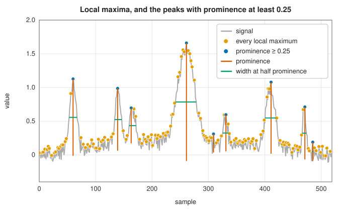

# Peak finding

<div class="entry-summary">

| | |
|---|---|
| **Problem** | Find the peaks of a sampled signal that matter, ignoring the many small maxima made by noise, and measure their size and width |
| **Devised by** | Local-maximum detection and full width at half maximum are long-standing practice in spectroscopy and chromatography; prominence comes from topography; the combination used here is SciPy's `find_peaks` (2018) |
| **Accuracy** | Exact: the same peaks, prominences, bases, widths and interpolated crossings as SciPy on every test case |
| **Cost** | $O(n)$ for the local maxima and the height, threshold and distance criteria; prominence and width walk outwards from each peak, $O(n)$ per peak in the worst case |
| **Read first** | [Power spectra: periodogram, Welch, spectrogram and Lomb-Scargle](power-spectra.md) |
| **API** | [`find_peaks`](../../api/lib_jsl_dsp/discrete/peaks/fn.find_peaks.html), [`PeakOptions`](../../api/lib_jsl_dsp/discrete/peaks/struct.PeakOptions.html), [`Bounds`](../../api/lib_jsl_dsp/discrete/peaks/struct.Bounds.html), [`peak_prominences`](../../api/lib_jsl_dsp/discrete/peaks/fn.peak_prominences.html), [`peak_widths`](../../api/lib_jsl_dsp/discrete/peaks/fn.peak_widths.html), [`local_maxima`](../../api/lib_jsl_dsp/discrete/peaks/fn.local_maxima.html) |

</div>

## Overview

Spectra have lines, chromatograms have compounds, heartbeats have R-waves, and in every case the first task is to say where the peaks are.
The definition looks easy: a sample larger than its two neighbours. On real data it is useless by itself, because noise turns every
gentle slope into a staircase of tiny maxima. The test signal below has seven real peaks and 146 local maxima.

The way out is to describe each local maximum by how much it stands out, and keep only those that stand out enough. The most useful such
description is the **prominence**: how far a peak rises above the higher of the two lowest points that separate it from taller terrain on
either side. A noise spike on the flank of a large peak has a tiny prominence, however high it sits; an isolated small peak keeps its full
height. With a prominence and a width, peaks can be selected by scale rather than by absolute level.

## History

Locating peaks and quoting their **full width at half maximum** (FWHM) has been routine in spectroscopy since the line shapes of atomic
spectra were first measured, and the same vocabulary passed into chromatography, crystallography and signal processing. Prominence is
borrowed from topography and mountaineering, where a summit's prominence is its height above the lowest contour line that encloses it and no
higher summit: Mont Blanc is prominent, a rock on its shoulder is not, although the rock is higher than most mountains.

The library follows the definitions of SciPy's `find_peaks`, `peak_prominences` and `peak_widths` (added to SciPy in 2018), which combine
these ideas with simple criteria on height, neighbour threshold and horizontal distance, and measure widths at a chosen fraction of the
prominence rather than of the absolute height, so that a sloping baseline does not distort them.

## The idea

### Local maxima and plateaus

A sample $x_i$ is a local maximum if $x_{i-1} < x_i > x_{i+1}$. Quantised signals often have flat tops, so a **plateau** of equal samples counts
as one peak if the samples just outside it are lower, and its position is the middle sample (rounded down). In
$0, 1, 1, 1, 1, 0, 2, 0, 3, 3$ the plateau at indices 1–4 gives a peak at 2, index 6 is a peak, and the final plateau is not, because the
signal ends without coming down. End samples are never peaks: there is no neighbour to compare with.

### Height, threshold and distance

The three cheapest criteria look at one peak at a time, or at pairs:

- **Height** keeps peaks whose value lies in a range. It fails when the baseline moves, as it does in most spectra.
- **Threshold** keeps peaks that rise by at least a given amount above *both* neighbours. It measures steepness at the top, so it rejects
  rounded peaks and keeps sharp noise.
- **Distance** keeps peaks at least $d$ samples apart. Peaks are visited from the tallest down; each kept peak removes every lower peak
  within $d$ samples of it. It suppresses the spikes on a peak's flanks but needs to know the spacing in advance.

### Prominence

For a peak at $i$, walk left while the signal is not higher than $x_i$, and record the lowest value passed, $m_L$; stop at the first higher
sample or at the start. Do the same to the right for $m_R$. The higher of the two is the **key col** (the saddle to cross to reach higher
ground), and

$$
\text{prominence} = x_i - \max(m_L, m_R).
$$

The positions of the two minima are the peak's **bases**. Take $x = 0, 3, 5, 2, 1, 4, 8, 2, 0$. The peak 5 at index 2: to the left the
walk reaches the start with minimum 0; to the right it passes 2, 1 and 4 (none above 5) and stops at 8, the first higher sample; the lowest value it passed is
1, at index 4. The key col is $\max(0, 1) = 1$ and the prominence is $5 - 1 = 4$. The peak 8 at index 6 is the highest, so
both walks reach the ends, with minima 0 and 0, and its prominence is 8. A window of length `wlen` centred on the peak can limit the
walks, which speeds up long signals and measures prominence locally (relative to nearby terrain only).



<p class="caption" id="fig-15-9"><strong>Figure 15.9.</strong> Peaks selected by prominence.</p>

The orange dots are all 146 local maxima. The blue dots are those with prominence at least 0.25, with each prominence drawn as a vertical
line from the peak down to its key col; the horizontal lines are the widths at half prominence. The large peak near 260 has many local
maxima on its flanks, all with small prominence, because each is walled in by the peak itself.

### Width

The width is measured at a height a fraction `rel_height` of the prominence below the peak:

$$
h_w = x_i - \text{rel\_height}\times\text{prominence}.
$$

From the peak, walk outwards on each side (no further than the bases) to the first sample below $h_w$, and interpolate linearly between it
and the sample before to find where the signal crosses $h_w$. The width is the distance between the two crossings, in samples, and can be
fractional. For the triangle $0, 1, 2, 3, 4, 3, 2, 1, 0$ the prominence is 4, half of it gives $h_w = 2$, the crossings are at indices 2 and 6,
and the width is 4. With `rel_height` $= 0.5$ this is the full width at half prominence, which equals the classical FWHM when the baseline
is flat; with `rel_height` $= 1$ it is the width at the key col.

### Choosing criteria

On the test signal, with seven true peaks:

<p class="caption" id="tab-15-8"><strong>Table 15.8.</strong> Peaks kept by each criterion on the test signal, and how many of the seven true peaks they include.</p>

{{#include ../generated/spectral/peak_criteria.md}}

Height leaves dozens of noise maxima on the tall peaks; threshold loses true peaks with rounded tops and keeps sharp noise; distance needs
the spacing, which here is uneven (two true peaks are only 25 samples apart). Prominence alone finds every true peak with two extras, and
adding a minimum width removes those two narrow noise features. In practice, prominence is the first criterion to try, and width the second.

## Algorithm

**`find_peaks`**:

1. Find the local maxima and plateau edges in one pass.
2. Apply the criteria in this order, each removing peaks (and their already computed properties): plateau size, height, threshold, distance,
   prominence, width.
3. For distance, sort the remaining peaks by height; from the tallest down, unless it has been removed, remove every peak closer than
   $\lceil d\rceil$ samples on either side.
4. Compute prominences (with bases) if prominence or width is requested; select by prominence.
5. Compute widths at `rel_height` from the prominences and bases; select by width.
6. Return the indices and every property that was computed.

**`peak_prominences`**, for each peak: walk left and right while not above the peak (within the window if `wlen` is given), tracking the
minimum and its position; the prominence is the peak minus the larger minimum.

**`peak_widths`**, for each peak: compute $h_w$, walk left until the signal is not above $h_w$ or the left base is reached, interpolate the crossing;
the same to the right; subtract.

## Implementation

Local maxima, with plateaus:

```rust,ignore
{{#include ../../../crates/dsp/src/discrete/peaks.rs:local_maxima}}
```

Prominence:

```rust,ignore
{{#include ../../../crates/dsp/src/discrete/peaks.rs:peak_prominences}}
```

Width:

```rust,ignore
{{#include ../../../crates/dsp/src/discrete/peaks.rs:peak_widths}}
```

- Criteria are given in a `PeakOptions` struct, with ranges as `Bounds { min, max }` (`Bounds::at_least`, `Bounds::between`); `None`
  disables a criterion. `rel_height` defaults to 0.5.
- The result holds the peak indices and, as `Option`s, each property that a criterion required: heights, thresholds, plateau sizes and
  edges, prominences with bases, widths with their heights and interpolated ends.
- Peaks of equal height are resolved for the distance criterion from the right, as in SciPy.
- Signals must be finite; NaN has no ordering.

Timings on 100 000 samples:

<p class="caption" id="tab-15-9"><strong>Table 15.9.</strong> Time of find_peaks on 100 000 samples.</p>

{{#include ../generated/spectral/peak_timing.md}}

Prominence dominates the cost, because each walk continues until it meets higher ground, which for small peaks can be far away. A window
(`wlen`) bounds it.

## In practice

```rust,ignore
{{#include ../../../crates/dsp/examples/dsp_peaks.rs}}
```

```text
local maxima: 111
peaks with prominence at least 0.2:
  at  79: height 1.065, prominence 0.989, width at half prominence 9.5 samples
  at 201: height 0.616, prominence 0.408, width at half prominence 21.5 samples
  at 300: height 1.008, prominence 0.722, width at half prominence 7.2 samples
```

The three Gaussian lines have standard deviations 4, 10 and 3, so their FWHMs are $2.355\sigma = 9.4$, $23.5$ and $7.1$ samples. The narrow
lines are measured accurately; the broad one comes out narrower, because the sloping baseline and the neighbouring lines lift its key col
and so lower its prominence. Prominence measures height relative to the surroundings, not above an absolute zero.

**Strengths**

- Prominence separates real peaks from noise without a model of the baseline or the peak shape.
- Widths at a fraction of the prominence are insensitive to a slowly varying baseline.
- Every criterion is cheap and has an obvious meaning; the results match SciPy exactly.

**Weaknesses**

- The criteria need scales (a prominence, a width) chosen for the data; there is no automatic noise model.
- Overlapping peaks are not separated: the smaller one may have no local maximum at all. Fitting a sum of line shapes
  ([least squares](../optimization/least-squares.md)) does better.
- Peak positions are sample indices; sub-sample positions need interpolation, for example a parabola through the top three samples.
- Very noisy signals are best smoothed first, for example with a [zero-phase low-pass filter](../filters/sos-zero-phase.md), which does
  not move the peaks.

## Exercises

1. Find by hand the prominences and bases of every peak of $x = 1, 4, 2, 6, 3, 5, 0$.
2. Show that the prominence of the highest peak of a signal is its height above the higher of the two end minima, and that every other
   peak's prominence is less than its height above the global minimum.
3. For a Gaussian $e^{-t^2/2\sigma^2}$ on a flat baseline, show that the width at `rel_height` $r$ is $2\sigma\sqrt{-2\ln(1 - r)}$, and check the value
   2.355σ at $r = \tfrac12$.
4. Give a signal on which the distance criterion keeps a different set of peaks depending on whether equal heights are visited from the
   left or from the right.
5. Smooth the test signal of the figure above with `sosfiltfilt` before finding peaks, and compare the number of local maxima and the prominence
   needed to isolate the seven true peaks. What happens if you use a one-pass filter instead?

<details>
<summary>Hints and answers</summary>

1. The peaks are 4 (index 1), 6 (index 3) and 5 (index 5). Peak 4: the left walk reaches the start (minimum 1), the right walk stops at 6
   having passed 2, so the prominence is $4 - \max(1, 2) = 2$, bases 0 and 2. Peak 6 is the highest: minima 1 (left) and 0 (right), prominence
   $6 - 1 = 5$. Peak 5: the left walk stops at 6 having passed 3, the right reaches the end with minimum 0, prominence $5 - 3 = 2$.
2. Neither walk from the highest peak ever stops early, so its minima are those of the two halves of the signal. For any other peak, at
   least one walk stops at higher ground, and each minimum is at least the global minimum.
3. Solve $e^{-t^2/2\sigma^2} = 1 - r$ for $t$ and double it. At $r = \tfrac12$, $2\sigma\sqrt{2\ln2} = 2.3548\sigma$.
4. Take two equal peaks closer than $d$, such as $0, 1, 0, 1, 0$ with $d = 3$: only one survives, and which one depends on the visiting order.
   The library, like SciPy, keeps the right-hand one.
5. Smoothing removes most of the noise maxima, so far fewer local maxima remain and a smaller prominence suffices. A zero-phase filter
   leaves the peaks in place; a one-pass filter shifts them all by its group delay (and the shift differs between narrow and broad peaks).

</details>

## Further reading

- SciPy documentation, `scipy.signal.find_peaks`, `peak_prominences` and `peak_widths`: definitions of every criterion and property.
- E. Kirmse and J. de Ferranti, "Calculating the prominence and isolation of every mountain in the world", *Progress in Physical
  Geography* 41 (2017) 788–802: prominence in its original, topographic setting.
- J. M. Chalmers and P. R. Griffiths (eds.), *Handbook of Vibrational Spectroscopy*, Wiley, 2002: peak picking, widths and baseline
  handling in spectroscopy.
