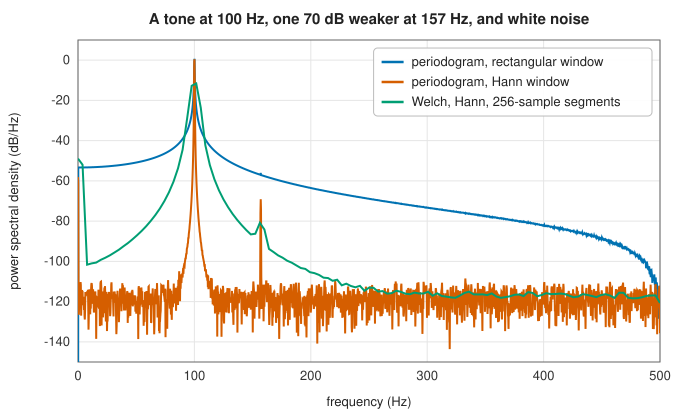
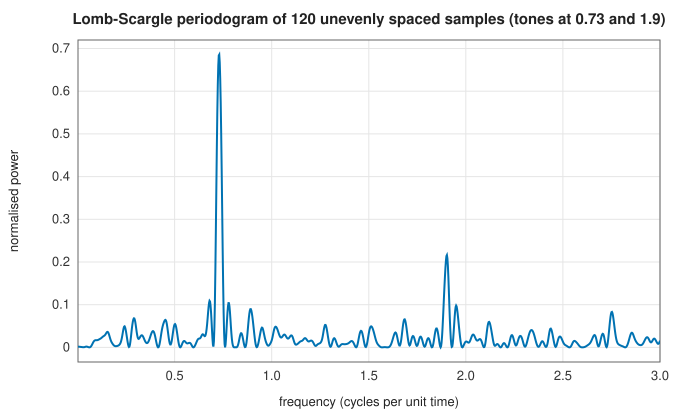

# Power spectra: periodogram, Welch, spectrogram and Lomb-Scargle

<div class="entry-summary">

| | |
|---|---|
| **Problem** | Estimate how the power of a random signal is distributed over frequency, as a whole or as it changes in time, from regularly or irregularly spaced samples |
| **Devised by** | Arthur Schuster (1898), the periodogram; M. S. Bartlett (1948) and Peter Welch (1967), averaging segments; Dennis Gabor (1946), short-time analysis; Nicholas Lomb (1976) and Jeffrey Scargle (1982), unevenly sampled data; Daniel Griffin and Jae Lim (1984), the inverse STFT |
| **Accuracy** | Periodogram, Welch and Lomb-Scargle values agree with SciPy to $10^{-15}$; `istft(stft(x))` reproduces $x$ to $10^{-15}$ |
| **Cost** | $O(N\log M)$ for $N$ samples in segments of $M$; Lomb-Scargle $O(NF)$ for $F$ frequencies |
| **API** | [`periodogram`](../../api/lib_jsl_dsp/discrete/spectral/welch/fn.periodogram.html), [`welch`](../../api/lib_jsl_dsp/discrete/spectral/welch/fn.welch.html) ([`SpectralScaling`](../../api/lib_jsl_dsp/discrete/spectral/welch/enum.SpectralScaling.html), [`Detrend`](../../api/lib_jsl_dsp/discrete/spectral/welch/enum.Detrend.html)), [`stft`](../../api/lib_jsl_dsp/discrete/spectral/stft/fn.stft.html), [`istft`](../../api/lib_jsl_dsp/discrete/spectral/stft/fn.istft.html), [`spectrogram`](../../api/lib_jsl_dsp/discrete/spectral/stft/fn.spectrogram.html), [`lomb_scargle`](../../api/lib_jsl_dsp/discrete/spectral/non_uniformly_sampled/fn.lomb_scargle.html), [`non_uniform_dft`](../../api/lib_jsl_dsp/discrete/spectral/non_uniformly_sampled/fn.non_uniform_dft.html), [`fit_sinusoid`](../../api/lib_jsl_dsp/discrete/spectral/non_uniformly_sampled/fn.fit_sinusoid.html) |

</div>

## Overview

The **power spectral density** (PSD) $S(f)$ of a stationary random signal says how its variance is spread over frequency: integrating it over all frequencies gives the variance.
The **periodogram**, the squared magnitude of the DFT suitably scaled, is the obvious estimate and a poor one. Its bias is set by the window's
leakage, and its standard deviation equals its mean however long the signal, because longer records only add frequency bins.
**Welch's method** averages the periodograms of overlapping segments, trading resolution for a variance that falls with the number of segments.
The **spectrogram** keeps the segments separate, giving a picture of how the spectrum evolves. For samples taken at irregular times, the
**Lomb-Scargle periodogram** fits sinusoids by least squares instead.

## History

Arthur Schuster (1898) introduced the periodogram to search for hidden periodicities in sunspot and meteorological records. It took
half a century to understand its erratic behaviour: M. S. Bartlett (1948) proposed averaging periodograms of separate segments, and
Peter Welch (1967) showed that overlapping windowed segments, computed by FFT, do better. Dennis Gabor (1946) introduced short-time Fourier analysis, and the
spectrogram became a standard tool of speech research at Bell Labs. Astronomers, whose observations are interrupted by day, weather and
seasons, needed spectra of unevenly sampled data. Nicholas Lomb (1976) and Jeffrey Scargle (1982) defined a periodogram equivalent to least-squares fitting of sinusoids.

## The idea

### The periodogram and its scaling

The **power spectral density** (PSD) of a signal says how its power is distributed over
frequency. The most direct estimate takes the DFT of a record and squares its magnitude: the
energy found at each frequency. This is the **periodogram**. For $N$ samples $x_n$ at rate $f_s$,
multiplied by a [window](windows.md) $w$, the one-sided periodogram is

$$
P(f_k) = \frac{c_k}{f_s\sum_nw_n^2}\Big|\sum_nw_nx_ne^{-2\pi ikn/N}\Big|^2, \qquad f_k = kf_s/N .
$$

For a real signal the negative frequencies duplicate the positive ones, so they are folded in:
$c_k = 2$, except at DC and at the Nyquist frequency, which have no partner. The remaining
factors fix the units, and there are two conventions, suited to two kinds of signal.

- **Density** scaling, the factor $1/(f_s\sum w^2)$ shown above, gives units of power per hertz.
  Integrating the result over frequency gives the variance of the signal. It is the right scale
  for noise, whose power is spread over a band.
- **Spectrum** scaling, with $1/(\sum w)^2$ instead, gives units of power. A sinusoid of
  amplitude $A$ centred on a bin reads $A^2/2$, its mean square. It is the right scale for tones,
  whose power is concentrated at a frequency.

The scalings follow SciPy, and the results agree with it to rounding error.

The periodogram has two defects, bias and variance, treated in the next two sections.

### Bias: leakage



<p class="caption" id="fig-15-2"><strong>Figure 15.2.</strong> Periodogram and Welch estimates.</p>

With no window, the strong tone's leakage, decaying only as $1/f$, buries a second tone 70 dB weaker and every bit of the noise floor. A Hann window's leakage
falls off steeply, revealing both. The window's resolution and dynamic range carry over directly to the spectrum estimate (see [windows](windows.md)).

### Variance: Welch averaging

The second defect is that the periodogram of a noisy signal is itself extremely noisy, and
taking a longer record does not help. A longer record gives more frequency bins, each as erratic
as before. In statistical terms, each periodogram value of a Gaussian noise process is
approximately the true density multiplied by a random factor distributed as $\chi^2_2/2$, whose
standard deviation equals its mean: the estimate is wrong by about 100%, whatever $N$ is.

The cure for a noisy estimate is to average several independent ones. **Welch's method** cuts
the record into $K$ shorter segments, computes a windowed periodogram of each, and averages
them. Averaging $K$ independent estimates divides the standard deviation by $\sqrt K$. The price
is resolution: shorter segments have wider bins.

Segments may overlap. A tapered window gives little weight to the samples near the ends of each
segment, so without overlap those samples would be largely wasted. Overlapping by half with a
Hann window uses them, while the segments remain nearly independent:

<p class="caption" id="tab-15-4"><strong>Table 15.4.</strong> Columns: segment length (Hann, 50% overlap), segments averaged, bin width (× fs), mean density (true 2.000), and more.</p>

{{#include ../generated/spectral/welch_variance.md}}

A single 16 384-point periodogram is as noisy as possible (ratio 0.98), with bins of width $6 \times 10^{-5} f_s$. 511 segments of 64 points have a ratio of 0.04, but bins 256 times wider. The ratio
follows $1/\sqrt K$ closely: Hann segments overlapping by half are nearly uncorrelated, so the overlap buys almost twice as many useful
averages from the same data. The choice of segment length is the [bias-variance trade-off](../machine_learning/index.md#background-bias-variance-and-generalisation): short segments give many averages (low variance) but coarse frequency resolution (bias).

### The short-time Fourier transform and the spectrogram

The **STFT** computes the spectrum of each windowed frame $x[tH + n]w[n]$, with hop $H$. Its squared magnitude, scaled like a periodogram, is the **spectrogram**:


<p class="caption" id="fig-15-3"><strong>Figure 15.3.</strong> Spectrogram.</p>

The chirp traces a straight line, and the tone appears at one second. Time and frequency resolution trade off through the frame length:
a 256-sample frame at 8 kHz resolves 31 Hz and 32 ms. [`istft`](../../api/lib_jsl_dsp/discrete/spectral/stft/fn.istft.html) inverts the STFT by weighted overlap-add,
$x[n] = \sum_tw[n - tH]\,y_t[n - tH]/\sum_tw^2[n - tH]$, which is exact for an unmodified STFT and the least-squares signal for a modified one (Griffin and Lim). {{#include ../generated/spectral/istft.md}}

### Unevenly sampled data: Lomb-Scargle

With irregular sample times $t_j$ there is no FFT, and the DFT sum is no longer orthogonal. The **Lomb-Scargle periodogram** instead fits $y_j \approx a\cos\omega(t_j - \tau) + b\sin\omega(t_j - \tau)$ by least squares at each frequency,
with the offset $\tau$ chosen to decouple $a$ and $b$ ($\tan2\omega\tau = \sum\sin2\omega t_j/\sum\cos2\omega t_j$). The power is the variance the fit explains:

$$
P(\omega) = \frac12\left[\frac{\big(\sum_jy_j\cos\omega(t_j - \tau)\big)^2}{\sum_j\cos^2\omega(t_j - \tau)} + \frac{\big(\sum_jy_j\sin\omega(t_j - \tau)\big)^2}{\sum_j\sin^2\omega(t_j - \tau)}\right].
$$



<p class="caption" id="fig-15-4"><strong>Figure 15.4.</strong> Lomb-Scargle periodogram.</p>

Both tones stand out of 120 random samples. Irregular sampling has a benefit: there is no single Nyquist frequency, and frequencies far
above the average sample rate can be detected. `normalize` divides by the total variance, giving the fraction of variance explained.

## Algorithm

**Welch's method**, for segments of $M$ samples with a given overlap.

1. Step through the signal in strides of $M - \text{overlap}$ samples; each position at which a
   full segment fits gives one segment.
2. For each segment: remove its mean or linear trend, if detrending is requested; multiply by
   the window; take a real FFT; and add $|X_k|^2$ to a running total for each bin $k$.
3. Divide the totals by the number of segments.
4. Scale by $1/(f_s\sum w^2)$ for a density or $1/(\sum w)^2$ for a spectrum, and double every
   bin except DC and Nyquist.

The **periodogram** is the special case of a single segment covering the whole signal.

**STFT**: steps 1 and 2 without the squaring and averaging; the complex spectrum of each frame
is kept. **ISTFT**:

1. inverse-FFT each frame and multiply it by the window again;
2. add the frames into the output at their positions (overlap-add), and add the squared window
   into a second array at the same positions;
3. divide the output by the second array wherever it is not negligible.

**Lomb-Scargle**, for samples $y_j$ at arbitrary times $t_j$.

1. Subtract the mean from the samples.
2. For each requested angular frequency $\omega$: compute $\tau$ from
   $\tan2\omega\tau = \sum\sin2\omega t_j/\sum\cos2\omega t_j$; then compute the four sums over the
   data in the formula for $P(\omega)$, and combine them.

The cost is $O(n)$ per frequency, with no FFT.

## Implementation

```rust,ignore
{{#include ../../../crates/dsp/src/discrete/spectral/welch.rs:welch}}
```

- `periodogram` is `welch` with one segment spanning the signal.
- `lomb_scargle` takes **angular** frequencies, as SciPy does; `non_uniformly_sampled_spectrum` takes them in hertz.

## In practice

```rust,ignore
{{#include ../../../crates/dsp/examples/dsp_power_spectrum.rs}}
```

```text
flat-top periodogram: peak 2.0000 V² at 125 Hz (A²/2 = 2)
Welch: 31 segments; integrated density 2.003 (signal power 2.003)
spectrogram: 63 frames × 129 bins, first frame centred at 0.128 s
```

The flat-top window with spectrum scaling reads the tone's power exactly; the Welch density integrates to the signal power.

**Strengths**

- Fast, nonparametric and well understood; the spectrogram shows time-varying content at a glance.
- Lomb-Scargle handles gaps and irregular sampling without interpolation.

**Weaknesses**

- Resolution is limited to about one bin of the segment length, and variance falls only with averaging.
- The time-frequency trade-off of the spectrogram is fixed by the frame length; [wavelets](wavelets.md) and [parametric methods](parametric.md) make other trade-offs.

## Exercises

1. Show that the density scaling makes the one-sided PSD of white noise of variance $\sigma^2$ equal to $2\sigma^2/f_s$.
2. Show that the periodogram of Gaussian white noise has, at each interior bin, an exponential distribution with standard deviation equal to its mean.
3. Show that the windowed segments of a Hann STFT with hop $M/4$ satisfy $\sum_tw^2[n - tH] = \text{const}$, and find the constant.
4. Show that the Lomb-Scargle power at frequency $\omega$ equals the reduction in residual sum of squares of the best sinusoidal fit at that frequency (divided by two).
5. Sample a sinusoid of frequency 3 at 50 random times in $[0, 10]$ (an average rate of 5), and find it with `lomb_scargle`. What would an evenly sampled DFT show?

## Further reading

- P. D. Welch, "The use of fast Fourier transform for the estimation of power spectra", *IEEE Transactions on Audio and Electroacoustics* 15 (1967) 70–73.
- J. D. Scargle, "Studies in astronomical time series analysis II", *Astrophysical Journal* 263 (1982) 835–853.
- D. W. Griffin and J. S. Lim, "Signal estimation from modified short-time Fourier transform", *IEEE Transactions on Acoustics, Speech, and Signal Processing* 32 (1984) 236–243.
- D. B. Percival and A. T. Walden, *Spectral Analysis for Physical Applications*, Cambridge University Press, 1993.
