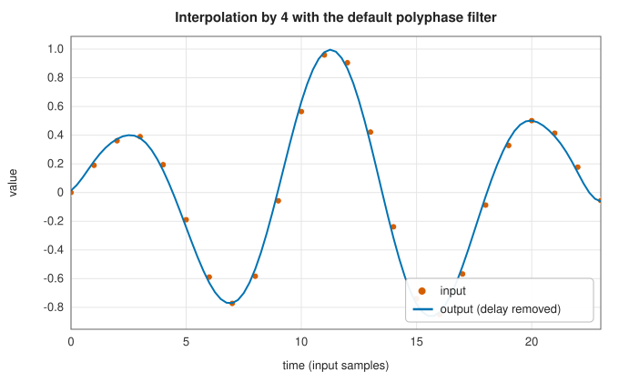
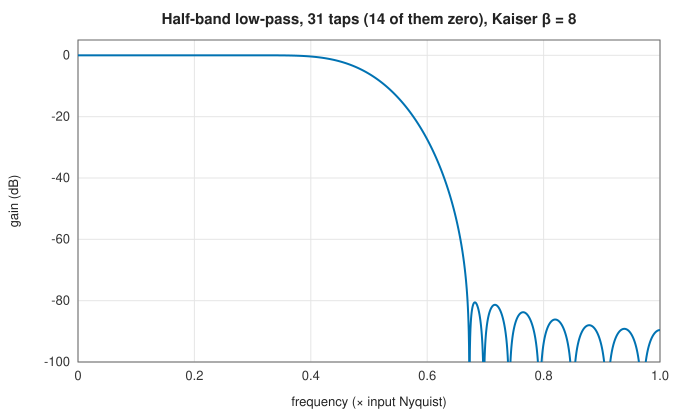
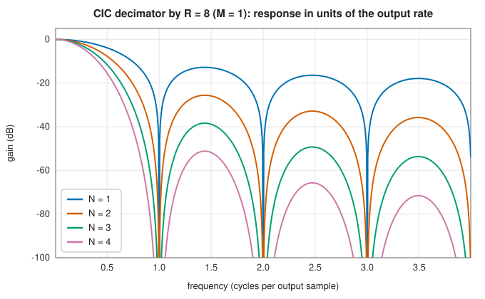

# Resampling: polyphase, half-band and CIC filters

<div class="entry-summary">

| | |
|---|---|
| **Problem** | Change a signal's sampling rate by a rational or arbitrary factor without aliasing or imaging, at the lowest cost per sample |
| **Devised by** | Ronald Schafer and Lawrence Rabiner (1973), digital interpolation; Maurice Bellanger, Georges Bonnerot and M. Coudreuse (1976), polyphase decomposition; Ronald Crochiere and Lawrence Rabiner (1983), the standard text; Eugene Hogenauer (1981), the cascaded integrator-comb (CIC) filter |
| **Accuracy** | The polyphase resampler equals SciPy's `upfirdn` exactly, including its length; the CIC impulse response matches its closed form to $10^{-16}$ |
| **Cost** | Polyphase: $L/U$ multiplies per output for a filter of $L$ taps and upsampling $U$. Half-band: about $L/4$ per output. CIC: no multiplies |
| **API** | [`PolyphaseIntegerResampler`](../../api/lib_jsl_dsp/discrete/resampling/polyphase_integer_resampling/struct.PolyphaseIntegerResampler.html), [`PolyphaseArbitraryResampler`](../../api/lib_jsl_dsp/discrete/resampling/polyphase_arbitrary_resampling/struct.PolyphaseArbitraryResampler.html), [`halfband_lowpass`](../../api/lib_jsl_dsp/discrete/resampling/half_band/fn.halfband_lowpass.html), [`HalfBandDecimator`](../../api/lib_jsl_dsp/discrete/resampling/half_band/struct.HalfBandDecimator.html), [`HalfBandInterpolator`](../../api/lib_jsl_dsp/discrete/resampling/half_band/struct.HalfBandInterpolator.html), [`CicDecimator`](../../api/lib_jsl_dsp/discrete/resampling/cic/struct.CicDecimator.html), [`CicInterpolator`](../../api/lib_jsl_dsp/discrete/resampling/cic/struct.CicInterpolator.html), [`cic_magnitude_response`](../../api/lib_jsl_dsp/discrete/resampling/cic/fn.cic_magnitude_response.html) |

</div>

## Overview

Audio moves between 44.1 and 48 kHz, radios decimate from megasamples to kilosamples per second, and images are scaled. Changing a sampling rate by $U/D$
means conceptually (the reasons for each step are in [sampling and aliasing](../filters/index.md#sampling-and-aliasing)): insert $U - 1$ zeros between samples (**upsampling**, which creates spectral **images**), low-pass filter, and keep every $D$-th sample (**downsampling**, which **aliases** anything above the new Nyquist). Done literally,
most of the multiplications are by the inserted zeros or produce samples that are thrown away. **Polyphase** filtering computes only the outputs that are kept, from only the
nonzero inputs. Two special filters push the cost down further: **half-band** filters, with almost half their taps zero, for factors of two, and **CIC** filters,
which need no multiplications at all, for large factors.

## History

Ronald Schafer and Lawrence Rabiner (1973) set out the theory of digital interpolation by an integer factor. Maurice Bellanger, Georges
Bonnerot and M. Coudreuse (1976) introduced the polyphase decomposition, splitting a filter into $U$ subfilters that run at the low rate.
Eugene Hogenauer (1981) designed the cascaded integrator-comb filter for hardware decimators. It is now in nearly every digital radio
receiver. Ronald Crochiere and Lawrence Rabiner's *Multirate Digital Signal Processing* (1983) and P. P. Vaidyanathan's *Multirate Systems and Filter Banks* (1993) are the standard texts.

## The idea

### Polyphase resampling

**The textbook procedure.** To change the sampling rate of a signal by the rational factor
$U/D$, three steps are needed in principle.

1. **Upsample by $U$**: insert $U - 1$ zeros between consecutive samples. The rate is now $U$
   times higher, but the spectrum of the zero-stuffed signal contains $U - 1$ unwanted copies
   (**images**) of the original spectrum at higher frequencies.
2. **Low-pass filter** at the high rate. One filter does two jobs: it removes the images, which
   turns the zeros into interpolated values, and it removes everything above the *new* Nyquist
   frequency, which would otherwise fold back (**alias**) into the band in the next step.
3. **Downsample by $D$**: keep every $D$-th sample.

Done literally this is very wasteful. The filter runs at the high rate, yet most of its inputs
are zeros that contribute nothing, and most of its outputs are thrown away.

**The polyphase shortcut.** Both kinds of waste can be removed by algebra. Write the upsampled
signal as $u[j] = x[j/U]$ when $U$ divides $j$, and 0 otherwise. Filtering with $h$ and keeping every $D$-th sample gives

$$
y[m] = \sum_kh[k]\,u[mD - k] = \sum_jh[mD - jU]\,x[j],
$$

where the second form drops the zero terms: the sum runs only over actual inputs $j$, those
whose tap index $mD - jU$ lies in $[0, L)$ for a filter of length $L$. Two things have happened.
Only the outputs that are kept are ever computed. And each one uses only every $U$-th tap of the
filter, about $\lceil L/U\rceil$ of them: the subset $\{h[p], h[p + U], \ldots\}$ with
$p = mD \bmod U$. Such a subset is called a **phase** of the filter, and the filter is in effect
split into $U$ short filters used in rotation, which gives the method its name. This is SciPy's `upfirdn`, and
[`PolyphaseIntegerResampler`](../../api/lib_jsl_dsp/discrete/resampling/polyphase_integer_resampling/struct.PolyphaseIntegerResampler.html) computes it as a stream, multiplying the taps by $U$ so that interpolation keeps unit gain (as `resample_poly` does).
Without taps, it designs a Kaiser-window low-pass with cutoff $1/\max(U, D)$ of the high-rate Nyquist and 60 dB attenuation.



Writing this chapter fixed both polyphase resamplers. They pushed an input and its $U - 1$ stuffed zeros into the history and then computed every
output due for that input from the same history. All outputs between two inputs were therefore equal: upsampling by 3 turned $0, 3, 6$ into
$0, 0, 0, 3, 3, 3, 6, 6, 6$. They also applied asymmetric filters reversed. The tests used a single unit tap, for which neither error shows.

### Arbitrary ratios

[`PolyphaseArbitraryResampler`](../../api/lib_jsl_dsp/discrete/resampling/polyphase_arbitrary_resampling/struct.PolyphaseArbitraryResampler.html) allows a real $D$. Output $m$ takes the filtered upsampled signal at position $\lfloor mD\rfloor$, so output times are rounded to the
nearest point below on a grid $U$ times finer than the input. The error in time is less than $1/U$ input samples:

{{#include ../generated/spectral/arbitrary_resampling.md}}

Against the rounded times the output is accurate to the filter's stopband; against the exact times the rounding error falls in proportion to $1/U$. A
large $U$ costs only memory for the filter, not computation, because each output uses one phase.

### Half-band filters

Halving the sampling rate is the most common rate change, and there is a filter made for it. A **half-band** filter has its cutoff at a quarter of the sampling rate and a response symmetric about it, $H(f) + H(\frac12 - f) = 1$. Its impulse response, $h[n] = \frac12\operatorname{sinc}(n/2)$ windowed, is zero at every even offset from the centre except the centre itself,
where it is $\frac12$:



{{#include ../generated/spectral/halfband_facts.md}}

Decimating by two needs only every other output, and of those only the nonzero taps: about $L/4$ multiplies per output. Cascades of half-band stages
are the usual way to decimate by powers of two.

### CIC filters

At very high sampling rates, as at the output of a radio's analogue-to-digital converter, even
one multiplication per sample is expensive. The **cascaded integrator-comb** (CIC) filter
changes the rate by a large factor $R$ using only additions and subtractions.

Its starting point is the simplest low-pass filter, a moving sum. A moving sum of length $RM$, $H(z) = \frac{1 - z^{-RM}}{1 - z^{-1}}$, can be built from an **integrator** $1/(1 - z^{-1})$ at the high rate and a **comb** $1 - z^{-M}$ at the low rate, with the rate change in between. $N$ cascaded integrators
and $N$ combs give

$$
|H(f)| = \left|\frac{\sin(\pi RMf)}{\sin(\pi f)}\right|^N,
$$

with nulls at every multiple of the output rate, where aliases would land, and no multiplications at all:



More stages deepen the nulls and widen the attenuation around them, but also increase the **droop**, the falling gain across the passband, which a short compensating FIR filter at
the low rate corrects. The integrators' registers overflow by design. In two's complement arithmetic the wrap-around cancels exactly in the
combs, as long as the output fits, which is why the library's CIC filters work on `i64`. {{#include ../generated/spectral/cic_facts.md}}

## Algorithm

**Polyphase resampler** (a stream), with upsampling factor $U$, downsampling factor $D$ and a
filter $h$ of length $L$. Positions on the upsampled time axis are numbered so that input
sample $j$ sits at position $jU$. Output $m$ is taken at position $p = mD$ (or
$\lfloor mD\rfloor$ for a real $D$).

1. Keep the recent input samples in a buffer.
2. The next output, at position $p$, needs the inputs up to $j = \lfloor p/U\rfloor$. Wait until
   that sample has arrived.
3. Compute the output as $\sum_jh[p - jU]\,x[j]$ over the inputs $j$ for which the tap index
   $p - jU$ lies in $[0, L)$. These are the taps of one phase, $p \bmod U$.
4. Advance to the next output position, and discard the buffered inputs that no later output
   can reach.

At the end of the stream, `flush` feeds zeros until the position $(N - 1)U + L$ has been
passed, so that the filter's tail is emitted. Each output costs about $L/U$ multiplications.

**Half-band decimator** by 2: for each pair of input samples, the output is the centre tap
times the suitably delayed sample, plus the sum of the taps at odd offsets times their
samples. The taps at even offsets are zero and are skipped.

**CIC decimator** by $R$, with $N$ stages and differential delay $M$, on integers.

1. For each input sample, pass it through the $N$ integrators in turn: each adds its input to
   its running total, with wrapping arithmetic, and passes the total on.
2. For every $R$-th input sample, pass the last integrator's output through the $N$ combs in
   turn: each subtracts the value it received $M$ output samples earlier.
3. The result of the last comb is the output sample.

## Implementation

```rust,ignore
{{#include ../../../crates/dsp/src/discrete/resampling/polyphase_integer_resampling.rs:polyphase}}
```

```rust,ignore
{{#include ../../../crates/dsp/src/discrete/resampling/cic.rs:cic}}
```

- Both polyphase resamplers share one engine and implement [`StreamOperator`](../../api/lib_jsl_dsp/discrete/stream_operator/trait.StreamOperator.html). The integer resampler reduces $U/D$ to lowest terms.
- The output is delayed by the filter's group delay, $(L - 1)/2$ high-rate samples for a linear-phase filter, as with `upfirdn`. Unlike `resample_poly`, no samples are trimmed.

## In practice

```rust,ignore
{{#include ../../../crates/dsp/examples/dsp_resampling.rs}}
```

```text
44.1 → 48 kHz: 4410 samples in, 4816 out; RMS 0.7070 (sine: 0.7071)
arbitrary 1/1.25: 3528 outputs from 4410
half-band: 23 taps, 10 zero; 2205 outputs
CIC R = 16, N = 4: steady output 6553600 = 100 × gain 65536
```

**Strengths**

- Exact rational resampling at the low rate's cost; any ratio with bounded timing error.
- Half-band and CIC filters make large power-of-two and integer factors cheap.

**Weaknesses**

- The arbitrary resampler rounds output times; a fractional-delay interpolator (such as a Farrow filter) is needed for exact timing with a small $U$.
- CIC filters droop and alias near the band edges, and need integer arithmetic and compensation.

## Exercises

1. Show that upsampling by $U$ compresses the spectrum by $U$ and creates $U - 1$ images, and that downsampling by $D$ aliases the spectrum $D - 1$ times.
2. Show that the polyphase sum uses only $\lceil L/U\rceil$ taps per output.
3. Prove that the half-band impulse response vanishes at even nonzero offsets, and that $H(f) + H(\frac12 - f) = 1$.
4. Show that $N$ integrators followed by $N$ combs compute the $N$-fold moving sum even when the integrators overflow in two's complement arithmetic.
5. Find how many bits a CIC decimator with $R = 64$, $M = 1$, $N = 5$ and 16-bit input needs in its registers (Hogenauer's rule).

## Further reading

- R. E. Crochiere and L. R. Rabiner, *Multirate Digital Signal Processing*, Prentice Hall, 1983.
- E. B. Hogenauer, "An economical class of digital filters for decimation and interpolation", *IEEE Transactions on Acoustics, Speech, and Signal Processing* 29 (1981) 155–162.
- P. P. Vaidyanathan, *Multirate Systems and Filter Banks*, Prentice Hall, 1993.
- R. W. Schafer and L. R. Rabiner, "A digital signal processing approach to interpolation", *Proceedings of the IEEE* 61 (1973) 692–702.
