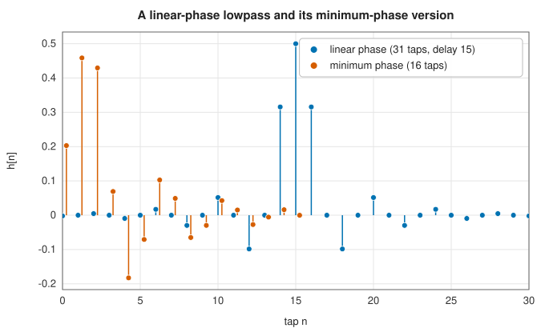
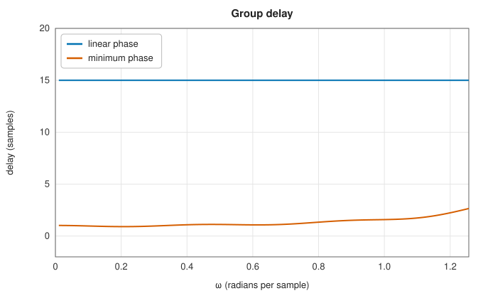

# Signal-processing utilities

<div class="entry-summary">

| | |
|---|---|
| **Problem** | Analyse a filter's delay; convert a linear-phase FIR filter to minimum phase; design an FIR filter by least squares; change a sampling rate by decimation or by the FFT; remove impulsive noise; extract an amplitude envelope; and measure how two signals are related across frequency |
| **Devised by** | Group delay: Harry Nyquist and Hendrik Bode (1930s); the cepstrum: Bruce Bogert, Michael Healy and John Tukey (1963), Alan Oppenheim and Ronald Schafer (homomorphic filtering, 1968); least-squares FIR design: Thomas Parks and Sidney Burrus (1987); the median filter: John Tukey (1974); coherence: Norbert Wiener (1930), Peter Welch (1967) |
| **Accuracy** | Agrees with `scipy.signal` to $10^{-13}$ or better; group delay of high-order IIR filters to $10^{-8}$, limited by cancellation in the polynomial evaluation |
| **Cost** | `group_delay`: $O(n)$ per frequency. `minimum_phase`, `resample`: a few FFTs. `firls`: one $M \times M$ solve for $2M + 1$ taps. `medfilt`: $O(nk\log k)$. `csd`: one FFT per segment and signal |
| **Read first** | [FIR filter design](../filters/fir-design.md), [Power spectra](power-spectra.md), [The Hilbert transform](hilbert.md) |
| **API** | [`signal_tools`](../../api/lib_jsl_dsp/discrete/signal_tools/index.html): `group_delay`, `minimum_phase`, `firls`, `decimate`, `resample`, `medfilt`, `envelope`, `csd`, `coherence` |

</div>

## Overview

This entry collects nine functions of `scipy.signal` that the earlier entries used without providing:

- **`group_delay`**, the delay a filter imposes on each frequency;
- **`minimum_phase`**, which turns a linear-phase FIR filter into one with the same magnitude response and far less delay;
- **`firls`**, FIR design by least squares, the counterpart of [Parks-McClellan](../filters/fir-design.md)'s minimax design;
- **`decimate`** and **`resample`**, rate changes by filtering and downsampling, or by the FFT;
- **`medfilt`**, the median filter for impulsive noise;
- **`envelope`**, the amplitude of the [analytic signal](hilbert.md);
- **`csd`** and **`coherence`**, the cross spectrum and the frequency-by-frequency correlation of two signals.

## History

Harry Nyquist and Hendrik Bode related the phase of a feedback amplifier to its delay and its stability in the 1930s, and group
delay became the standard measure of phase distortion. Bruce Bogert, Michael Healy and John Tukey (1963) defined the
**cepstrum**, the spectrum of the logarithm of a spectrum, to detect echoes in seismograms. Alan Oppenheim and Ronald Schafer
(1968) built homomorphic signal processing on it, including the construction of minimum-phase sequences. Least-squares FIR design
goes back to the earliest digital filters and was put in its standard form by Thomas Parks and Sidney Burrus (1987). John Tukey
introduced the running median for robust smoothing (1974). Norbert Wiener's generalised harmonic analysis (1930) defined the cross
spectrum, and Peter Welch's averaged periodograms (1967) made it practical to estimate.

## The idea

### Group delay and minimum phase

A filter with frequency response $H(e^{i\omega}) = |H|e^{i\varphi(\omega)}$ delays a narrowband signal at frequency $\omega$ by the **group delay** $\tau(\omega) = -d\varphi/d\omega$ samples. For
$H = B/A$ the derivative has a closed form. With $c = b * \operatorname{reverse}(\bar a)$, the coefficients of $B(z)\overline{A(1/\bar z)}z^{-N}$,

$$
\tau(\omega) = \operatorname{Re}\frac{\sum_k k\,c_k e^{-i\omega k}}{\sum_k c_k e^{-i\omega k}} - (\operatorname{len}(a) - 1),
$$

so no phase unwrapping or numerical differentiation is needed. A symmetric FIR filter of length $N$ has the constant delay $(N - 1)/2$: no phase distortion, but
a long latency.

Among all filters with a given magnitude response, the **minimum-phase** one has all its zeros inside the unit circle and the least
delay. The **homomorphic** method constructs it from the magnitude alone. The log magnitude $\ln|H|$ and the phase of a minimum-phase filter
are a Hilbert-transform pair, so its **cepstrum** $c = \mathcal F^{-1}\ln|H|$ is causal. Folding the negative quefrencies onto the positive ones,
$\hat c_n = 2c_n$ for $n > 0$, and exponentiating back gives the minimum-phase filter. Applied to the square root of the magnitude (`half`), this halves the
length of a filter that is the square of a minimum-phase one, as a linear-phase filter designed by `remez` or `firwin` approximately is:



<p class="caption" id="fig-15-10"><strong>Figure 15.10.</strong> Minimum-phase taps.</p>



<p class="caption" id="fig-15-11"><strong>Figure 15.11.</strong> Group delay.</p>

The minimum-phase filter has half the taps, and in the passband about 1 sample of delay instead of 15. Its delay varies with frequency,
so it distorts the waveform slightly. That is acceptable for audio and control, but not where the shape of a pulse matters.

### Least-squares FIR design

A linear-phase filter of length $2M + 1$ has the zero-phase response $A(\omega) = \sum_{n=0}^M a_n\cos(n\omega)$. `firls` minimises the weighted squared error over the bands,

$$
\sum_{\text{bands}} w_b\int_{\text{band}}\big(A(\omega) - D(\omega)\big)^2\,d\omega ,
$$

for a piecewise-linear desired response $D$. The minimum solves the normal equations $Q\mathbf a = \mathbf b$. Here $Q_{mn} = \sum_b w_b\int\cos m\omega\cos n\omega$ splits into a Toeplitz and a Hankel matrix, and
$b_n = \sum_b w_b\int D(\omega)\cos n\omega$. Every integral has a closed form in terms of sinc functions. Unlike the minimax design, least squares spreads the error
over the band. The ripple is largest near the band edges, but the energy in the stopband is smaller.

### Rate changes

`decimate` keeps every $q$-th sample after an anti-alias lowpass: SciPy's order-8 Chebyshev type I filter with cutoff $0.8/q$ of Nyquist, applied
forwards and backwards for zero phase. `resample` treats the signal as one period of a band-limited signal and changes its
length by truncating or zero-padding the spectrum. It is exact for band-limited periodic signals and rings at discontinuities, including
the jump between the last and first sample. A Nyquist bin of an even length has no partner, so it is split in two when upsampling and folded
when downsampling.

### Robust smoothing and envelopes

The **median filter** replaces each sample by the median of its neighbourhood. An isolated spike changes the median of a window of 3 or more
samples hardly at all, so the filter removes impulsive noise that a linear filter would only smear, and it preserves steps. The **envelope** is
$|x + i\mathcal H\{x\}|$, the instantaneous amplitude of the analytic signal.

### Cross spectra and coherence

For two signals the **cross spectral density** $P_{xy}(f)$ is estimated, as Welch estimates a power spectrum, by averaging $\overline{X_k}Y_k$ over windowed segments.
Its phase is the phase lag of $y$ behind $x$. Its magnitude, normalised as

$$
C_{xy}(f) = \frac{|P_{xy}(f)|^2}{P_{xx}(f)P_{yy}(f)} \in [0, 1],
$$

is the **coherence**, the fraction of the power of $y$ at $f$ that a linear filter applied to $x$ explains. If $y = h * x + n$ with independent noise $n$, then $C_{xy} = |H|^2P_{xx}/(|H|^2P_{xx} + P_{nn})$. The coherence is near 1
where the signal dominates and near 0 where the noise does. With $K$ averaged segments, the coherence of unrelated signals is still about $1/K$, its bias.

## Algorithm

**`minimum_phase(h, half)`**: $|H| = |\mathrm{FFT}_N(h)|$ with $N = 2^{\lceil\log_2(200(n-1))\rceil}$, plus $10^{-7}$ of its smallest non-zero value; $c = \mathrm{IFFT}(\tfrac12\ln|H|)$ (or $\ln|H|$); multiply by $(1, 2, \ldots, 2, [1], 0, \ldots)$;
$h_{\min} = \operatorname{Re}\,\mathrm{IFFT}(\exp(\mathrm{FFT}(c)))$; keep the first $\lfloor n/2\rfloor + n \bmod 2$ (or $n$) values.

**`firls`**: $q_n = \sum_b w_b(f_2\operatorname{sinc}(f_2n) - f_1\operatorname{sinc}(f_1n))$, $Q = \operatorname{toeplitz}(q_{0..M}) + \operatorname{hankel}(q_{0..M}, q_{M..2M})$; $\mathbf b$ from the closed-form integrals of the linear desired
response; solve; the taps are $(a_M, \ldots, a_1, 2a_0, a_1, \ldots, a_M)$.

**`csd`**: segments of the window's length stepped by length minus overlap; each detrended and windowed; accumulate $\overline{X}Y$; scale by
$1/(f_s\sum w^2)$ per segment and double the one-sided bins.

## Implementation

```rust,ignore
{{#include ../../../crates/dsp/src/discrete/signal_tools.rs:minimum_phase}}
```

```rust,ignore
{{#include ../../../crates/dsp/src/discrete/signal_tools.rs:firls}}
```

- `decimate` implements SciPy's default IIR path. It designs the filter with [`cheby1`](../filters/iir-design.md), converts it to second-order sections and applies
  `sosfiltfilt` (or `sosfilt`).
- `minimum_phase` implements the homomorphic method. SciPy's alternative `'hilbert'` method is not provided.
- `envelope` is `abs(hilbert(x))`. SciPy's newer `envelope` function adds band-pass filtering and residuals, which are not included.

## In practice

Every function is compared with `scipy.signal` from SciPy 1.17.1 (references from `book/generator/data/make_signal_tools_refs.py`):

<p class="caption" id="tab-15-10"><strong>Table 15.10.</strong> Signal-processing utilities against SciPy.</p>

{{#include ../generated/spectral/signal_tools_scipy.md}}

**Strengths**

- Exact closed forms: the group delay without differentiation, `firls` without numerical integration.
- Minimum-phase conversion halves the length and most of the delay of a linear-phase design.
- Coherence separates linear relationships from noise frequency by frequency.

**Weaknesses**

- `decimate` has only the IIR filter. For FIR anti-aliasing, use the [polyphase resampler](resampling.md).
- `resample` assumes periodicity. For non-periodic signals, a polyphase resampler avoids the wrap-around ringing.
- The group delay of high-order IIR filters near their poles is sensitive to rounding. Second-order sections, analysed one at a time, are more accurate.

## Exercises

1. Show that the group delay of $z^{-d}$ is $d$, and that of a symmetric FIR filter of length $N$ is $(N - 1)/2$.
2. Show that reflecting a zero $z_0$ outside the unit circle to $1/\bar z_0$ leaves $|H|$ unchanged up to a constant, and reduces the group delay.
3. Derive the closed form of $\int_{f_1}^{f_2}\cos(n\pi f)\,df$, and hence the entries $q_n$ of `firls`.
4. Show that the coherence of $y = h * x$ (no noise) is 1 at every frequency where $P_{xx} > 0$.
5. Explain why `resample` of a ramp $0, 1, \ldots, N - 1$ shows large ringing at both ends.

<details>
<summary>Hints and answers</summary>

1. $\varphi(\omega) = -d\omega$. A symmetric filter is $e^{-i\omega(N-1)/2}$ times a real function of $\omega$.
2. $|e^{i\omega} - z_0| = |z_0|\,|e^{i\omega} - 1/\bar z_0|$ on the unit circle. A zero inside the circle contributes a smaller phase change, and hence less delay, than its reflection outside.
3. $\int_{f_1}^{f_2}\cos(n\pi f)\,df = f_2\operatorname{sinc}(nf_2) - f_1\operatorname{sinc}(nf_1)$ with $\operatorname{sinc}(x) = \sin(\pi x)/(\pi x)$. The products $\cos m\omega\cos n\omega$ split into $\cos(m - n)\omega$ and $\cos(m + n)\omega$, which give the Toeplitz and Hankel parts.
4. $P_{xy} = HP_{xx}$ and $P_{yy} = |H|^2P_{xx}$, so $|P_{xy}|^2/(P_{xx}P_{yy}) = 1$. The estimate from windowed segments is close to 1 but not exactly, because the filter's response to one segment spills into the next.
5. Periodically extended, the ramp has a jump of $N - 1$ between its last and first samples. Its spectrum decays only like $1/k$, so truncating it rings (the Gibbs phenomenon).

</details>

## Further reading

- A. V. Oppenheim and R. W. Schafer, *Discrete-Time Signal Processing*, 3rd ed., Pearson, 2010, chapters 5 (group delay, minimum phase) and 13 (cepstrum).
- T. W. Parks and C. S. Burrus, *Digital Filter Design*, Wiley, 1987, chapter 3 (least-squares design).
- J. S. Bendat and A. G. Piersol, *Random Data: Analysis and Measurement Procedures*, 4th ed., Wiley, 2010 (cross spectra and coherence).
- J. W. Tukey, "Nonlinear (nonsuperposable) methods for smoothing data", *Proceedings of the EASCON* (1974) 673–681.
