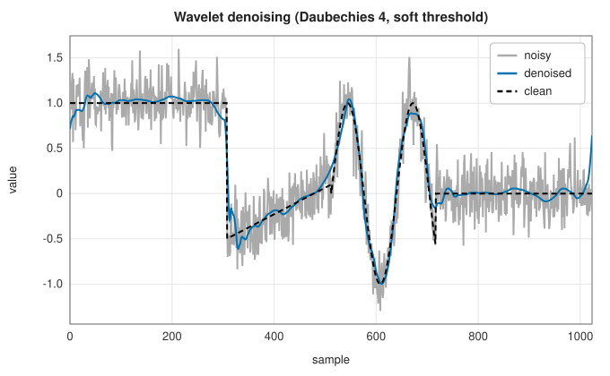
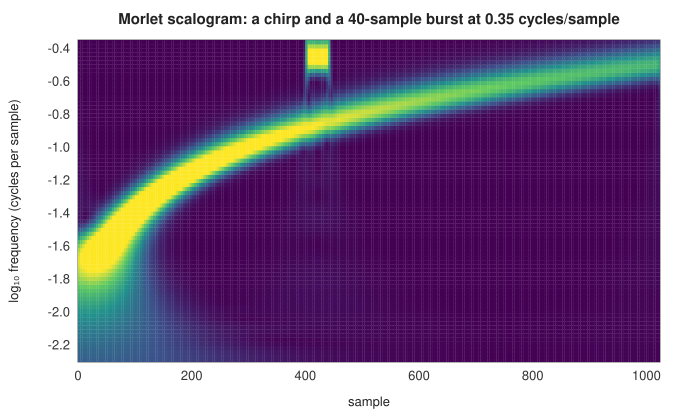

# Wavelet transforms

<div class="entry-summary">

| | |
|---|---|
| **Problem** | Analyse a signal at many scales at once, with time resolution that sharpens at high frequencies; compress and denoise signals with localised features |
| **Devised by** | Alfréd Haar (1910); Jean Morlet and Alex Grossmann (1984), the continuous wavelet transform; Stéphane Mallat (1989), multiresolution analysis and the fast algorithm; Ingrid Daubechies (1988), compactly supported orthogonal wavelets; David Donoho and Iain Johnstone (1994), wavelet shrinkage |
| **Accuracy** | The Daubechies filters are orthonormal to $10^{-17}$, and four-level decompositions reconstruct to $10^{-15}$ (table below) |
| **Cost** | Discrete transform $O(LN)$ for filters of length $L$, all levels together; continuous transform $O(N\log N)$ per scale |
| **API** | [`Wavelet`](../../api/lib_jsl_dsp/discrete/spectral/wavelet_transform/enum.Wavelet.html) (`Haar`, `Daubechies(1..=10)`), [`dwt`](../../api/lib_jsl_dsp/discrete/spectral/wavelet_transform/fn.dwt.html), [`idwt`](../../api/lib_jsl_dsp/discrete/spectral/wavelet_transform/fn.idwt.html), [`wavedec`](../../api/lib_jsl_dsp/discrete/spectral/wavelet_transform/fn.wavedec.html), [`waverec`](../../api/lib_jsl_dsp/discrete/spectral/wavelet_transform/fn.waverec.html), [`max_level`](../../api/lib_jsl_dsp/discrete/spectral/wavelet_transform/fn.max_level.html), [`ContinuousWavelet`](../../api/lib_jsl_dsp/discrete/spectral/wavelet_transform/enum.ContinuousWavelet.html) (`Morlet`, `Ricker`), [`continuous_wavelet_transform`](../../api/lib_jsl_dsp/discrete/spectral/wavelet_transform/fn.continuous_wavelet_transform.html) |

</div>

## Overview

The Fourier transform uses sinusoids that last forever, so it says which frequencies are present but not when. The [STFT](power-spectra.md#the-short-time-fourier-transform-and-the-spectrogram) windows them,
with one time-frequency resolution for all frequencies. **Wavelets** are shifted and stretched copies of one short oscillation, the mother wavelet $\psi$:
narrow at small scales, to locate high-frequency events precisely in time, and wide at large scales, to measure low frequencies precisely.
The **continuous wavelet transform** correlates the signal with wavelets at every scale and shift, for analysis. The **discrete wavelet transform**, built from a pair of
filters and downsampling by two, is an orthogonal change of basis with as many coefficients as samples. It is computed in linear time, and is the
basis of JPEG 2000 compression and of wavelet denoising.

## History

Alfréd Haar (1910) constructed the first orthonormal basis of step functions. Seismologist Jean Morlet and physicist Alex Grossmann (1984) introduced the continuous
wavelet transform to analyse seismic echoes, and Yves Meyer found smooth orthonormal wavelets in 1985. Stéphane Mallat (1989) connected wavelets to
multiresolution analysis and to the filter banks of signal processing, giving the fast pyramid algorithm. Ingrid Daubechies (1988) constructed the compactly supported orthonormal
wavelets with the most vanishing moments for their length, which the library provides. David Donoho and Iain Johnstone (1994) showed that
thresholding wavelet coefficients is a nearly optimal denoiser for a wide class of signals.

## The idea

### Multiresolution and the filter-bank algorithm

**The simplest case: Haar.** Take a signal two samples at a time, and replace each pair
$(x_0, x_1)$ by its scaled sum and difference,

$$
a = \frac{x_0 + x_1}{\sqrt2}, \qquad d = \frac{x_0 - x_1}{\sqrt2} .
$$

The sums $a$ form a version of the signal at half the resolution, a local average. The
differences $d$ record the detail that the averaging lost. Nothing has been thrown away: the pair
is recovered as $x_0 = (a + d)/\sqrt2$, $x_1 = (a - d)/\sqrt2$. Where the signal is smooth,
neighbouring samples are nearly equal and the details are nearly zero. Now repeat the step on the
sequence of averages, and again on *its* averages. The signal ends up described by one overall
average and details at successively coarser scales. That is a **discrete wavelet transform**
(DWT), with the Haar wavelet.

**The general case.** Other wavelets replace the two-point sum and difference by longer
filters. An orthogonal wavelet is defined by a **scaling filter** $h$ (low-pass, $\sum h = \sqrt2$) and a **wavelet filter** $g_n = (-1)^nh_{L-1-n}$ (high-pass, its quadrature mirror). One level of the DWT filters the signal with both and keeps every
other sample:

$$
a_k = \sum_nh_n\,x_{2k+n}, \qquad d_k = \sum_ng_n\,x_{2k+n}.
$$

For Haar, $h = (1, 1)/\sqrt2$ and $g = (1, -1)/\sqrt2$, which reproduces the sums and
differences above. As before, the **approximation** $a$ is a half-resolution version of the
signal and the **detail** $d$ is what was lost. Repeating the step on $a$ gives a pyramid of
details at coarser and coarser scales. Each level works on half as many samples as the one
before, so the total cost is $N + N/2 + \cdots < 2N$ filter steps: the transform is $O(N)$,
cheaper even than an FFT.

Invertibility comes from a condition on the filters: they are orthonormal under shifts by two,
$\sum_nh_nh_{n+2s} = \delta_s$. This makes the transform an orthogonal matrix, so its inverse is
its transpose, energy is preserved, and reconstruction is exact:

<p class="caption" id="tab-15-8"><strong>Table 15.8.</strong> Columns: wavelet, filter length, largest deviation from orthonormality Σ h[n]h[n+2s] = δ_s, reconstruction error after 4 levels.</p>

{{#include ../generated/spectral/wavelet_checks.md}}

### Vanishing moments

The Haar details vanish where the signal is constant, since $g = (1, -1)/\sqrt2$ sums to zero.
Longer filters can do better. The Daubechies wavelet with $p$ **vanishing moments**, of filter
length $2p$, satisfies $\sum_nn^jg_n = 0$ for $j < p$, which means that its detail coefficients
are zero wherever the signal is locally a polynomial of degree below $p$. Smooth stretches of a signal therefore
produce small details, and only edges and singularities produce large ones. Signals that are smooth apart from a few jumps become **sparse** in the wavelet basis,
the property behind compression and denoising. Haar is Daubechies with one moment; longer filters give smoother wavelets and more
vanishing moments, at more cost and with longer edge effects.

### Denoising by thresholding

White noise spreads evenly over all orthonormal coefficients, while a piecewise-smooth signal concentrates in a few large ones. Shrinking every
detail coefficient towards zero by a threshold $\lambda$ (**soft thresholding**, $d \mapsto \mathrm{sgn}(d)\max(|d| - \lambda, 0)$) kills most of the noise and few of the signal's coefficients. Donoho and Johnstone's
**universal threshold** is $\lambda = \sigma\sqrt{2\ln N}$:



<p class="caption" id="fig-15-9"><strong>Figure 15.9.</strong> Wavelet denoising.</p>

{{#include ../generated/spectral/wavelet_denoise.md}}

The error halves while the jumps stay sharp, which a linear low-pass filter cannot achieve: smoothing the noise would also blur the edges.

### The continuous wavelet transform

The CWT correlates the signal with scaled wavelets at every shift, $W(a, b) = \frac{1}{\sqrt a}\sum_nx_n\overline{\psi((n - b)/a)}$. With the complex **Morlet** wavelet $\psi(t) = \pi^{-1/4}e^{i\omega_0t}e^{-t^2/2}$, the scale $a$ corresponds to the frequency $\omega_0/(2\pi a)$ cycles per sample, and $|W|$ is a
**scalogram**:



<p class="caption" id="fig-15-10"><strong>Figure 15.10.</strong> Morlet scalogram.</p>

Unlike a spectrogram, the resolution varies with frequency. The chirp's low-frequency start is well resolved in frequency and smeared in time,
and the short high-frequency burst is sharp in time and broad in frequency. The **Ricker** ("Mexican hat") wavelet, the second derivative of a Gaussian, is real
and suits the detection of peaks.

## Algorithm

**One level of the DWT**, for a signal of even length $N$ and filters of length $L$. The signal
is extended periodically, so indices are taken modulo $N$.

For $k = 0, \ldots, N/2 - 1$:
$a_k = \sum_{n=0}^{L-1}h_n\,x_{(2k+n) \bmod N}$ and $d_k = \sum_{n=0}^{L-1}g_n\,x_{(2k+n) \bmod N}$.

**One level of the inverse**: start with $x = 0$, and for every $k$ and $n$ add
$a_kh_n + d_kg_n$ to $x_{(2k+n) \bmod N}$. This applies the transpose of the forward transform,
which is its inverse because the transform is orthogonal.

**`wavedec`** (multi-level decomposition):

1. apply one level to the signal, and store the detail;
2. apply one level to the approximation just obtained, and store its detail;
3. continue for the requested number of levels, which cannot exceed `max_level`, the number
   of times the length can be halved while staying at least the filter length;
4. return the final approximation and all the details.

**`waverec`** reverses it: starting from the coarsest approximation and detail, apply the
inverse level, and repeat with each finer detail in turn.

**Denoising**, as in the figure above, is a recipe built from these two functions: decompose;
apply soft thresholding with $\lambda = \sigma\sqrt{2\ln N}$ to every detail coefficient; reconstruct.

**CWT**, for a list of scales: for each scale $a$, sample the wavelet $\psi(t/a)/\sqrt a$ out to
$\pm5a$, and correlate it with the signal by FFT. Each scale gives one row of the scalogram.

## Implementation

```rust,ignore
{{#include ../../../crates/dsp/src/discrete/spectral/wavelet_transform.rs:dwt}}
```

- The signal is extended periodically, so each level needs an even length and the transform is exactly orthogonal; edge coefficients
  mix the two ends of the signal. (PyWavelets defaults to symmetric extension, which changes the edge coefficients.)
- The Daubechies filters are stored to double precision for $p = 1, \ldots, 10$.

## In practice

```rust,ignore
{{#include ../../../crates/dsp/examples/dsp_wavelets.rs}}
```

```text
Haar approximation [1.485, 1.768, 2.051, 2.333, 1.202, 1.485, 1.768, 2.051]
Haar detail        [-0.071, -0.071, -0.071, -0.071, -0.071, -0.071, -0.071, -0.071]
reconstruction error 4.4e-16
db2 finest details of a ramp (interior): max |d| = 3.6e-15
waverec error 2.1e-14
|W| at 0.05 cycles/sample peaks at sample 260 with 0.36
|W| at 0.1 cycles/sample peaks at sample 230 with 2.90
|W| at 0.2 cycles/sample peaks at sample 260 with 0.25
```

Haar detail coefficients of a ramp are constant; Daubechies 2, with two vanishing moments, gives zero detail for it away from the
wrap-around at the ends. The Morlet transform locates the burst at samples 200–260 in the scale tuned to its frequency.

**Strengths**

- Multiscale analysis with time resolution matched to frequency; sparse representations of piecewise-smooth signals.
- Fast, exactly invertible orthogonal transform; simple nonlinear denoising.

**Weaknesses**

- Coefficients depend on the alignment of the signal (the DWT is not shift-invariant) and on the extension at the edges.
- The choice of wavelet matters, and the CWT is highly redundant.

## Exercises

1. Show that $g_n = (-1)^nh_{L-1-n}$ is orthogonal to $h$ under all even shifts when $h$ is.
2. Derive the Haar filters from $\phi(t) = \phi(2t) + \phi(2t - 1)$.
3. Show that the Daubechies-2 wavelet filter annihilates constant and linear sequences.
4. Show that soft thresholding is the solution of $\min_y\frac12(y - d)^2 + \lambda|y|$.
5. Denoise the example signal with hard thresholding ($d \mapsto d$ if $|d| > \lambda$, else 0) and compare the error and the visual artefacts.

## Further reading

- I. Daubechies, *Ten Lectures on Wavelets*, SIAM, 1992.
- S. Mallat, *A Wavelet Tour of Signal Processing*, 3rd ed., Academic Press, 2009.
- D. L. Donoho and I. M. Johnstone, "Ideal spatial adaptation by wavelet shrinkage", *Biometrika* 81 (1994) 425–455.
- C. Torrence and G. P. Compo, "A practical guide to wavelet analysis", *Bulletin of the American Meteorological Society* 79 (1998) 61–78.
