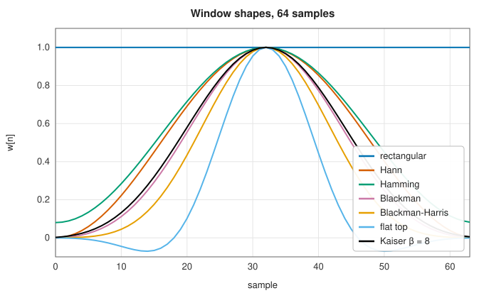
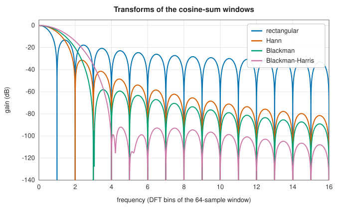
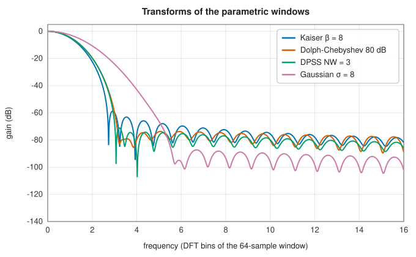

# Window functions

<div class="entry-summary">

| | |
|---|---|
| **Problem** | Taper a finite block of samples so that its spectrum suffers little leakage, trading frequency resolution against the dynamic range of the spectrum |
| **Devised by** | Julius von Hann (1903, the cosine bell); Richard Hamming and John Tukey (1950s); R. B. Blackman and Tukey (1958); C. L. Dolph (1946), Chebyshev arrays; T. T. Taylor (1955); James Kaiser (1966, 1974); David Slepian (1978), prolate spheroidal sequences; Fredric Harris (1978), the standard survey |
| **Accuracy** | All 24 windows agree with `scipy.signal.windows` to about $10^{-15}$ in both their symmetric and periodic forms ([table below](#testing-against-scipy)) |
| **Cost** | $O(M)$ for most; $O(M^2)$ for the Dolph-Chebyshev window (a direct DFT) and $O(M)$ per iteration for the DPSS |
| **API** | [`generate_window`](../../api/lib_jsl_dsp/discrete/windows/fn.generate_window.html), [`WindowType`](../../api/lib_jsl_dsp/discrete/windows/enum.WindowType.html), one function per window in [`windows`](../../api/lib_jsl_dsp/discrete/windows/index.html) (`hann`, `hamming`, `blackman`, `kaiser`, `chebwin`, `dpss`, `taylor`, `general_cosine`, …) |

</div>

## Overview

The DFT of a block of $M$ samples treats the block as one period of a periodic signal. Unless a sinusoid fits a whole number of periods into
the block, the period boundaries are discontinuous and its energy **leaks** into every frequency bin. A **window** $w[n]$ multiplies the block before the transform,
tapering it towards zero at the ends so the discontinuity disappears. The transform of the windowed signal is the true spectrum convolved
with the window's transform $W(f)$. That transform has a **main lobe**, which sets how close two frequencies can be and still be resolved, and **side lobes**,
which set how weak a component can be and still be seen next to a strong one. No window is narrow and low at once. The many windows in
the library are different choices along that trade-off, plus a few for special purposes.

## History

The cosine-bell taper is named after the Austrian meteorologist Julius von Hann, who used it for smoothing in 1903. Richard Hamming and John Tukey
introduced windowed spectral estimation at Bell Labs in the 1950s, and R. B. Blackman and Tukey's *The Measurement of Power
Spectra* (1958) made the windows standard. C. L. Dolph (1946) designed antenna arrays with equal side lobes from Chebyshev polynomials, the
origin of the Dolph-Chebyshev window, and T. T. Taylor (1955) relaxed it for radar. James Kaiser (1966) approximated the optimally
concentrated prolate spheroidal functions with Bessel functions. David Slepian (1978) gave the discrete prolate spheroidal sequences themselves,
which David Thomson (1982) used in multitaper spectral estimation. Fredric Harris's 1978 survey, "On the use of windows for harmonic analysis
with the discrete Fourier transform", defined the figures of merit still used.

## The idea

### Leakage, the main lobe and the side lobes

**Where leakage comes from.** A spectrum can only be computed from a finite record of $M$
samples. Taking a finite record is the same as multiplying the endless signal by a function that
is 1 during the record and 0 outside it, a rectangular **window**. That multiplication changes
the spectrum. Multiplying two signals in time convolves their spectra in frequency, so the
spectrum we compute is the true spectrum smeared by the transform $W(f)$ of the window.

The effect is clearest for a pure tone, whose true spectrum is a single spike. Convolving a spike
with $W$ gives a copy of $W$ centred on the tone's frequency. So instead of one sharp line, the
tone appears as the whole shape of $W$: a central **main lobe**, whose width limits how close two
tones can be and still be told apart, and a series of **side lobes** that spread the tone's
energy to distant frequencies. That spreading is **leakage**. The side lobes of a strong tone can
hide a weak one entirely.

(When a tone has exactly a whole number of cycles in the record, the DFT happens to sample $W$
only at its peak and its zeros, and no leakage is visible. For any other frequency it is.)

**The remedy.** The side lobes of the rectangular window are high because it switches on and off
abruptly. A window $w[n]$ that rises smoothly from zero and falls smoothly back has far lower
side lobes. The price is a wider main lobe, because the taper makes the record effectively
shorter. Every window is a compromise between the two:

| | |
|:---:|:---:|
|  |  |

The rectangular window (no taper) has the narrowest main lobe but side lobes only 13 dB down, decaying slowly. Each smoother taper widens
the main lobe and lowers the side lobes: Hann to −31 dB, Blackman to −58 dB, the four-term Blackman-Harris to −92 dB.

### Families

- **Cosine sums** $w[n] = \sum_ka_k(-1)^k\cos(2\pi kn/M)$: rectangular, Hann ($a = \frac12, \frac12$), Hamming (0.54, 0.46, cancelling the first side lobe), Blackman, Nuttall, Blackman-Harris,
  and the **flat top**, whose main lobe is so flat that a tone between bins is measured with negligible amplitude error. `general_cosine` takes any
  coefficients.
- **Parametric windows** with a knob for the trade-off: **Kaiser** ($\beta$), **Gaussian** ($\sigma$), **Tukey** (the tapered fraction $\alpha$), **Dolph-Chebyshev** (the side-lobe level, all lobes
  equal: the narrowest main lobe for that level), **Taylor** (nearly equal near-in lobes, then decaying), and the **DPSS** or Slepian window
  (the half-bandwidth $NW$), which maximises the energy inside a band.
- Others: triangular and Bartlett, Parzen, Bohman, Bartlett-Hann, cosine, exponential, Lanczos (a sinc), and the Kaiser-Bessel derived
  window used by the modified DCT.



### Figures of merit

Three numbers summarise how a window of length $M$ affects measurements made with it.

- The **coherent gain** $\sum w/M$ is the factor by which the window scales the amplitude of a
  tone. A taper reduces the samples near the ends, so the gain is below 1 and amplitudes must be
  divided by it.
- The **equivalent noise bandwidth** $M\sum w^2/(\sum w)^2$, in bins, measures how much noise each
  bin collects. It is the width of the ideal rectangular filter that would pass the same noise
  power. A wider main lobe admits more noise, so tapering costs a little signal-to-noise ratio.
- The **scalloping loss** is the amplitude lost by a tone that falls halfway between two bins,
  the worst case, where both neighbouring bins sample the main lobe on its slopes instead of at
  its peak.

{{#include ../generated/spectral/window_merits.md}}

The flat-top window measures amplitudes to 0.01 dB wherever the tone falls, at the price of a main lobe ten bins wide. The Dolph-Chebyshev
and Taylor windows reach their design levels (−80 and −30 dB) only in their symmetric form. The periodic form drops a sample from a
window one longer, which raises the highest lobe to −74 dB and −29 dB here.

### Symmetric and periodic forms

Each function takes `sym`. A **symmetric** window ($w[n] = w[M - 1 - n]$) suits FIR filter design. A **periodic** window is the first $M$ samples of a symmetric window of length $M + 1$. It is the
right choice for spectral analysis, because its DFT has the exact structure the formulas assume. For example, the periodic Hann window's
transform has just three non-zero bins.

### The Dolph-Chebyshev and DPSS windows

The **Dolph-Chebyshev** window is defined through its transform, the Chebyshev polynomial $T_{M-1}(\beta\cos(\pi k/M))$ sampled at $M$ points, and computed by an inverse DFT. The **DPSS**
window is the eigenvector, for the largest eigenvalue, of a symmetric tridiagonal matrix that commutes with the band-concentration
problem. The library finds that eigenvalue by bisection on Sturm sequence counts and the eigenvector by inverse iteration.

### Testing against SciPy

{{#include ../generated/spectral/window_reference.md}}

Writing this chapter fixed two windows and their tests. `chebwin` used a Chebyshev polynomial of the wrong order with a sign error, and was
wrong by up to 0.99. `dpss` used power iteration, which finds the eigenvalue of largest *magnitude*. That is the wrong one when the bandwidth exceeds a quarter of the
sampling rate, so `dpss(7, 2.5)` was wrong by 0.31. The golden files the window tests compared with had been generated by the library itself.
They now come from SciPy. (The Kaiser window's Bessel function was corrected in the [filter chapter](../filters/index.md#testing-against-scipy).)

## Algorithm

1. **Cosine sum**: evaluate $\sum_ka_k\cos(k\theta_n)$ at $\theta_n$ evenly spaced on $[-\pi, \pi]$.
2. **Kaiser**: $I_0(\beta\sqrt{1 - (2n/(M - 1) - 1)^2})/I_0(\beta)$.
3. **Dolph-Chebyshev**: sample $T_{M-1}$, take the real DFT (with a half-sample shift for even $M$), centre, normalise to a peak of 1.
4. **DPSS**: bisection for the largest eigenvalue, then inverse iteration; normalise to a peak of 1.
5. **Periodic form**: compute the symmetric window of length $M + 1$ and drop the last sample.

## Implementation

```rust,ignore
{{#include ../../../crates/dsp/src/discrete/windows/general_cosine.rs:general_cosine}}
```

```rust,ignore
{{#include ../../../crates/dsp/src/discrete/windows/dpss.rs:dpss_bisection}}
```

- `generate_window(WindowType, m, sym)` dispatches to the individual functions; `firwin` and the spectral estimators accept a `WindowType` or a window vector.
- The Kaiser-Bessel derived window is defined for even lengths only, as in SciPy. For an odd length the library returns the next even
  window with its last sample dropped.

## In practice

```rust,ignore
{{#include ../../../crates/dsp/examples/dsp_windows.rs}}
```

```text
Hann             coherent gain 0.5000, equivalent noise bandwidth 1.500 bins
Blackman-Harris  coherent gain 0.3588, equivalent noise bandwidth 2.004 bins
Kaiser β = 8     coherent gain 0.4357, equivalent noise bandwidth 1.666 bins
flat top         coherent gain 0.2156, equivalent noise bandwidth 3.770 bins
symmetric Hann(5): [0.0, 0.5, 1.0, 0.5, 0.0]
periodic Hann(5):  [0.0, 0.34549150281252633, 0.9045084971874737, 0.9045084971874737, 0.34549150281252633]
```

**Strengths**

- A choice of trade-offs: resolution (rectangular, Hann), dynamic range (Blackman-Harris, Chebyshev, DPSS), amplitude accuracy (flat top), or a tunable mix (Kaiser).

**Weaknesses**

- No window is best for every purpose; low side lobes always cost resolution and noise bandwidth.

## Exercises

1. Show that the periodic Hann window of length $M$ has a DFT with only three non-zero bins.
2. Derive the Hamming coefficients 0.54 and 0.46 from the condition that the first side lobe vanishes (approximately 25/46 and 21/46).
3. Show that the equivalent noise bandwidth of any window is at least 1 bin, with equality only for the rectangular window.
4. Compute the scalloping loss of the rectangular window, $20\log_{10}(\pi/2)$, and check it against the table.
5. Explain why the Dolph-Chebyshev window of very large length has impulsive end samples, and why Taylor's modification avoids them.

## Further reading

- F. J. Harris, "On the use of windows for harmonic analysis with the discrete Fourier transform", *Proceedings of the IEEE* 66 (1978) 51–83.
- A. H. Nuttall, "Some windows with very good sidelobe behavior", *IEEE Transactions on Acoustics, Speech, and Signal Processing* 29 (1981) 84–91.
- D. Slepian, "Prolate spheroidal wave functions, Fourier analysis, and uncertainty — V: the discrete case", *Bell System Technical Journal* 57 (1978) 1371–1430.
- R. B. Blackman and J. W. Tukey, *The Measurement of Power Spectra*, Dover, 1958.
