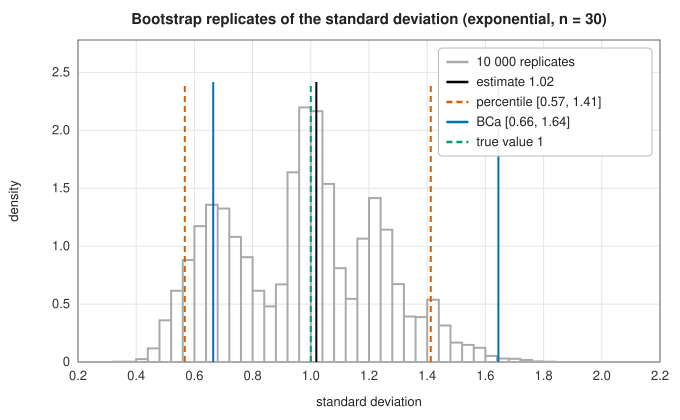

# The bootstrap

<div class="entry-summary">

| | |
|---|---|
| **Problem** | Estimate the standard error, bias and confidence interval of any statistic, without a formula for its sampling distribution |
| **Devised by** | Maurice Quenouille (1949) and John Tukey (1958), the jackknife; Bradley Efron (1979), the bootstrap; Efron (1987), the bias-corrected and accelerated (BCa) interval |
| **Accuracy** | Percentile intervals are first-order accurate (coverage error $O(n^{-1/2})$); BCa intervals second-order ($O(n^{-1})$). Both under-cover for small, skewed samples (table below) |
| **Cost** | $B$ evaluations of the statistic on resamples of size $n$ (typically $B = 1000$ to $10\,000$), plus $n$ jackknife evaluations for BCa |
| **API** | [`bootstrap`](../../api/lib_jsl_statistics/bootstrap/fn.bootstrap.html), [`BootstrapResult`](../../api/lib_jsl_statistics/bootstrap/struct.BootstrapResult.html) (`percentile_interval`, `bca_interval`) |

</div>

## Overview

The uncertainty of a statistic $\hat\theta = s(x_1, \ldots, x_n)$ is described by its **sampling distribution**: how it would vary over repeated samples from
the population. For a mean, theory gives the answer $\sigma/\sqrt n$; for a median, a correlation, a ratio or the output of a complicated
procedure, there may be no usable formula. The **bootstrap** replaces the unknown population by the sample itself. Draw $n$
values *with replacement* from the data, recompute the statistic, repeat $B$ times, and treat the spread of the **replicates**
$\hat\theta^*_1, \ldots, \hat\theta^*_B$ as an estimate of the sampling distribution.

## History

Maurice Quenouille (1949) introduced the **jackknife** to reduce bias, recomputing a statistic with each observation left out
in turn, and John Tukey (1958) used it to estimate variances and named it after a rough-and-ready tool. Bradley Efron's
"Bootstrap methods: another look at the jackknife" (1979) generalised the idea to resampling with replacement, and the
cheapness of computing made it practical. Efron (1987) introduced the bias-corrected and accelerated interval, and the
second-order theory of bootstrap intervals was developed by Peter Hall (1988, 1992), Thomas DiCiccio and others. Efron and
Robert Tibshirani's *An Introduction to the Bootstrap* (1993) brought the method into everyday practice.

## The idea

### Resampling and the plug-in principle

Why should resampling the data we already have tell us anything about samples we never took?

The sampling distribution of $\hat\theta$ is determined by the population distribution $F$: if
we knew $F$, we could simulate as many fresh samples as we liked and watch how $\hat\theta$
varies. We do not know $F$, but we have an estimate of it. The **empirical distribution**
$\hat F$ puts probability $1/n$ on each observation, and for a reasonably large sample it
resembles $F$. The **plug-in principle** is to use $\hat F$ wherever $F$ is needed. Drawing a
sample of size $n$ from $\hat F$ means choosing $n$ of the observations at random, *with
replacement*, since each draw is independent and may pick the same observation again.

So the bootstrap is a simulation of the sampling process with $\hat F$ standing in for $F$.
From the replicates $\hat\theta^*_1, \ldots, \hat\theta^*_B$:

- the **standard error** of $\hat\theta$ is estimated by the standard deviation of the
  replicates;
- the **bias** is estimated by $\bar\theta^* - \hat\theta$, the amount by which the replicates,
  on average, overshoot the value for the sample they were drawn from.

A resample is not a copy of the data. The chance that a given observation is missed by all $n$
draws is $(1 - 1/n)^n \approx e^{-1}$, so a resample contains on average
$1 - (1 - 1/n)^n \approx 63\%$ of the distinct observations, some of them repeated. That variation
in which observations are included is what mimics the variation between real samples.

### Percentile intervals

A **confidence interval** at level $1 - \alpha$ is a range computed from the data that contains
the true value in a fraction $1 - \alpha$ of repeated experiments; that fraction is its
**coverage**. The simplest bootstrap interval reads the range straight off the replicates: it
runs from their $\alpha/2$ quantile to their $1 - \alpha/2$ quantile. For a 90% interval, sort
the replicates and cut off the lowest 5% and the highest 5%.

The percentile interval is exactly right when some monotone transformation of $\hat\theta$ has a
normal, unbiased sampling distribution. Otherwise it inherits whatever bias and skewness the
bootstrap distribution has, and its actual coverage differs from the nominal $1 - \alpha$ by an
error of order $n^{-1/2}$.

### The BCa interval

Efron's **bias-corrected and accelerated** (BCa) interval uses the same replicates but reads
off *different* quantiles, adjusted for two defects of the percentile interval.

**Bias correction.** If the statistic were unbiased in the median sense, half the replicates
would fall below $\hat\theta$. The actual fraction measures the bias, expressed as a normal
quantile:

$$
z_0 = \Phi^{-1}\Big(\frac{\#\{\hat\theta^*_b < \hat\theta\}}{B}\Big),
$$

which is zero when exactly half fall below.

**Acceleration.** The percentile interval assumes that the standard error of $\hat\theta$ is the
same whatever the true $\theta$ is. Often it is not: the standard error of a standard deviation,
for instance, grows with the standard deviation itself. The **acceleration** $a$ measures how
fast the standard error changes with $\theta$. It is estimated from the **jackknife** values
$\hat\theta_{(i)}$, the statistic recomputed with observation $i$ left out, through their
skewness:

$$
a = \frac{\sum(\bar\theta_{(\cdot)} - \hat\theta_{(i)})^3}{6\big(\sum(\bar\theta_{(\cdot)} - \hat\theta_{(i)})^2\big)^{3/2}},
$$

where $\bar\theta_{(\cdot)}$ is the mean of the jackknife values.

**The interval.** With $z_\alpha = \pm\Phi^{-1}(1 - \alpha/2)$, the endpoints are the replicate
quantiles at the levels

$$
\Phi\Big(z_0 + \frac{z_0 + z_\alpha}{1 - a(z_0 + z_\alpha)}\Big) .
$$

When $z_0 = 0$ and $a = 0$ this reduces to $\Phi(z_\alpha)$, that is $\alpha/2$ and
$1 - \alpha/2$: the percentile interval. Otherwise both ends shift, in the direction that
compensates for the bias and the skewness. BCa intervals are **transformation-respecting** (the
interval for $g(\theta)$ is $g$ applied to the interval for $\theta$) and **second-order
accurate**: their coverage error is $O(n^{-1})$ instead of $O(n^{-1/2})$.

### How well do they cover?

{{#include ../generated/statistics/bootstrap_coverage.md}}

For the mean of exponential data, all three intervals under-cover at $n = 10$ and approach 90% as $n$ grows; the bootstrap intervals are
slightly narrower than the $t$ interval because the bootstrap divides by $n$ rather than $n - 1$ and ignores the extra uncertainty of
estimating the variance. For the standard deviation, a statistic driven by the few largest values of a skewed sample, coverage
is poor: 56–61% at $n = 10$, still 81–83% at $n = 100$, with BCa consistently better than percentile. The bootstrap cannot invent
information about tails the sample has not seen.



The replicates of the standard deviation from one sample of 30 are lumpy, because the result depends mainly on how many copies
of the largest observation a resample contains. The BCa interval is shifted to the right of the percentile one, correcting
for the skewness, and covers the true value.

## Algorithm

Input: the data, a function that computes the statistic, the number of replicates $B$ and a
confidence level $1 - \alpha$.

1. **Compute** the statistic $\hat\theta$ on the original data.
2. **Resample.** For $b = 1, \ldots, B$: draw $n$ indices uniformly from $1, \ldots, n$ with
   replacement, form the resample from those observations, and evaluate the statistic on it to
   get $\hat\theta^*_b$.
3. **Standard error and bias.** The standard error is the standard deviation of the $B$
   replicates. The bias estimate is their mean minus $\hat\theta$.
4. **Percentile interval.** Sort the replicates and take their $\alpha/2$ and $1 - \alpha/2$
   quantiles.
5. **BCa interval.**
   - Compute $z_0$ from the fraction of replicates below $\hat\theta$.
   - Compute the $n$ jackknife values, each the statistic with one observation left out, and
     from them the acceleration $a$.
   - Compute the two adjusted levels from $z_0$, $a$ and $z_\alpha$, and take the replicate
     quantiles at those levels.

The cost is $B$ evaluations of the statistic, plus $n$ more for the jackknife if the BCa
interval is requested.

## Implementation

```rust,ignore
{{#include ../../../crates/statistics/src/bootstrap.rs:bootstrap}}
```

```rust,ignore
{{#include ../../../crates/statistics/src/bootstrap.rs:bca}}
```

- `bootstrap` takes a seed, so results are reproducible; the statistic is any `Fn(&[f64]) -> f64`.
- `bca_interval` needs the original data and statistic again, for the jackknife.

## In practice

```rust,ignore
{{#include ../../../crates/statistics/examples/statistics_bootstrap.rs}}
```

```text
median = 115.0 ms, bootstrap standard error = 9.9, bias = +0.84
95% percentile interval: [99.5, 138.0]
95% BCa interval:        [98.0, 133.0]
coefficient of variation = 0.426, 95% BCa interval [0.262, 0.582]
```

**Strengths**

- Works for any statistic, however complicated, with no derivation.
- BCa intervals correct for bias and skewness, with second-order accuracy.

**Weaknesses**

- Under-covers for small samples and for statistics that depend on the tails; it cannot do better than the sample.
- Fails for some statistics: the maximum, and statistics of heavy-tailed data with infinite variance.
- Independent observations only; dependent data (time series) need block resampling, which is not implemented.
- $B$ evaluations of the statistic can be expensive.

## Exercises

1. Show that the probability that a given observation is absent from a resample tends to $e^{-1}$.
2. Compute the exact bootstrap distribution of the mean of the sample $\{1, 2, 4\}$ by enumerating all 27 resamples.
3. Show that the bootstrap variance of the mean is $\frac{1}{n^2}\sum(x_i - \bar x)^2$, and compare with $s^2/n$.
4. Show that the bootstrap fails for the sample maximum of a uniform distribution: what is the probability that the maximum
   of a resample equals the sample maximum?
5. Compare the coverage of percentile and BCa intervals for the correlation coefficient of bivariate normal data with $\varrho = 0.8$, $n = 20$.

## Further reading

- B. Efron, "Bootstrap methods: another look at the jackknife", *Annals of Statistics* 7 (1979) 1–26.
- B. Efron, "Better bootstrap confidence intervals", *Journal of the American Statistical Association* 82 (1987) 171–185.
- B. Efron and R. J. Tibshirani, *An Introduction to the Bootstrap*, Chapman and Hall, 1993.
- T. J. DiCiccio and B. Efron, "Bootstrap confidence intervals", *Statistical Science* 11 (1996) 189–228.
- A. C. Davison and D. V. Hinkley, *Bootstrap Methods and their Application*, Cambridge University Press, 1997.
