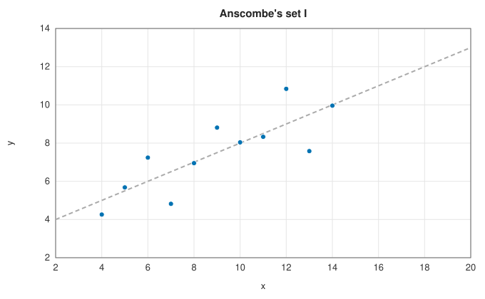
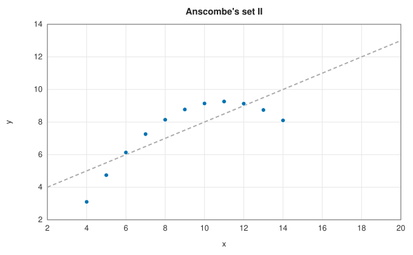
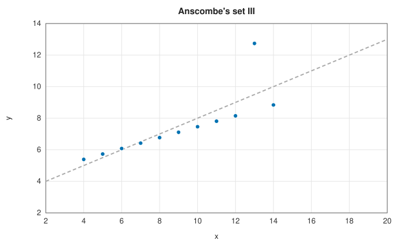
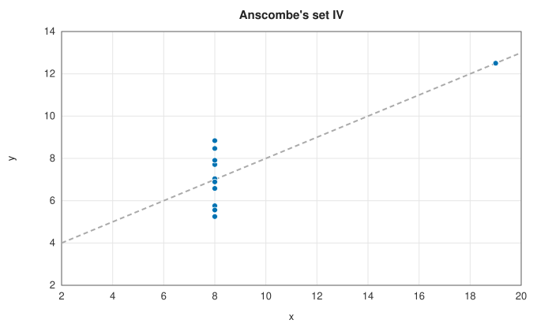

# Correlation and covariance

<div class="entry-summary">

| | |
|---|---|
| **Problem** | Measure the strength of association between two variables, and test whether it could be chance |
| **Devised by** | Francis Galton (1888), "co-relation"; Karl Pearson (1896), the product-moment coefficient; R. A. Fisher (1915), its sampling distribution; Charles Spearman (1904), rank correlation; Maurice Kendall (1938), $\tau$, and (1945) the tie-corrected $\tau_b$ |
| **Accuracy** | Coefficients and p-values agree with SciPy to $10^{-14}$ (table in the [hypothesis tests](hypothesis-tests.md#checking-against-scipy) entry) |
| **Cost** | Pearson $O(n)$; Spearman $O(n \log n)$; Kendall $O(n^2)$ |
| **API** | [`correlation`](../../api/lib_jsl_statistics/correlation/index.html): [`pearson`](../../api/lib_jsl_statistics/correlation/fn.pearson.html), [`spearman`](../../api/lib_jsl_statistics/correlation/fn.spearman.html), [`kendall`](../../api/lib_jsl_statistics/correlation/fn.kendall.html), `rank`, `covariance`, `covariance_matrix`, `correlation_matrix` |

</div>

## Overview

The **covariance** $\operatorname{cov}(x, y) = \frac{1}{n - 1}\sum(x_i - \bar x)(y_i - \bar y)$ is positive when the two variables tend to be above their means together.
Dividing by the standard deviations makes it scale-free: **Pearson's correlation** $r$, between $-1$ and $1$, measures the
strength of *linear* association. **Rank correlations** replace the values by their ranks and measure any *monotone*
association, at the same time becoming immune to outliers. Each coefficient comes with a p-value for the null hypothesis
of no association.

## History

Francis Galton, studying the heights of parents and children, introduced "co-relation" and regression towards the mean
(1886–1888). Karl Pearson (1896) gave the product-moment formula and its theory, and R. A. Fisher (1915) derived the exact
distribution of $r$ for normal data, together with the transformation $\tanh^{-1} r$ that bears his name. Charles Spearman (1904), a
psychologist studying intelligence, proposed correlating ranks; Maurice Kendall (1938) defined a coefficient from concordant
and discordant pairs, with a tie-corrected version $\tau_b$ (1945). Francis Anscombe's quartet (1973) became the standard warning that a
correlation coefficient is no substitute for a plot.

## The idea

### Pearson's correlation

$$
r = \frac{\sum(x_i - \bar x)(y_i - \bar y)}{\sqrt{\sum(x_i - \bar x)^2\,\sum(y_i - \bar y)^2}}.
$$

The numerator is positive when $x$ and $y$ tend to be above their means together and below
their means together, and negative when one tends to be high where the other is low. Dividing by
the two spreads removes the units and the scales of the variables, so $r$ is a pure number that
does not change if either variable is shifted or rescaled.

- By the Cauchy-Schwarz inequality $|r| \le 1$, with equality exactly when the points lie on a
  straight line. So $r$ measures the strength of a *linear* relation; a perfect but curved
  relation can have a small $r$.
- $r^2$ is the fraction of the variance of $y$ explained by the least-squares line through the
  data.
- **Significance.** Even unrelated variables give a nonzero $r$ in a finite sample, so one asks
  how large a value chance alone would produce. For independent normal variables the statistic
  $t = r\sqrt{(n - 2)/(1 - r^2)}$ has Student's $t$ distribution with $n - 2$ degrees of freedom,
  which gives the [p-value](hypothesis-tests.md).

The library computes $r$ by two passes (means first, then deviations, as for the
[variance](descriptive.md#the-variance-why-the-textbook-formula-fails)) and clamps it to
$[-1, 1]$, which rounding could otherwise slightly exceed.

### Spearman's rank correlation

Pearson's $r$ has two limitations: it detects only linear relations, and a single extreme value
can dominate it. Both are removed by discarding the values and keeping only their order. Replace
each $x$ value by its **rank** among the $x$ values (1 for the smallest; tied values share the
average of their ranks), do the same for the $y$ values, and compute Pearson's $r$ of the ranks.

The result $\rho$ equals 1 for *any* increasing relation, linear or not, because the ranks of $x$
and $y$ then coincide. It is also robust: however extreme an outlier is, its rank is at most
$n$, so it can only have a limited effect. The library
uses the same $t$ approximation for the p-value, as SciPy does.

### Kendall's tau

A pair of observations $(i, j)$ is **concordant** if $x$ and $y$ order it the same way and **discordant** otherwise. With $C$ concordant and $D$ discordant
pairs among the $n_0 = n(n - 1)/2$ pairs, $\tau = (C - D)/n_0$ is the probability of concordance minus that of discordance, a directly interpretable
quantity. With ties, $\tau_b = (C - D)/\sqrt{(n_0 - n_1)(n_0 - n_2)}$, where $n_1$ and $n_2$ count the pairs tied in $x$ and in $y$. Under independence $S = C - D$ is approximately
normal with a known, tie-corrected variance, which gives the p-value. The direct count is $O(n^2)$; Knight's (1966) merge-sort algorithm
achieves $O(n \log n)$.

### Anscombe's quartet

| | | | |
|:---:|:---:|:---:|:---:|
|  |  |  |  |

{{#include ../generated/statistics/anscombe.md}}

Anscombe's four data sets share their means, variances, regression line $y = 3 + x/2$ (dashed) and Pearson correlation of 0.816, yet look
nothing alike: a noisy line, a smooth curve, a perfect line with one outlier, and a single influential point. The rank correlations
tell them apart: on set III they see the near-perfect monotone relation through the outlier, and on set IV the association rests on
one point and is not significant.

## Algorithm

1. **Pearson**: means; sums of cross-products and squares about them; $r$; $t$ statistic and p-value.
2. **Spearman**: average ranks of each variable by sorting; Pearson's $r$ of the ranks.
3. **Kendall**: count $S = C - D$ over all pairs; tie group sizes of each variable; $\tau_b$; variance of $S$ with tie corrections; normal p-value.

## Implementation

```rust,ignore
{{#include ../../../crates/statistics/src/correlation.rs:kendall}}
```

- `covariance_matrix` and `correlation_matrix` take a slice of variables (each a sample), and return symmetric matrices.
- A constant variable has no correlation; the functions return an error.

## In practice

```rust,ignore
{{#include ../../../crates/statistics/examples/statistics_correlation.rs}}
```

```text
Pearson   +0.362  (p = 1.85e-1)
Spearman  +0.600  (p = 1.81e-2)
Kendall   +0.638  (p = 9.14e-4)
+1.000  +0.362  +0.972
+0.362  +1.000  +0.182
+0.972  +0.182  +1.000
```

One misrecorded response hides a strong monotone relation from Pearson's $r$; the rank correlations still find it.

**Strengths**

- Three coefficients with p-values matching SciPy, including ties.
- Rank correlations capture monotone, nonlinear association and resist outliers.

**Weaknesses**

- Correlation measures association, not causation, and only linear (Pearson) or monotone (rank) association: $y = x^2$ on a symmetric range
  has correlation zero.
- Kendall's $\tau$ is $O(n^2)$; the p-values are asymptotic.

## Exercises

1. Prove $|r| \le 1$ from the Cauchy-Schwarz inequality, with equality only for collinear points.
2. Show that without ties Spearman's $\rho = 1 - 6\sum d_i^2/(n(n^2 - 1))$, where $d_i$ are the rank differences.
3. Show that for continuous bivariate normal data $\tau = \frac{2}{\pi}\arcsin\varrho$, and check it by simulation.
4. Construct a data set with $r = 0$ but a perfect functional relation.
5. Implement Knight's $O(n \log n)$ algorithm for $\tau$ by counting inversions during a merge sort.

## Further reading

- F. J. Anscombe, "Graphs in statistical analysis", *The American Statistician* 27 (1973) 17–21.
- M. G. Kendall and J. D. Gibbons, *Rank Correlation Methods*, 5th ed., Edward Arnold, 1990.
- W. R. Knight, "A computer method for calculating Kendall's tau with ungrouped data", *Journal of the American Statistical
  Association* 61 (1966) 436–439.
- J. L. Rodgers and W. A. Nicewander, "Thirteen ways to look at the correlation coefficient", *The American Statistician* 42 (1988) 59–66.
