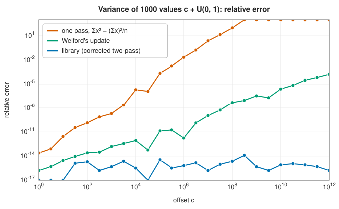
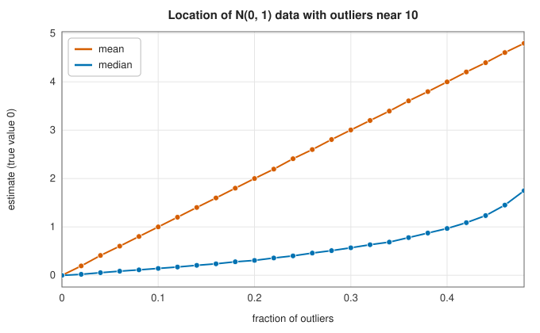
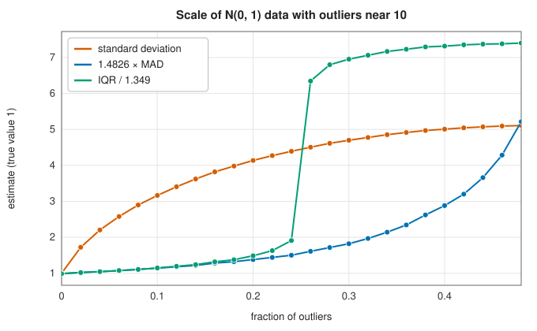

# Descriptive statistics

<div class="entry-summary">

| | |
|---|---|
| **Problem** | Summarise a sample by its location, spread and shape: means, variance, quantiles, robust measures, skewness and kurtosis |
| **Devised by** | Karl Pearson (1890s), moments, skewness and the standard deviation; B. P. Welford (1962), one-pass updating; Tony Chan, Gene Golub and Randall LeVeque (1983), analysis of variance algorithms; John Tukey (1977), the five-number summary; Frank Hampel (1974), robustness and the median absolute deviation; Rob Hyndman and Yanan Fan (1996), sample quantile definitions |
| **Accuracy** | Mean and variance to a few units in the last place regardless of the offset of the data (figure below); values agree with SciPy and NumPy to $10^{-15}$ |
| **Cost** | $O(n)$ for moments; $O(n \log n)$ for quantiles (a sort) |
| **API** | [`descriptive`](../../api/lib_jsl_statistics/descriptive/index.html): `mean`, `variance`, `standard_deviation`, `standard_error`, `weighted_mean`, `geometric_mean`, `harmonic_mean`, `quantile`, `median`, `interquartile_range`, `median_absolute_deviation`, `skewness`, `excess_kurtosis`, [`summary`](../../api/lib_jsl_statistics/descriptive/fn.summary.html) |

</div>

## Overview

Descriptive statistics compress a sample $x_1, \ldots, x_n$ into a few numbers. **Location** says where the data sit (mean,
median), **spread** how far they scatter (standard deviation, interquartile range, median absolute deviation), and **shape**
how they depart from symmetry and from normal tails (skewness, kurtosis). Two questions recur. Is the computation
**numerically sound**, given that data often carry a large common offset? And is the statistic **robust**, or can a single
wild value move it arbitrarily far?

## History

Karl Pearson introduced the term "standard deviation" (1893) and the moment measures of skewness and kurtosis in the 1890s,
building on Gauss's and Laplace's theory of errors. R. A. Fisher's $k$-statistics (1929) gave unbiased versions. As
computers arrived, the textbook "one-pass" variance formula $\sum x^2 - n\bar x^2$ was found to fail on real data; B. P. Welford
(1962) proposed a stable updating formula, and Tony Chan, Gene Golub and Randall LeVeque (1983) analysed all the
variants, recommending the corrected two-pass algorithm when the data can be read twice. John Tukey's *Exploratory Data
Analysis* (1977) popularised medians, quartiles and the box plot; Frank Hampel (1968, 1974) founded robust statistics
with the influence function and the breakdown point. Rob Hyndman and Yanan Fan (1996) catalogued nine competing
definitions of the sample quantile used by statistical packages.

## The idea

### The mean and compensated summation

The mean $\bar x = \frac1n\sum x_i$ is the value $c$ that minimises the sum of squared deviations
$\sum(x_i - c)^2$, which is why it is called the least-squares estimate of location.

Computing it requires a sum, and even a sum deserves care. Each floating-point addition rounds
its result, and when a small number is added to a large running total the low digits of the
small number are lost. Over $n$ additions these errors accumulate and grow with $n$. The library
uses **Neumaier's compensated summation**: after each addition it works out, exactly, the
rounding error that the addition just made (this is possible with two further floating-point
operations) and accumulates those errors in a second variable, which is added to the total at
the end. The sum is then accurate to a few units in the last place for any $n$. Weighted, geometric ($\exp$ of the mean log)
and harmonic (reciprocal of the mean reciprocal) means are also provided.

### The variance: why the textbook formula fails

The sample variance is the average squared deviation from the mean,

$$
s^2 = \frac{1}{n - 1}\sum(x_i - \bar x)^2 .
$$

The divisor is $n - 1$ and not $n$ (`ddof = 1`) because the deviations are measured from the
sample mean, which was itself fitted to the data and so lies closer to the data than the true
mean does; dividing by $n - 1$ compensates exactly, making $s^2$ an **unbiased** estimate of the
true variance.

Expanding the square gives the algebraically equivalent formula
$\sum(x_i - \bar x)^2 = \sum x_i^2 - n\bar x^2$, which appears in many textbooks because it needs
only a single pass over the data. Numerically it is a trap. Suppose the data are near $10^8$ and
vary by about 1. Then $\sum x_i^2$ and $n\bar x^2$ are both about $n \times 10^{16}$ and agree in
their first sixteen digits, while their difference, the quantity wanted, is only about $n$. Double
precision holds sixteen digits, so the subtraction cancels every one of them and leaves rounding
error. This is **catastrophic cancellation**.

The library uses the **corrected two-pass algorithm** instead. The first pass computes
$\bar x$. The second computes the deviations $x_i - \bar x$, which are small numbers computed
accurately, and forms

$$
\sum(x_i - \bar x)^2 - \frac1n\Big(\sum(x_i - \bar x)\Big)^2 .
$$

In exact arithmetic the deviations sum to zero and the second term vanishes. In floating point
the computed mean is slightly off, the deviations sum to a small nonzero number, and the second
term removes the resulting error.



<p class="caption" id="fig-10-1"><strong>Figure 10.1.</strong> Variance accuracy.</p>

For 1000 values $c + U$ with $U$ uniform on $[0, 1)$, the one-pass formula loses all accuracy once $c \approx 10^8$ (its errors above $10^3$ are
clipped), Welford's one-pass update degrades more slowly, and the two-pass algorithm stays at rounding level for every offset.

### Quantiles

The $p$-quantile splits the data so that a fraction $p$ lies below it. For a finite sample this
does not define a unique number: with four values, any number between the second and the third
has half the data below it. Hyndman and Fan catalogued nine definitions in use. The library uses
their **type 7**, the default of R and NumPy. Sort the data into the **order statistics**
$x_{(1)} \le x_{(2)} \le \cdots \le x_{(n)}$, place them at equally spaced positions from 0 to
$n - 1$, and read off the value at position $h = (n - 1)p$, interpolating linearly between the
two neighbouring order statistics $x_{(\lfloor h\rfloor + 1)}$ and $x_{(\lfloor h\rfloor + 2)}$ when $h$ is not
a whole number. For the data $1, 2, 4, 8$ and $p = 0.5$, $h = 1.5$, halfway between the second
and third values: the median is 3. The median is the 0.5-quantile, the quartiles the 0.25 and 0.75 quantiles, and `summary` returns
Tukey's five-number summary with the count, mean and standard deviation.

### Robustness and the breakdown point

The **breakdown point** of an estimator is the largest fraction of the data that can be replaced by arbitrary values without
carrying the estimate arbitrarily far. The mean and standard deviation have breakdown point 0: a single value suffices. The
median and the **median absolute deviation** $\operatorname{MAD} = \operatorname{median}|x_i - \operatorname{median}(x)|$ have breakdown point 50%, the largest possible; the
interquartile range has 25%. Scaled by $1.4826 = 1/\Phi^{-1}(0.75)$, the MAD estimates $\sigma$ for normal data, as does $\operatorname{IQR}/1.349$.

| | |
|:---:|:---:|
|  |  |

As standard normal data are progressively replaced by values near 10, the mean and standard deviation drift at once; the
interquartile range holds until a quarter of the data are contaminated and then jumps; the median and MAD drift only slowly
until half are.

### Shape: skewness and kurtosis

With central moments $m_k = \frac1n\sum(x_i - \bar x)^k$, the **skewness** $g_1 = m_3/m_2^{3/2}$ measures asymmetry (positive for a long right tail) and the
**excess kurtosis** $g_2 = m_4/m_2^2 - 3$ measures tail weight relative to the normal distribution, for which it is 0. These are the biased
versions, as in `scipy.stats.skew` and `kurtosis`; both are very sensitive to outliers, since they raise deviations to the third
and fourth powers.

## Algorithm

**Sum and mean** (Neumaier's compensated summation). Keep a running sum $s$ and a compensation
$c$, both initially zero. For each value $x$:

1. compute $t = s + x$;
2. if $|s| \ge |x|$, add $(s - t) + x$ to $c$; otherwise add $(x - t) + s$ to $c$. In either case
   this is the part of the smaller number that was lost when it was added to the larger;
3. set $s = t$.

The sum is $s + c$, and the mean is the sum divided by $n$.

**Variance** with `ddof` degrees of freedom removed (1 for the sample variance, 0 for the
population variance):

1. compute the mean $\bar x$;
2. in a second pass, accumulate $S_2 = \sum(x_i - \bar x)^2$ and $S_1 = \sum(x_i - \bar x)$;
3. return $(S_2 - S_1^2/n)/(n - \text{ddof})$.

**Quantile** at level $p$:

1. reject data containing NaN, and sort a copy;
2. compute the position $h = (n - 1)p$ and its integer part $k = \lfloor h\rfloor$;
3. return $x_{(k+1)} + (h - k)\,(x_{(k+2)} - x_{(k+1)})$, or simply $x_{(n)}$ when $p = 1$.

**Median absolute deviation**: compute the median $m$; form the absolute deviations
$|x_i - m|$; return their median.

The mean and variance cost $O(n)$; the order-based statistics cost a sort, $O(n\log n)$.

## Implementation

```rust,ignore
{{#include ../../../crates/statistics/src/descriptive.rs:mean_variance}}
```

```rust,ignore
{{#include ../../../crates/statistics/src/descriptive.rs:quantile}}
```

Against SciPy 1.17 and NumPy 2.4 on a skewed sample of 20 values (the [kernel density](kernel-density.md) estimate is included for
completeness):

<p class="caption" id="tab-10-1"><strong>Table 10.1.</strong> Descriptive statistics against SciPy and NumPy.</p>

{{#include ../generated/statistics/scipy_descriptive.md}}

- Every function returns an error for an empty sample; quantile functions reject NaN; geometric and harmonic means need positive
  values.

## In practice

```rust,ignore
{{#include ../../../crates/statistics/examples/statistics_descriptive.rs}}
```

```text
n = 12, mean = 143.9, sd = 348.5
five-number summary: 28.0 38.0 42.8 53.4 1250.0
robust spread: IQR = 15.4, 1.4826 MAD = 12.4
skewness = 3.01, excess kurtosis = 7.08
geometric mean = 56.1, 90th percentile = 60.4
```

One income of 1250 makes the mean more than three times the median and the standard deviation 28 times the MAD.

**Strengths**

- Numerically robust mean and variance; quantiles compatible with R and NumPy.
- Robust alternatives (median, IQR, MAD) alongside the classical statistics.

**Weaknesses**

- Quantiles sort a copy of the data, $O(n \log n)$; selection algorithms would be $O(n)$.
- No one-pass (streaming) accumulator; Welford's update would be needed for data seen once.

## Exercises

1. Show that $E[s^2] = \sigma^2$ when dividing by $n - 1$, and find the bias when dividing by $n$.
2. Derive Welford's update $M_k = M_{k-1} + (x_k - M_{k-1})/k$, $S_k = S_{k-1} + (x_k - M_{k-1})(x_k - M_k)$.
3. Show that the correction term $S_1^2/n$ in the two-pass algorithm is zero in exact arithmetic, and estimate its size in floating point.
4. Compute the breakdown points of the trimmed mean that discards the top and bottom 10%, and of the interquartile range.
5. Compute the type 7 and type 6 ($h = (n + 1)p - 1$) quantiles of $1, 2, 3, 4$ at $p = 0.1$.

<details>
<summary>Hints and answers</summary>

1. $\mathbb E\sum(x_i - \bar x)^2 = (n - 1)\sigma^2$, so dividing by $n - 1$ is unbiased and dividing by $n$ has bias $-\sigma^2/n$.
2. $M_k = M_{k-1} + (x_k - M_{k-1})/k$ from $kM_k = (k - 1)M_{k-1} + x_k$. Then $S_k - S_{k-1} = (x_k - M_{k-1})(x_k - M_k)$ follows by expanding $\sum(x_i - M_k)^2$ in terms of $M_{k-1}$.
3. $S_1 = \sum(x_i - \bar x)$ is zero by the definition of the mean; in floating point it is of the order of $\varepsilon\sqrt n\max|x_i - \bar x|$, which is why it corrects the rounding in $\bar x$.
4. The 10% trimmed mean breaks down when 10% of the data are corrupted (the trimmed tail can absorb only that fraction); the interquartile range breaks down at 25%.
5. Type 7: position $h = (n - 1)p = 0.3$ (0-based), so $1 + 0.3(2 - 1) = 1.3$. Type 6: position $(n + 1)p - 1 = -0.5$ is below the first element, so the result is clamped to the minimum, $1$.

</details>

## Further reading

- T. F. Chan, G. H. Golub and R. J. LeVeque, "Algorithms for computing the sample variance: analysis and recommendations", *The American
  Statistician* 37 (1983) 242–247.
- B. P. Welford, "Note on a method for calculating corrected sums of squares and products", *Technometrics* 4 (1962) 419–420.
- R. J. Hyndman and Y. Fan, "Sample quantiles in statistical packages", *The American Statistician* 50 (1996) 361–365.
- P. J. Huber and E. M. Ronchetti, *Robust Statistics*, 2nd ed., Wiley, 2009.
- J. W. Tukey, *Exploratory Data Analysis*, Addison-Wesley, 1977.
