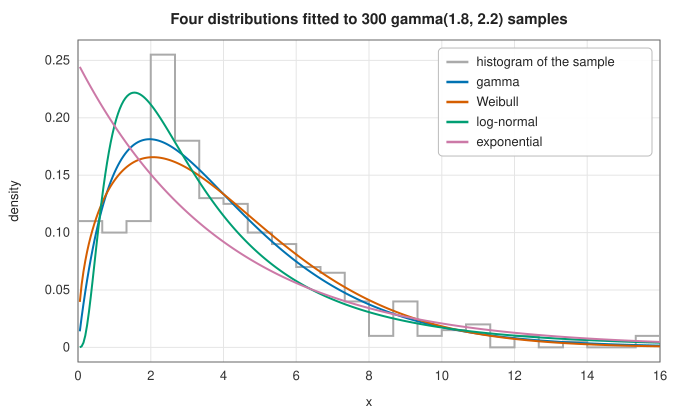

# Probability distributions

<div class="entry-summary">

| | |
|---|---|
| **Problem** | Work with a probability distribution as one object: evaluate its density or mass, distribution, survival and quantile functions; compute its moments; draw samples; and estimate its parameters from data by maximum likelihood |
| **Devised by** | Maximum likelihood: Ronald Fisher (1912, 1922). Extreme-value distributions: Fisher and Leonard Tippett (1928), Emil Gumbel (1958), Richard von Mises (1936) and Arthur Jenkinson (1955, GEV); skew-normal: Adelchi Azzalini (1985); Owen's T: Donald Owen (1956); gamma MLE starting value: Thomas Minka (2002) |
| **Accuracy** | Densities, distribution functions, quantiles and moments agree with `scipy.stats` to $10^{-12}$ or better for every distribution; maximum-likelihood fits to $10^{-7}$ (exactly, where closed forms exist) |
| **Cost** | Closed forms: $O(1)$. Quantiles by inversion: 10–40 evaluations of the distribution function. Fits: $O(n)$ for closed forms and score equations, a few thousand likelihood evaluations by Nelder-Mead |
| **Read first** | [Descriptive statistics](descriptive.md), [Incomplete gamma and beta functions](../special_functions/incomplete.md) |
| **API** | [`ContinuousDistribution`](../../api/lib_jsl_statistics/distributions/trait.ContinuousDistribution.html), [`DiscreteDistribution`](../../api/lib_jsl_statistics/distributions/trait.DiscreteDistribution.html), [`Fit`](../../api/lib_jsl_statistics/distributions/trait.Fit.html), and 25 distribution types such as [`Gamma`](../../api/lib_jsl_statistics/distributions/struct.Gamma.html), [`GeneralizedExtremeValue`](../../api/lib_jsl_statistics/distributions/struct.GeneralizedExtremeValue.html) and [`NegativeBinomial`](../../api/lib_jsl_statistics/distributions/struct.NegativeBinomial.html) |

</div>

## Overview

Most statistical work involves a few named distributions and the same handful of questions about each: how likely is a value,
what is the probability below a threshold, which value has 95% of the probability below it, what are the mean and the spread,
and which parameters best describe a sample. `scipy.stats` answers them with one object per distribution and the same methods on
every object. This entry gives the library the same design:

- a trait `ContinuousDistribution` with `pdf`, `logpdf`, `cdf`, `sf`, `ppf`, `isf`, `mean`, `variance`, `skewness`, `excess_kurtosis`, `median`,
  `interval`, `log_likelihood` and `sample`; and its counterpart `DiscreteDistribution` with `pmf`;
- 20 continuous distributions: normal, uniform, exponential, gamma, beta, chi-squared, Student's t, F, log-normal, Weibull,
  Cauchy, Laplace, logistic, Pareto, Rayleigh, Gumbel, generalised extreme value, truncated normal, von Mises and skew-normal;
- 5 discrete ones: binomial, Poisson, geometric, negative binomial and hypergeometric;
- maximum-likelihood fitting for all of them except the truncated normal and the hypergeometric.

## History

Most of these distributions arose in the eighteenth and nineteenth centuries: the binomial and normal with Jacob Bernoulli and
Abraham de Moivre, the Poisson as a limit of the binomial (1837), and Student's t with William Gosset (1908). Ronald Fisher introduced
maximum likelihood between 1912 and 1922 and showed that, under regularity conditions, it is consistent, efficient and asymptotically
normal with variance given by the inverse Fisher information. Distributions of extremes came from Fisher and Leonard Tippett (1928),
who found the three possible limits of the maximum of many samples. Richard von Mises (1936) and Arthur Jenkinson (1955) united them as the generalised extreme value
distribution, and Emil Gumbel's *Statistics of Extremes* (1958) brought them into engineering use for floods and loads. Richard von
Mises (1918) also gave the circular normal distribution. Adelchi Azzalini (1985) introduced the skew-normal, whose
distribution function needs Donald Owen's T function (1956).

## The idea

### Four views of one distribution

A continuous distribution is described equally by its **density** $f$, its **distribution function** $F(x) = P(X \le x) = \int_{-\infty}^x f$, its
**survival function** $S(x) = 1 - F(x)$, or its **quantile function** $F^{-1}(p)$. Each is best for something:

- $f$ for likelihoods;
- $F$ and $S$ for probabilities of intervals and tails. Computing $S$ directly instead of as $1 - F$ keeps its accuracy when $F \approx 1$, so every distribution here
  evaluates the tail it is asked for, with `exp_m1`, `ln_1p` or the complementary special function;
- $F^{-1}$ for critical values and for sampling: if $U$ is uniform on $(0, 1)$, then $F^{-1}(U)$ has distribution $F$ (**inversion**).

Many distributions reduce to two special functions, the regularised incomplete gamma $P(a, x)$ and beta $I_x(a, b)$. The gamma and
chi-squared distribution functions are $P(k, x/\theta)$, and the Poisson's is $Q(k + 1, \lambda)$. The beta, Student's t, F, binomial and negative binomial are all
incomplete beta functions. Where the quantile has a closed form (normal, exponential, Weibull, Pareto, Gumbel, GEV, Laplace,
logistic, Cauchy, Rayleigh, log-normal), it is used. Otherwise the distribution function is inverted by expanding a bracket from the mean and applying
Brent's method, which converges to machine precision in a few tens of evaluations.

### Two less common distribution functions

The **skew-normal** density $2\varphi(z)\Phi(\alpha z)$ tilts the normal by a factor that rises from 0 to 2. Its distribution function is
$F(z) = \Phi(z) - 2T(z, \alpha)$, where Owen's T function

$$
T(h, a) = \frac{1}{2\pi}\int_0^a \frac{e^{-h^2(1+x^2)/2}}{1 + x^2}\,dx
$$

is computed by 40-point Gauss-Legendre quadrature for $|a| \le 1$, and through the identity $T(h, a) + T(ah, 1/a) = \tfrac12\Phi(h) + \tfrac12\Phi(ah) - \Phi(h)\Phi(ah)$ (for $h \ge 0$) beyond.

The **von Mises** distribution $f(x) \propto e^{\kappa\cos(x - \mu)}$ lives on a circle. Its distribution function is a Fourier series,

$$
F(x) = \frac{1}{2\pi}\Big(x - \mu + \pi + 2\sum_{j \ge 1}\frac{I_j(\kappa)}{I_0(\kappa)}\,\frac{\sin j(x - \mu)}{j}\Big),
$$

whose Bessel-function ratios come from Miller's backward recurrence $I_{j-1}/I_j = 2j/\kappa + I_{j+1}/I_j$. The series loses accuracy in the far tails for large $\kappa$, where SciPy switches to
a normal approximation. Its relative error is about $10^{-11}$ there.

### Maximum likelihood

Given independent observations $x_1, \ldots, x_n$, the **maximum-likelihood estimate** maximises $\ell(\theta) = \sum_i \ln f(x_i; \theta)$. For many distributions
the maximum has a closed form or reduces to one equation:

| distribution | maximum-likelihood estimate |
|---|---|
| normal | $\hat\mu = \bar x$, $\hat\sigma^2 = \frac1n\sum(x_i - \bar x)^2$ |
| exponential, Poisson, geometric | $\hat\lambda = 1/\bar x$, $\hat\lambda = \bar x$, $\hat p = 1/\bar x$ |
| log-normal | the normal estimates of $\ln x_i$ |
| Laplace | $\hat\mu = $ median, $\hat b = $ mean absolute deviation from it |
| Pareto, Rayleigh | $\hat x_m = \min x_i$, $\hat\alpha = n/\sum\ln(x_i/\hat x_m)$; $\hat\sigma^2 = \sum x_i^2/2n$ |
| gamma | $\ln k - \psi(k) = \ln\bar x - \overline{\ln x}$, then $\hat\theta = \bar x/k$ |
| beta | $\psi(a) - \psi(a + b) = \overline{\ln x}$, $\psi(b) - \psi(a + b) = \overline{\ln(1 - x)}$ |
| Weibull | $\sum x_i^k\ln x_i / \sum x_i^k - 1/k = \overline{\ln x}$, then $\hat\lambda^k = \overline{x^k}$ |
| Gumbel | $\beta = \bar x - \sum x_ie^{-x_i/\beta}/\sum e^{-x_i/\beta}$, then $\mu$ in closed form |
| von Mises | $\hat\mu$ = mean direction; $I_1(\kappa)/I_0(\kappa) = \bar R$, the mean resultant length |
| negative binomial | for each $r$, $\hat p = r/(r + \bar x)$; then $r$ from the profile score $\sum\psi(x_i + r) - n\psi(r) + n\ln\frac{r}{r + \bar x} = 0$ |

The one-dimensional equations are solved by Brent's method or Newton's method (the gamma shape from Minka's starting value
converges in 3–4 Newton steps), and the beta equations by Newton's method in two dimensions with trigamma derivatives. The
remaining distributions are fitted by Nelder-Mead on $-\ell$, with positive parameters on a log scale: Student's t, F, Cauchy,
logistic, GEV and skew-normal.

Maximum likelihood also chooses between models: of several fitted distributions, the one with the smallest **Akaike information
criterion** $\mathrm{AIC} = 2k - 2\ell$ (with $k$ parameters) is expected to predict new data best:



<p class="caption" id="fig-10-2"><strong>Figure 10.2.</strong> Fitted distributions.</p>

<p class="caption" id="tab-10-2"><strong>Table 10.2.</strong> Log-likelihood and AIC of the four fits.</p>

{{#include ../generated/statistics/distributions_aic.md}}

The gamma model, which generated the data, has the lowest AIC. The Weibull is close behind, as it often is for skewed positive data.
The log-normal, whose density vanishes too fast at zero, and the exponential, which has one parameter fewer, are clearly worse.

## Algorithm

**`ppf(p)`** (when no closed form): start from the mean (or a point in the support) and double a step of one standard deviation outward
until $F$ brackets $p$, then solve $F(x) = p$ by Brent's method to a relative tolerance of $2\varepsilon$.

**Discrete `ppf(p)`**: the smallest $k$ with $F(k) \ge p$, by doubling an upper bracket from $\mu + 3\sigma$ and bisecting.

**`fit`**: the closed form or score equation from the table, or Nelder-Mead from moment estimates with tolerances of $10^{-14}$ in the objective
and $10^{-11}$ in the parameters.

**`sample`**: inversion, `ppf(U)` with $U$ uniform on $(0, 1)$.

## Implementation

```rust,ignore
{{#include ../../../crates/statistics/src/distributions.rs:traits}}
```

```rust,ignore
{{#include ../../../crates/statistics/src/distributions.rs:gamma_fit}}
```

- Parameters are each distribution's natural ones: `Gamma { shape, scale }`, `Exponential { lambda }` (a rate), and
  `GeneralizedExtremeValue { xi, … }` in the statistics convention, where SciPy's `genextreme` shape is $c = -\xi$. Each type's documentation
  gives the SciPy equivalent.
- Fits estimate the parameters each type has. Distributions without a location parameter here (gamma, Weibull, log-normal, Pareto,
  Rayleigh, exponential) correspond to SciPy's fits with `floc=0`.
- `sample` uses inversion for every distribution: simple and exact, though slower than the specialised samplers in `lib_jsl_random`
  for the gamma, beta and Poisson distributions.

## In practice

Every distribution is compared with `scipy.stats` from SciPy 1.17.1 (references from
`book/generator/data/make_distributions_refs.py`). The density, distribution and survival functions are evaluated at four or five points
including the tails, the quantiles at $p = 0.001, 0.1, 0.5, 0.9, 0.999$, and the four moments. Each fit is to 400 samples, against SciPy's maximum-likelihood
estimate polished by a tight Nelder-Mead search. All entries are relative differences:

<p class="caption" id="tab-10-3"><strong>Table 10.3.</strong> Distributions against SciPy.</p>

{{#include ../generated/statistics/distributions_scipy.md}}

The functions agree to rounding except in two places. The skew-normal distribution function at $x = -2$ is $3 \times 10^{-9}$, and the difference there is
$2 \times 10^{-16}$ in absolute terms. The von Mises series agrees to $10^{-11}$ in the tails. The fits agree to the tolerance of the optimisation, or exactly where closed forms
exist.

**Strengths**

- One interface for 25 distributions, with accurate tails through direct survival functions and complementary special functions.
- Maximum-likelihood fits that are exact where possible, with score equations solved to machine precision.
- Every distribution's quantile function, closed form or numerical, so inversion sampling and critical values work everywhere.

**Weaknesses**

- No multivariate distributions beyond the existing multivariate normal sampler: no Wishart, multivariate t or Dirichlet density.
- No fits with free location for distributions that do not have one here (SciPy's three-parameter gamma or Weibull), and no fits for the
  truncated normal or the hypergeometric distribution. The binomial is fitted for a known $n$.
- Fits return point estimates only. Standard errors need the observed information or the [bootstrap](bootstrap.md).

## Exercises

1. Show that if $U$ is uniform on $(0, 1)$, then $F^{-1}(U)$ has distribution function $F$. Use it to sample from the Weibull distribution in closed form.
2. Derive the maximum-likelihood equations for the gamma distribution, and show that $\ln k - \psi(k)$ is decreasing, so the shape equation has exactly one solution.
3. Show that the Student t distribution function is $1 - \tfrac12 I_{\nu/(\nu + t^2)}(\nu/2, 1/2)$ for $t > 0$.
4. For the negative binomial, show that for fixed $r$ the likelihood is maximised at $p = r/(r + \bar x)$, and why the data must be over-dispersed ($s^2 > \bar x$) for a finite $\hat r$.
5. Fit both the Gumbel and the GEV distribution to annual maxima of your choice, and use the likelihood-ratio statistic $2(\ell_{\text{GEV}} - \ell_{\text{Gumbel}})$, approximately $\chi^2_1$, to test $\xi = 0$.

<details>
<summary>Hints and answers</summary>

1. $P(F^{-1}(U) \le x) = P(U \le F(x)) = F(x)$. For the Weibull, $F^{-1}(u) = \lambda(-\ln(1 - u))^{1/k}$.
2. $\ell = (k - 1)\sum\ln x_i - \sum x_i/\theta - nk\ln\theta - n\ln\Gamma(k)$. Setting $\partial_\theta\ell = 0$ gives $\theta = \bar x/k$, and substituting into $\partial_k\ell = 0$ gives the equation. Its left side is decreasing because $\frac{d}{dk}(\ln k - \psi(k)) = 1/k - \psi'(k) < 0$.
3. Substitute $u = \nu/(\nu + s^2)$ in $\int_t^\infty$ of the density: the tail beyond $t$ is $\tfrac12 I_{\nu/(\nu + t^2)}(\nu/2, \tfrac12)$.
4. $\partial_p\ell = nr/p - \sum x_i/(1 - p) = 0$ gives $p = r/(r + \bar x)$. As $r \to \infty$ the negative binomial tends to the Poisson. If $s^2 \le \bar x$, the profile likelihood increases without bound in $r$.
5. The GEV contains the Gumbel as $\xi = 0$, so twice the gain in log-likelihood is asymptotically $\chi^2_1$ under the null hypothesis. Reject $\xi = 0$ at 5% if it exceeds 3.84.

</details>

## Further reading

- N. L. Johnson, S. Kotz and N. Balakrishnan, *Continuous Univariate Distributions*, vols. 1 and 2, 2nd ed., Wiley, 1994–95.
- N. L. Johnson, A. W. Kemp and S. Kotz, *Univariate Discrete Distributions*, 3rd ed., Wiley, 2005.
- S. Coles, *An Introduction to Statistical Modeling of Extreme Values*, Springer, 2001.
- A. Azzalini, "A class of distributions which includes the normal ones", *Scandinavian Journal of Statistics* 12 (1985) 171–178.
- T. P. Minka, "Estimating a gamma distribution", Microsoft Research technical note, 2002.
- Y. Pawitan, *In All Likelihood: Statistical Modelling and Inference Using Likelihood*, Oxford University Press, 2001.
