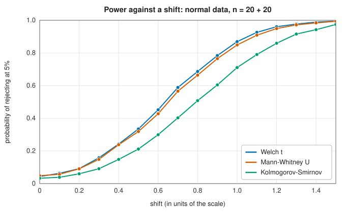
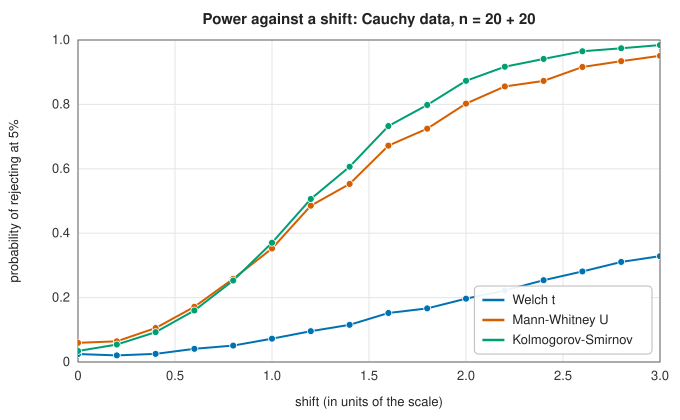

# Hypothesis tests

<div class="entry-summary">

| | |
|---|---|
| **Problem** | Decide whether data are consistent with a null hypothesis (equal means, a given distribution, independence) and quantify the evidence against it by a p-value |
| **Devised by** | Karl Pearson (1900), the $\chi^2$ test; "Student" (William Sealy Gosset, 1908), the $t$ test; R. A. Fisher (1920s), significance testing and the analysis of variance; Jerzy Neyman and Egon Pearson (1933), errors of two kinds and power; Andrey Kolmogorov (1933) and Nikolai Smirnov (1939), distribution tests; Frank Wilcoxon (1945), Henry Mann and Donald Whitney (1947), rank tests; Bernard Welch (1947), unequal variances |
| **Accuracy** | Statistics and p-values agree with SciPy to $10^{-14}$ for every test with an exact reference distribution; the Kolmogorov-Smirnov p-values are asymptotic approximations (table below) |
| **Cost** | $O(n)$ for the $t$ tests, $\chi^2$ and ANOVA; $O(n \log n)$ for the rank and Kolmogorov-Smirnov tests |
| **API** | [`hypothesis_tests`](../../api/lib_jsl_statistics/hypothesis_tests/index.html): `t_test_one_sample`, [`t_test_two_sample`](../../api/lib_jsl_statistics/hypothesis_tests/fn.t_test_two_sample.html), `t_test_paired`, `chi_square_goodness_of_fit`, `chi_square_independence`, `anova_one_way`, `ks_test_one_sample`, `ks_test_two_sample`, [`mann_whitney_u`](../../api/lib_jsl_statistics/hypothesis_tests/fn.mann_whitney_u.html), `kolmogorov_survival`, [`Alternative`](../../api/lib_jsl_statistics/hypothesis_tests/enum.Alternative.html), [`TestResult`](../../api/lib_jsl_statistics/hypothesis_tests/struct.TestResult.html) |

</div>

## Overview

A hypothesis test computes a **statistic** that measures departure from a **null hypothesis** $H_0$, and its **p-value**: the probability,
if $H_0$ were true, of a statistic at least as extreme as the one observed. A small p-value is evidence against $H_0$; rejecting when
$p < \alpha$ makes the probability of a false rejection (the **size**, or type I error rate) equal to $\alpha$, *provided the reference distribution
is right*. The probability of rejecting when $H_0$ is false is the **power**. Every test here returns a `TestResult` with the statistic, the
p-value and the degrees of freedom, and the location tests accept a two-sided or one-sided `Alternative`.

Tests fall into two families. **Parametric** tests ($t$, ANOVA) assume normal data and are the most powerful when that holds.
**Nonparametric** tests (rank tests, Kolmogorov-Smirnov) assume only continuity, and keep their size and power when tails are heavy.

## History

Karl Pearson's $\chi^2$ test of goodness of fit (1900) was the first modern significance test. William Sealy Gosset, a chemist at the
Guinness brewery in Dublin, published the $t$ distribution under the pseudonym "Student" (1908) to handle the small samples of
brewing experiments; R. A. Fisher proved it, extended it to two samples and regression, and invented the analysis of variance
(1918–1925) for agricultural field trials at Rothamsted. Jerzy Neyman and Egon Pearson (1933) recast testing as a decision between
hypotheses with errors of two kinds. Andrey Kolmogorov (1933) found the limiting distribution of the largest deviation of an
empirical distribution function, and Nikolai Smirnov (1939) extended it to two samples. Frank Wilcoxon (1945) proposed rank-sum
tests, and Henry Mann and Donald Whitney (1947) studied them. Bernard Welch (1947) and Franklin Satterthwaite (1946) solved
the practical side of the Behrens-Fisher problem of comparing means with unequal variances.

## The idea

### Student's and Welch's $t$ tests

Every test in this entry follows the same three steps. First, reduce the data to a single
number, the **statistic**, that is near zero (or near some known value) when the null hypothesis
is true and far from it otherwise. Second, work out the **reference distribution**: how the
statistic would vary from sample to sample if $H_0$ were true. Third, report the p-value, the
probability under that distribution of a value at least as extreme as the one observed. The
tests differ only in the statistic and its reference distribution.

**One sample.** The question is whether a sample of size $n$, with mean $\bar x$ and standard
deviation $s$, is consistent with a population mean $\mu_0$. The natural measure is the distance
of the sample mean from $\mu_0$. But a distance of 1 means little without knowing how much
$\bar x$ fluctuates by chance: its standard deviation is $\sigma/\sqrt n$, estimated by $s/\sqrt n$
(the **standard error**). The statistic is the distance in units of the standard error:

$$
t = \frac{\bar x - \mu_0}{s/\sqrt n} .
$$

If $\sigma$ were known exactly, this would have a standard normal distribution for normal data.
Because $s$ is only an estimate, $t$ varies a little more, especially for small $n$. Its exact
distribution, worked out by Gosset ("Student"), is **Student's $t$ distribution** with $n - 1$
**degrees of freedom**. It has heavier tails than the normal and approaches it as $n$ grows.

**Paired samples.** When each observation in one sample is matched with one in the other
(before and after a treatment, say), take the differences and apply the one-sample test to them
with $\mu_0 = 0$.

**Two independent samples.** To compare the means of two groups, the statistic is the
difference of the means divided by its standard error. There are two ways to estimate that
standard error.

- **Student's** test assumes that the two populations have the same variance and **pools** the
  two estimates of it: $s_p^2 = ((n_1 - 1)s_1^2 + (n_2 - 1)s_2^2)/(n_1 + n_2 - 2)$. The reference
  distribution is $t$ with $n_1 + n_2 - 2$ degrees of freedom.
- **Welch's** test makes no such assumption. The variance of a difference of independent means
  is the sum of their variances, so

$$
t = \frac{\bar x_1 - \bar x_2}{\sqrt{s_1^2/n_1 + s_2^2/n_2}} .
$$

  This statistic does not have an exact $t$ distribution, but it is well approximated by one
  with a non-integer number of degrees of freedom given by the Welch-Satterthwaite formula

$$
\nu = \frac{(s_1^2/n_1 + s_2^2/n_2)^2}{(s_1^2/n_1)^2/(n_1 - 1) + (s_2^2/n_2)^2/(n_2 - 1)}.
$$

Welch's test is the safer default: when the smaller sample has the larger variance, Student's test rejects a true null five
times as often as it should (table below), while Welch's loses almost nothing when the variances are equal.

### Chi-square tests for counts

When the data are counts of observations falling into categories, the null hypothesis specifies
the **expected** count $E_i$ in each of the $k$ categories, and the test asks whether the
**observed** counts $O_i$ differ from them by more than chance. **Pearson's statistic** adds up
the squared discrepancies, each scaled by its expected count:

$$
X^2 = \sum_{i=1}^k\frac{(O_i - E_i)^2}{E_i} .
$$

The scaling is what makes the terms comparable: a count with expectation $E_i$ fluctuates by
about $\sqrt{E_i}$, so each term is roughly the square of a standardised deviation. For large
counts those deviations are approximately normal, and a sum of squared normals has a
**chi-square** distribution. The counts must add up to the total, which removes one degree of
freedom.

- **Goodness of fit.** For a fully specified set of expected counts, $X^2$ is approximately
  $\chi^2$ with $k - 1$ degrees of freedom.
- **Independence.** For a table with $r$ rows and $c$ columns, the null hypothesis is that the
  row and column classifications are independent. Then the probability of a cell is the product
  of its row and column probabilities, and the expected counts are $E_{ij} = R_iC_j/N$, from the
  row totals $R_i$, the column totals $C_j$ and the grand total $N$. The statistic has
  $(r - 1)(c - 1)$ degrees of freedom.

Both rest on the normal approximation to counts, which needs expected counts of about 5 or more.

### One-way analysis of variance

To compare the means of $k$ groups at once, **analysis of variance** (ANOVA) asks whether the
group means differ from each other by more than the scatter inside the groups can explain. It
splits the total sum of squared deviations from the overall mean into two parts:

- $SS_B$, the spread **between** groups: how far the group means lie from the overall mean;
- $SS_W$, the spread **within** groups: how far the observations lie from their own group mean.

Dividing each by its degrees of freedom gives two estimates of the variance. The within-group
one, $SS_W/(N - k)$, always estimates the noise variance. The between-group one, $SS_B/(k - 1)$,
estimates the same quantity if the true means are equal, and something larger if they are not.
Their ratio

$$
F = \frac{SS_B/(k - 1)}{SS_W/(N - k)}
$$

is therefore near 1 under $H_0$ and large otherwise. For normal groups with equal variances and
equal means it has the **$F$ distribution** with $(k - 1, N - k)$ degrees of freedom. With two
groups, ANOVA is equivalent to Student's $t$ test, with $F = t^2$.

The library computes the upper tail $P(F > f) = I_{d_2/(d_2 + d_1 f)}(d_2/2, d_1/2)$ directly as an
[incomplete beta function](../special_functions/incomplete.md#the-incomplete-beta-function); it
used to form $1 - \text{CDF}$, which lost every digit of p-values below $10^{-16}$.

### Kolmogorov-Smirnov tests

The tests so far compare means or counts. The Kolmogorov-Smirnov tests compare whole
distributions. The **empirical distribution function** $F_n(x)$ of a sample is the fraction of
the observations that are at most $x$: a staircase that rises by $1/n$ at each observation.

**One sample.** To test whether the sample comes from a specified continuous distribution $F$,
the statistic is the largest vertical gap between the staircase and the curve,

$$
D = \sup_x|F_n(x) - F(x)| .
$$

A remarkable property makes this practical: under $H_0$ the distribution of $D$ is the same
whatever $F$ is, so one table serves every hypothesis. As $n$ grows, $\sqrt nD$ converges to the
**Kolmogorov distribution**, whose upper tail is
$Q(\lambda) = 2\sum_{k\ge1}(-1)^{k-1}e^{-2k^2\lambda^2}$. For finite samples the library uses
Stephens' correction $Q((\sqrt n + 0.12 + 0.11/\sqrt n)D)$, which is within a fraction of a per
cent of the exact p-value (table below).

**Two samples.** The same statistic applied to two empirical distribution functions tests
whether two samples come from the same distribution, with the effective size $nm/(n + m)$ in
place of $n$. The same correction is less accurate there, and for samples of 15 and 25 the
p-value is 7% below the exact one.

These tests detect any difference in distribution, in shape or spread as well as in location.
The price of that generality is lower power against a pure shift than a test designed for
shifts.

### The Mann-Whitney $U$ test

The Mann-Whitney test is the rank-based counterpart of the two-sample $t$ test. It asks whether
values from one sample tend to be larger than values from the other, using only their order.

Consider every pair consisting of one value from each sample, $n_1n_2$ pairs in all, and let $U$
be the number of pairs in which the first sample's value is the larger. If the two samples come
from the same distribution, each pair is equally likely to go either way, and $U$ should be near
$n_1n_2/2$. In practice $U$ is computed without examining every pair: rank the combined samples,
add up the ranks of the first sample to get $R_1$, and then $U = R_1 - n_1(n_1 + 1)/2$.

Under $H_0$ (identical continuous distributions) $U$ has mean $n_1n_2/2$ and variance
$\frac{n_1n_2}{12}\big((n + 1) - \frac{\sum(t^3 - t)}{n(n - 1)}\big)$, where $n = n_1 + n_2$ and the
sum is a correction for groups of $t$ tied values. For samples that are not very small $U$ is
approximately normal, and the library uses that approximation with a continuity correction, as
SciPy's `method="asymptotic"` does.

Because it uses ranks, the test is unaffected by outliers and by the shape of the distribution.
It gives up very little when the data really are normal: against normal shifts its asymptotic
efficiency relative to the $t$ test is $3/\pi \approx 0.955$, meaning that it needs only about 5%
more data for the same power. For heavy-tailed data it can be far more powerful.

### Checking against SciPy

The cases below were computed with `scipy.stats` (version 1.17.1) by `book/generator/data/make_stats_refs.py`, and recomputed
with the library. The statistics agree to at least nine digits (the generator asserts it), and every p-value with an exact
reference distribution agrees to rounding:

<p class="caption" id="tab-10-3"><strong>Table 10.3.</strong> Columns: case, statistic (SciPy), p-value, SciPy p-value, and more.</p>

{{#include ../generated/statistics/scipy_tests.md}}

### Size: do the tests reject a true null 5% of the time?

<p class="caption" id="tab-10-4"><strong>Table 10.4.</strong> Columns: test, data (null hypothesis true), rejection rate at 5%.</p>

{{#include ../generated/statistics/size.md}}

The tests hold their size when their assumptions hold. Three departures stand out. The $t$ test on skewed (exponential) data of
size 10 rejects twice as often as it should; the central limit theorem repairs this by $n = 100$. Student's pooled test with unequal
variances and unequal sizes rejects a quarter of true nulls. And the discrete tests are somewhat conservative at small sizes.

### Power

| | |
|:---:|:---:|
|  |  |

For normal data Welch's $t$ test is the most powerful, with Mann-Whitney a close second. For Cauchy data, whose variance is infinite,
the $t$ test barely gains power with the shift, while the rank and Kolmogorov-Smirnov tests detect it easily.

## Algorithm

Every test has the same three steps, and they differ only in the first two.

1. **Compute the statistic** from the data.
2. **Identify the reference distribution** and its parameters (degrees of freedom).
3. **Evaluate the tail probability** with the
   [distribution functions](../special_functions/statistical.md). For a two-sided test on a
   symmetric distribution, the p-value is twice the lower tail at $-|t|$; the tail is always
   computed directly, never as one minus a CDF.

The first two steps for each test:

| Test | Statistic from | Reference distribution |
|---|---|---|
| One-sample and paired $t$ | mean and standard deviation (of the differences, if paired) | $t$ with $n - 1$ degrees of freedom |
| Student's two-sample $t$ | two means and the pooled variance | $t$ with $n_1 + n_2 - 2$ |
| Welch's $t$ | two means and two variances | $t$ with the Welch-Satterthwaite $\nu$ |
| Chi-square goodness of fit | observed and expected counts | $\chi^2$ with $k - 1$ |
| Chi-square independence | table, with expected counts from its margins | $\chi^2$ with $(r - 1)(c - 1)$ |
| One-way ANOVA | group means and sums of squares | $F$ with $(k - 1, N - k)$ |
| Kolmogorov-Smirnov | sorted sample; largest gap to $F$, checked just before and just after each data point | Kolmogorov, with Stephens' correction |
| Mann-Whitney | ranks of the pooled samples, with average ranks for ties | normal, with tie and continuity corrections |

For the Kolmogorov-Smirnov statistic the empirical distribution function is a staircase, so
its largest distance from a continuous $F$ occurs at a data point, on one side or the other of
the jump: with the data sorted, $D = \max_i\max\big(i/n - F(x_{(i)}),\ F(x_{(i)}) - (i - 1)/n\big)$.

## Implementation

```rust,ignore
{{#include ../../../crates/statistics/src/hypothesis_tests.rs:t_two_sample}}
```

```rust,ignore
{{#include ../../../crates/statistics/src/hypothesis_tests.rs:mann_whitney}}
```

- `anova_one_way` returns the `TestResult` (with the between-groups degrees of freedom) and the within-groups degrees of freedom.
- `chi_square_independence` applies no continuity correction, as `scipy.stats.chi2_contingency(correction=False)`.

## In practice

```rust,ignore
{{#include ../../../crates/statistics/examples/statistics_tests.rs}}
```

```text
Welch t = 0.266 on 10.0 df, p = 0.7954
Student t = 0.290 on 20 df, p = 0.7751
Mann-Whitney U = 97, p = 0.0161
Kolmogorov-Smirnov D = 0.600, p = 0.0220
chi-square = 5.263 on 1 df, p = 0.0218
```

One patient in the second group took 30 days to recover; that value inflates the variance and the $t$ tests see nothing, while
the rank tests find the shorter recovery times of the other nine.

**Strengths**

- The classical tests, with p-values matching SciPy; one-sided alternatives for the location tests.
- Rank and distribution tests for data that are not normal.

**Weaknesses**

- p-values of the rank and Kolmogorov-Smirnov tests are asymptotic; exact small-sample distributions are not implemented.
- No multiple-comparison corrections, post-hoc tests, or tests of normality beyond Kolmogorov-Smirnov.
- A p-value is not the probability that $H_0$ is true, and a non-significant result is not evidence of no effect; report effect sizes and
  confidence intervals as well.

## Exercises

1. Show that the paired $t$ test is more powerful than the two-sample test when the pairs are positively correlated.
2. Verify the Welch-Satterthwaite formula by matching the first two moments of $s_1^2/n_1 + s_2^2/n_2$ to a scaled $\chi^2$.
3. Prove that the null distribution of the Kolmogorov-Smirnov statistic does not depend on the continuous $F$.
4. Simulate the size of the $\chi^2$ goodness-of-fit test with 10 categories and expected counts of 1, 2 and 5.
5. Run 20 independent tests on null data and estimate the probability that at least one has $p < 0.05$. How does the Bonferroni correction help?

<details>
<summary>Hints and answers</summary>

1. The difference of pairs has variance $2\sigma^2(1 - \rho)$ against $2\sigma^2$ for independent samples, so the standard error is smaller by $\sqrt{1 - \rho}$ when $\rho > 0$ and the test is more powerful (although it has fewer degrees of freedom).
2. Match $\mathbb E[V] $ and $\operatorname{Var}V$ of $V = a + b$ with $a = s_1^2/n_1$, $b = s_2^2/n_2$ to those of $c\chi^2_\nu/\nu$; solving gives $\nu = (a + b)^2/\big(a^2/(n_1 - 1) + b^2/(n_2 - 1)\big)$.
3. $U = F(X)$ is uniform for continuous $F$, and $\sup|F_n(x) - F(x)|$ equals $\sup|G_n(u) - u|$ for the empirical distribution $G_n$ of the $U_i$, which does not involve $F$.
4. With expected counts of 1 or 2 the chi-square approximation to the statistic is poor, so the actual size differs from the nominal 5% (it is typically conservative or irregular); simulate with many replicates for each case.
5. The probability is $1 - 0.95^{20} \approx 0.64$. With Bonferroni each test uses $0.05/20 = 0.0025$, making the probability at least one false positive about $0.049$.

</details>

## Further reading

- E. L. Lehmann and J. P. Romano, *Testing Statistical Hypotheses*, 4th ed., Springer, 2022.
- M. A. Stephens, "EDF statistics for goodness of fit and some comparisons", *Journal of the American Statistical Association* 69 (1974) 730–737.
- B. L. Welch, "The generalization of 'Student's' problem when several different population variances are involved", *Biometrika* 34
  (1947) 28–35.
- R. L. Wasserstein and N. A. Lazar, "The ASA statement on p-values: context, process, and purpose", *The American Statistician* 70
  (2016) 129–133.
