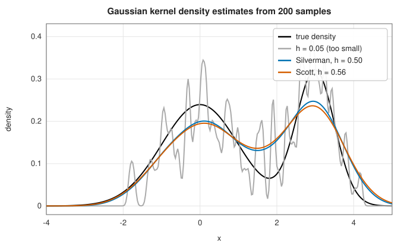

# Kernel density estimation

<div class="entry-summary">

| | |
|---|---|
| **Problem** | Estimate a smooth probability density from a sample, without assuming a parametric family |
| **Devised by** | Murray Rosenblatt (1956) and Emanuel Parzen (1962); David Scott (1979) and Bernard Silverman (1986), bandwidth rules of thumb; Simon Sheather and Chris Jones (1991), plug-in bandwidths |
| **Accuracy** | Mean integrated squared error $O(n^{-4/5})$ with a well-chosen bandwidth; matches `scipy.stats.gaussian_kde` to rounding |
| **Cost** | $O(n)$ per evaluation point |
| **Read first** | [Descriptive statistics](descriptive.md), [Background: bias and variance](../machine_learning/index.md#background-bias-variance-and-generalisation) |
| **API** | [`GaussianKde`](../../api/lib_jsl_statistics/kernel_density/struct.GaussianKde.html) (`new`, `pdf`, `cdf`, `resample`, `bandwidth`), [`Bandwidth`](../../api/lib_jsl_statistics/kernel_density/enum.Bandwidth.html) (`Scott`, `Silverman`, `Fixed`) |

</div>

## Overview

A histogram estimates a density, but depends on the arbitrary placement of its bins and is discontinuous. A **kernel density
estimate** places a small smooth bump, the **kernel**, at each observation and adds them up:

$$
\hat f(x) = \frac{1}{nh}\sum_{i=1}^nK\Big(\frac{x - x_i}{h}\Big).
$$

With the Gaussian kernel $K = \varphi$ the estimate is a mixture of $n$ normal densities of standard deviation $h$ centred at the data. The
kernel shape matters little; the **bandwidth** $h$ matters a great deal.

## History

Murray Rosenblatt (1956) and Emanuel Parzen (1962) introduced kernel estimators and proved their consistency, and the method is
sometimes called the Parzen-Rosenblatt window. David Scott (1979) derived normal-reference rules for histogram bin widths and
kernel bandwidths; Bernard Silverman's monograph *Density Estimation for Statistics and Data Analysis* (1986) made the method
standard and gave the robust rule of thumb that bears his name. Simon Sheather and Chris Jones (1991) developed plug-in
bandwidths that estimate the curvature of the density from the data.

## The idea

### Bias, variance and the bandwidth

This is the [bias-variance trade-off](../machine_learning/index.md#background-bias-variance-and-generalisation) in a density estimate.

The estimate places a small bump, the kernel, of width $h$ on each observation and adds the
bumps up. Everything depends on the **bandwidth** $h$, and the two ways of getting it wrong have
names.

- If $h$ is too small, each bump is narrow and the estimate is a row of spikes. It follows the
  particular sample closely and would look quite different for another sample. This is
  **variance**.
- If $h$ is too large, the bumps are so wide that real features, peaks and valleys, are smeared
  out. The estimate would be much the same for any sample, but systematically wrong. This is
  **bias**.

Both can be quantified. For a twice-differentiable density $f$ and the Gaussian kernel, at a
point $x$:

$$
\text{bias} \approx \tfrac12h^2f''(x), \qquad \text{variance} \approx \frac{f(x)}{2\sqrt\pi\,nh} .
$$

The bias formula says that smoothing lowers peaks (where $f'' < 0$) and fills valleys (where
$f'' > 0$), more so the sharper they are. The variance formula says that the noise falls as
$nh$, roughly the number of observations inside one kernel width, grows.

The total error at a point is the squared bias plus the variance. Integrating over $x$ (the
variance term integrates to $1/(2\sqrt\pi nh)$ because $\int f = 1$) gives the asymptotic mean
integrated squared error

$$
\text{AMISE}(h) = \frac{h^4}{4}\int f''^2 + \frac{1}{2\sqrt\pi\,nh} .
$$

The first term grows with $h$ and the second falls, so there is a best bandwidth, found by
setting the derivative to zero:

$$
h^3\int f''^2 - \frac{1}{2\sqrt\pi\,nh^2} = 0
\quad\Longrightarrow\quad
h^* = \Big(2\sqrt\pi\,n\int f''^2\Big)^{-1/5} \propto n^{-1/5} .
$$

This is the same kind of balance as the choice of step in
[numerical differentiation](../derivatives/finite-differences.md#rounding-error-and-the-optimal-step).
Two consequences follow. The best bandwidth shrinks only slowly as the sample grows, like
$n^{-1/5}$. And substituting $h^*$ back gives an error of order $n^{-4/5}$, which is slower than
the $n^{-1}$ of a parametric fit: that is the price of assuming nothing about the shape of the
density.

### Rules of thumb

The formula for $h^*$ cannot be used directly, because it contains $\int f''^2$, a property of
the unknown density being estimated. **Normal-reference** rules break the circle by pretending,
for this one purpose, that the density is normal with the sample's standard deviation $\sigma$.
For a normal density the integral can be done exactly, and the formula gives
$h = 1.06\,\sigma n^{-1/5}$. The library offers:

- **Scott**: $h = \sigma n^{-1/5}$, the factor used by `scipy.stats.gaussian_kde` (slightly smaller than 1.06).
- **Silverman**: $h = 0.9\min(\sigma, \operatorname{IQR}/1.34)\,n^{-1/5}$, which shrinks the bandwidth for heavy tails and resists outliers.
- **Fixed**: any given $h$.

The assumption has a cost. A density with two or more peaks has much more curvature than a
normal density of the same overall spread, so its $\int f''^2$ is larger and its best bandwidth
smaller. Both rules are tuned to unimodal, normal-like data and **oversmooth** multimodal
densities:



<p class="caption" id="fig-10-3"><strong>Figure 10.3.</strong> Kernel density estimates.</p>

{{#include ../generated/statistics/kde_error.md}}

For normal data Scott's rule is within 20% of the best fixed bandwidth's error at $n = 50$ and within a few per cent at larger sizes. For the bimodal mixture both rules
choose bandwidths about twice too large, and by $n = 5000$ their error is three to four times the best achievable; Silverman's rule
helps a little. Plug-in and cross-validation bandwidths address this.

### The distribution function and resampling

Integrating the kernels gives the estimated CDF $\hat F(x) = \frac1n\sum\Phi((x - x_i)/h)$. Sampling from $\hat f$ is easy: pick an observation at random and
add $N(0, h^2)$ noise, the **smoothed bootstrap**. The samples have variance $\hat\sigma^2 + h^2$, slightly inflated.

## Algorithm

**Set-up.** Compute the bandwidth $h$ from the chosen rule: the standard deviation of the data
for Scott's rule; the standard deviation and the interquartile range for Silverman's; or the
value given.

**`pdf(x)`**: add up the kernel $e^{-((x - x_i)/h)^2/2}$ over all the data points and divide by
$nh\sqrt{2\pi}$.

**`cdf(x)`**: average the normal distribution function $\Phi\big((x - x_i)/h\big)$ over the data
points.

**`resample`**: choose one of the data points uniformly at random and add a normal deviate with
standard deviation $h$.

Each evaluation of the density or the distribution function visits every data point, $O(n)$.
Evaluating on a grid of $m$ points therefore costs $O(nm)$; for very large samples, binning the
data and convolving with the kernel by FFT reduces this to about $O(n + m\log m)$, which the
library does not do.

## Implementation

```rust,ignore
{{#include ../../../crates/statistics/src/kernel_density.rs:kde_new}}
```

- Each evaluation costs $O(n)$; for many points on a grid, binning the data and convolving with an FFT reduces the cost to $O(n + m\log m)$.
- A constant sample has zero bandwidth under the rules and gives an error.

## In practice

```rust,ignore
{{#include ../../../crates/statistics/examples/statistics_kde.rs}}
```

```text
Scott (h = 4.31): 0.003 0.008 0.014 0.017 0.013 0.009 0.014 0.031 0.040 0.031 0.014 0.004
Silverman (h = 3.88): 0.003 0.008 0.014 0.018 0.013 0.008 0.014 0.031 0.042 0.031 0.013 0.003
Fixed(2.0) (h = 2.00): 0.002 0.008 0.014 0.022 0.012 0.005 0.009 0.033 0.048 0.033 0.010 0.002
P(gap < 65) = 0.308
five simulated gaps: [79.5, 83.1, 46.8, 86.1, 73.5]
```

The rules blur the valley between the two modes at 55 and 80 minutes; a smaller fixed bandwidth shows it more clearly.

**Strengths**

- No assumption about the shape of the density; a smooth estimate with a CDF and a sampler.
- Bandwidth rules match SciPy.

**Weaknesses**

- One dimension only, and one kernel.
- Rules of thumb oversmooth multimodal densities; no plug-in or cross-validated bandwidth.
- Bias at boundaries: for data on $[0, \infty)$ the estimate leaks mass below zero.

## Exercises

1. Show that $\hat f$ integrates to 1 and is non-negative for any non-negative kernel.
2. Derive the bias $\tfrac12h^2f''(x)$ and variance $f(x)\int K^2/(nh)$ to leading order.
3. Minimise the AMISE to find $h^*$, and evaluate it for a normal density to obtain the constant 1.06.
4. Implement least-squares cross-validation for $h$ and compare it with the rules on the bimodal mixture.
5. Estimate the density of an exponential sample and correct the boundary bias by reflecting the data about 0.

<details>
<summary>Hints and answers</summary>

1. $\int\tfrac1{nh}\sum K\big(\tfrac{x - x_i}{h}\big)dx = \tfrac1n\sum\int K(u)\,du = 1$ by substituting $u = (x - x_i)/h$; non-negativity follows from $K \ge 0$.
2. $\mathbb E\hat f(x) = \int K(u)f(x - hu)\,du = f + \tfrac12h^2\mu_2f'' + \ldots$ for $\mu_2 = \int u^2K$ (the entry takes $\mu_2 = 1$). The variance is $\tfrac1{nh}\int K^2\cdot f(x) + o(1/(nh))$.
3. $\mathrm{AMISE} = \tfrac14h^4\mu_2^2R(f'') + R(K)/(nh)$ with $R(g) = \int g^2$. Setting its derivative to zero gives $h^* = \big(R(K)/(\mu_2^2R(f'')n)\big)^{1/5}$; for a normal density and Gaussian kernel this is $(4/3)^{1/5}\sigma n^{-1/5} \approx 1.06\,\sigma n^{-1/5}$.
4. Minimise $\int\hat f_h^2 - \tfrac2n\sum\hat f_{h,-i}(x_i)$ over $h$ (leaving each point out when evaluating); on the bimodal mixture it typically selects a smaller bandwidth than the normal-reference rules, which oversmooth bimodal data.
5. For an exponential sample, the estimate leaks mass to $x < 0$ and underestimates the density near 0. Reflecting means adding the estimate of the reflected data $-x_i$ to the estimate on $x \ge 0$, which cancels the boundary bias.

</details>

## Further reading

- B. W. Silverman, *Density Estimation for Statistics and Data Analysis*, Chapman and Hall, 1986.
- D. W. Scott, *Multivariate Density Estimation*, 2nd ed., Wiley, 2015.
- M. P. Wand and M. C. Jones, *Kernel Smoothing*, Chapman and Hall, 1995.
- S. J. Sheather and M. C. Jones, "A reliable data-based bandwidth selection method for kernel density estimation", *Journal of the Royal
  Statistical Society B* 53 (1991) 683–690.
