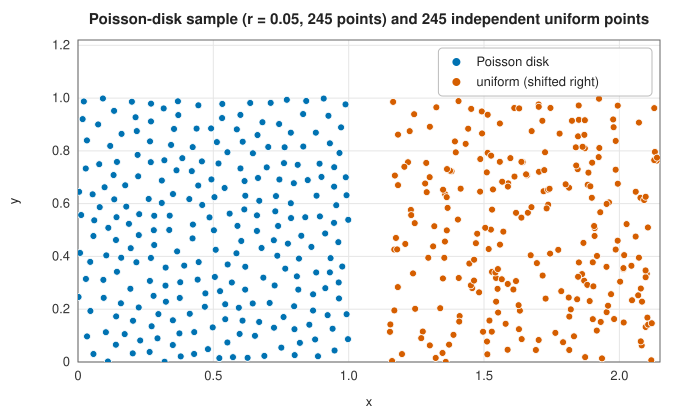
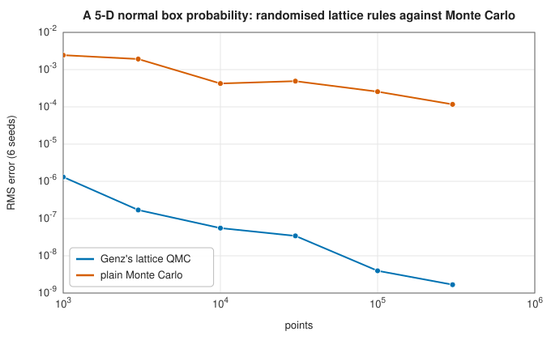

# Multivariate distribution functions and quasi-Monte Carlo sampling

<div class="entry-summary">

| | |
|---|---|
| **Problem** | Compute probabilities of boxes under multivariate normal and t distributions; handle normal distributions with singular covariance matrices; compare several treatments with one control (Dunnett's test); and draw low-discrepancy normal samples and evenly spread random points |
| **Devised by** | Zvi Drezner and George Wesolowsky (1990), bivariate normal probabilities; Alan Genz (1992) and Frank Bretz (2002), the multivariate normal and t integrals; Dirk Nuyens and Ronald Cools (2006), fast lattice construction; Charles Dunnett (1955); Robert Bridson (2007), Poisson-disk sampling |
| **Accuracy** | Bivariate normal exact to $10^{-16}$; higher dimensions to the requested error ($10^{-5}$ by default, typically $10^{-7}$); t probabilities to about $10^{-4}$ with SciPy's default of $1000d$ points |
| **Cost** | Normal: up to $10^6 d$ integrand evaluations of $O(d^2)$ each; t: $1000d$; Poisson disk: $O(n)$ with a background grid |
| **Read first** | [Multivariate distributions and further tests](multivariate-tests.md), [Quasi-random sequences](../random/quasi-random.md) |
| **API** | [`MultivariateNormal::cdf_between`](../../api/lib_jsl_statistics/multivariate/struct.MultivariateNormal.html), [`MultivariateNormal::new_allow_singular`](../../api/lib_jsl_statistics/multivariate/struct.MultivariateNormal.html), [`MultivariateT::cdf_between`](../../api/lib_jsl_statistics/multivariate/struct.MultivariateT.html), [`MvCdfOptions`](../../api/lib_jsl_statistics/mvn_cdf/struct.MvCdfOptions.html), [`bivariate_normal_upper`](../../api/lib_jsl_statistics/mvn_cdf/fn.bivariate_normal_upper.html), [`dunnett`](../../api/lib_jsl_statistics/mvn_cdf/fn.dunnett.html); [`MultivariateNormalQmc`](../../api/lib_jsl_statistics/qmc_normal/struct.MultivariateNormalQmc.html); [`PoissonDisk`](../../api/lib_jsl_random/qmc/struct.PoissonDisk.html) |

</div>

## Overview

The multivariate normal distribution has no closed-form distribution function beyond two dimensions, yet its box probabilities $P(a < X \le b)$ are needed throughout statistics:
- multiple-comparison procedures;
- probit models with correlated choices;
- reliability with correlated failure modes;
- the multivariate t distribution behind simultaneous confidence intervals.

SciPy computes them with Alan Genz's quasi-Monte Carlo method, and so does the library.

This entry adds:

- **Distribution functions** of the multivariate normal (exact in one and two dimensions) and t distributions.
- **Singular covariances** for the normal distribution (SciPy's `allow_singular=True`), whose density lives on a lower-dimensional subspace.
- **Dunnett's test**, which compares each of several treatment groups with a control while holding the family-wise error rate.
- **`MultivariateNormalQmc`**, low-discrepancy normal samples from a Sobol sequence.
- **`PoissonDisk`**, random points no two of which are closer than a given radius: blue-noise sampling for graphics and space-filling designs.

## History

Zvi Drezner and George Wesolowsky (1990) gave the Gauss-Legendre evaluation of Plackett's integral for bivariate normal probabilities that Genz refined into `bvnu`. Alan Genz (1992) transformed the multivariate normal integral into an integral over the unit cube that is smooth enough for quasi-Monte Carlo rules. With Frank Bretz (2002) he extended it to the t distribution. The randomised rank-1 lattice rules with Nuyens and Cools's (2006) fast component-by-component construction are what SciPy's `_qmvnt` uses. Charles Dunnett (1955) introduced the many-to-one comparisons, and Robert Bridson (2007) the linear-time Poisson-disk algorithm.

## The idea

### Genz's transformation

Write $\Sigma = LL^\top$ with $L$ lower triangular, so $X = LZ$ with $Z$ standard normal. The constraint $a_i < X_i \le b_i$ becomes
$$\frac{a_i - \sum_{j<i} L_{ij}Z_j}{L_{ii}} < Z_i \le \frac{b_i - \sum_{j<i} L_{ij}Z_j}{L_{ii}}.$$
The limits of each variable depend only on the earlier ones. Substituting $Z_i = \Phi^{-1}(e_i + w_i(d_i - e_i))$, where $(e_i, d_i)$ are the limits mapped through $\Phi$, turns the probability into
$$P = (d_1 - e_1)\int_{[0,1]^{d-1}} \prod_{i=2}^{d}\big(d_i(w) - e_i(w)\big)\,dw.$$
The integrand is smooth and bounded by 1. The first variable is integrated exactly, which removes one dimension. Reordering the variables so that the most constrained come first reduces its variance further.

### Lattice rules

A rank-1 lattice rule averages the integrand over the points $\{kz/N\}$, $k = 1,\dots,N$, for a prime $N$ and a generating vector $z$. The vector is chosen component by component to minimise a worst-case error, with fast Fourier transforms. Ten random shifts of the lattice give independent estimates, and their spread gives the error estimate.

The "tent" transform $w \mapsto |2w - 1|$ makes the integrand periodic, which lattice rules need for their fast convergence. For smooth integrands the error falls almost like $1/N$, against $1/\sqrt N$ for Monte Carlo.

### The t distribution

$X = Z/\sqrt{W/\nu}$ with $W \sim \chi^2_\nu$. The t probability is therefore the normal one with limits scaled by $\sqrt{W/\nu}$, averaged over $W$. That adds one dimension, the χ variable, through the inverse χ² distribution function.

### Singular covariances

If $\Sigma$ has rank $r < d$, $X$ lies in $\mu + \operatorname{range}(\Sigma)$. With the eigendecomposition $\Sigma = U\Lambda U^\top$ restricted to the eigenvalues above $10^6\varepsilon\max|\lambda|$, the density on that affine subspace is the $r$-dimensional normal density. It uses the pseudo-inverse and the pseudo-determinant $\prod_{\lambda > 0}\lambda$, and is zero off the subspace.

### Dunnett's test

With group means $\bar x_i$, control mean $\bar x_0$ and pooled standard deviation $s$ on $N - k - 1$ degrees of freedom, the statistics $t_i = (\bar x_i - \bar x_0)/(s\sqrt{1/n_i + 1/n_0})$ are jointly multivariate t. They share $\bar x_0$, so they are correlated with $\rho_{ij} = 1/\sqrt{(1 + n_0/n_i)(1 + n_0/n_j)}$. The adjusted p-value of comparison $i$ is $P(\max_j|T_j| \ge |t_i|)$, one minus a multivariate t box probability.

### Quasi-Monte Carlo normal samples

`MultivariateNormalQmc` maps the points of a Sobol sequence to normal samples. The default is the inverse transform: each coordinate goes through $\Phi^{-1}$. The alternative is the Box-Muller transform, which uses pairs of coordinates and needs one extra Sobol dimension when $d$ is odd. Either way the result is multiplied by a factor $A$ with $AA^\top = \Sigma$ and shifted by the mean. The factor is a Cholesky factor, or an eigenvalue factor when $\Sigma$ is singular. Averages over the samples inherit the faster convergence of the Sobol points.

### Poisson-disk sampling

Bridson's algorithm keeps a background grid with cells of side $r/\sqrt d$, each of which can hold at most one point. Starting from a random point, it repeatedly takes an active point and draws 30 candidates around it. A candidate is kept if no point within $r$ already exists, which only the neighbouring cells need checking for. A point with no successful candidate is retired, and the process ends when none remain active, with the box filled.

## Implementation

```rust,ignore
{{#include ../../../crates/statistics/src/mvn_cdf.rs:mvn_cdf}}
```

```rust,ignore
{{#include ../../../crates/statistics/src/mvn_cdf.rs:bvnu}}
```

```rust,ignore
{{#include ../../../crates/statistics/src/mvn_cdf.rs:dunnett}}
```

```rust,ignore
{{#include ../../../crates/statistics/src/multivariate.rs:allow_singular}}
```

```rust,ignore
{{#include ../../../crates/statistics/src/qmc_normal.rs:mvn_qmc}}
```

```rust,ignore
{{#include ../../../crates/random/src/qmc.rs:poisson_disk}}
```

- The quasi-Monte Carlo functions take a random generator for the lattice shifts, so results are reproducible for a seed but are not SciPy's numbers for the same seed. They differ from SciPy's by about the error estimate.
- The normal distribution function repeats the estimate with $\sqrt2$ times more points until the error estimate is below `abseps` (SciPy's `_qauto`). The t distribution function makes a single estimate of $1000d$ points, as SciPy does.
- Dunnett's simultaneous confidence intervals are not implemented.
- `MultivariateNormalQmc` takes any `SobolSequence`. With an unscrambled one it reproduces SciPy's samples exactly.

## In practice

The references are from SciPy 1.17.1, written by `book/generator/data/make_mv214_refs.py`. For the quasi-Monte Carlo results, the reference is SciPy run with many more points ($4\times10^7 d$ for the normal, four runs of $2\times10^6 d$ for the t), and both the library's and SciPy's default runs are compared with it:

<p class="caption" id="tab-10-14"><strong>Table 10.14.</strong> Multivariate normal and t box probabilities: the library's estimate, and the errors of the library's and SciPy's default runs against a high-accuracy reference.</p>

{{#include ../generated/statistics/mv214_cdf.md}}

Both reach the accuracy their error estimates promise. Neither is systematically better: the differences come from the random shifts.

<p class="caption" id="tab-10-15"><strong>Table 10.15.</strong> Singular normal densities, Dunnett's test, quasi-Monte Carlo normal samples and Poisson-disk sampling against SciPy.</p>

{{#include ../generated/statistics/mv214_other.md}}

Dunnett's statistics are identical. The p-values differ by at most $7\times10^{-5}$, within the error of the multivariate t integration SciPy and the library both use.



<p class="caption" id="fig-10-6"><strong>Figure 10.6.</strong> A Poisson-disk sample with radius 0.05 filling the unit square (left), and the same number of independent uniform points (right). The independent points clump and leave gaps; the Poisson-disk points are evenly spread but not regular.</p>



<p class="caption" id="fig-10-7"><strong>Figure 10.7.</strong> The error of a 5-D normal box probability ($P \approx 0.0052$) against the number of points. Genz's transformation alone reduces the variance enormously, and the lattice rules converge faster than $1/\sqrt N$. At 1000 points the method is already about a hundred times more accurate than Monte Carlo with $3\times10^5$ points.</p>

**Strengths**

- Exact bivariate probabilities, and error-controlled ones in higher dimensions.
- Normal distributions with singular covariances, for degenerate models and constraints.
- Dunnett's test with exact statistics and multivariate-t p-values.

**Weaknesses**

- The results depend on random lattice shifts, so they agree with SciPy only to their error estimates.
- The cost grows with dimension: beyond 20 or so dimensions, many more points are needed.
- No Dunnett confidence intervals, and no Poisson-disk `optimization` (SciPy's `random-cd` and `lloyd`).

## Exercises

1. Show that $P(X > 0, Y > 0) = \tfrac14 + \arcsin(\rho)/(2\pi)$ for a standard bivariate normal with correlation $\rho$.
2. Why does integrating the first variable exactly reduce the dimension of the Genz integral to $d - 1$?
3. Show that the correlation of the Dunnett statistics $t_i$ and $t_j$ is $1/\sqrt{(1 + n_0/n_i)(1 + n_0/n_j)}$.
4. Why must the background grid's cells have side at most $r/\sqrt d$?

<details>
<summary>Hints and answers</summary>

1. Write $Y = \rho X + \sqrt{1-\rho^2}Z$. The region is a wedge in the $(X, Z)$ plane of angle $\pi/2 + \arcsin\rho$, and the standard normal is rotationally symmetric.
2. Its limits do not depend on any other variable, so its contribution is the constant factor $d_1 - e_1$.
3. $\operatorname{Cov}(\bar x_i - \bar x_0, \bar x_j - \bar x_0) = \sigma^2/n_0$, and the variances are $\sigma^2(1/n_i + 1/n_0)$.
4. The cell diagonal is then at most $r$, so no two points with distance at least $r$ can share a cell.

</details>

## Further reading

- A. Genz, "Numerical computation of multivariate normal probabilities", *Journal of Computational and Graphical Statistics* 1 (1992) 141–149.
- A. Genz and F. Bretz, "Comparison of methods for the computation of multivariate t probabilities", *Journal of Computational and Graphical Statistics* 11 (2002) 950–971.
- Z. Drezner and G. O. Wesolowsky, "On the computation of the bivariate normal integral", *Journal of Statistical Computation and Simulation* 35 (1990) 101–107.
- D. Nuyens and R. Cools, "Fast algorithms for component-by-component construction of rank-1 lattice rules in shift-invariant reproducing kernel Hilbert spaces", *Mathematics of Computation* 75 (2006) 903–920.
- C. W. Dunnett, "A multiple comparison procedure for comparing several treatments with a control", *Journal of the American Statistical Association* 50 (1955) 1096–1121.
- R. Bridson, "Fast Poisson disk sampling in arbitrary dimensions", *SIGGRAPH Sketches* (2007).
