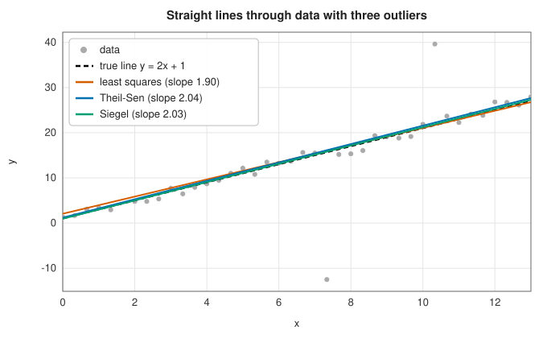

# More descriptive statistics and robust regression

<div class="entry-summary">

| | |
|---|---|
| **Problem** | Fit a straight line by least squares with standard errors, or robustly when some points are outliers; summarise data by trimmed means, standard scores and the mode; average angles; find the Box-Cox power that makes data normal; measure distances between observations |
| **Devised by** | Adrien-Marie Legendre (1805) and Carl Friedrich Gauss (1809), least squares; Henri Theil (1950) and Pranab Kumar Sen (1968), the median of pairwise slopes; Andrew Siegel (1982), repeated medians; John Tukey (1960s), trimmed means; Ronald Fisher (1953) and Kanti Mardia (1972), directional statistics; George Box and David Cox (1964), the power transform; Prasanta Chandra Mahalanobis (1936) and Paul Jaccard (1901), distances |
| **Accuracy** | Agrees with SciPy to $10^{-14}$ or better; the Box-Cox $\lambda$ reaches a higher likelihood than SciPy's |
| **Cost** | `linregress`: $O(n)$. `theilslopes` and `siegelslopes`: $O(n^2\log n)$. `pdist`: $O(m^2d)$ for $m$ points in $d$ dimensions |
| **Read first** | [Descriptive statistics](descriptive.md), [Correlation and covariance](correlation.md) |
| **API** | [`linregress`](../../api/lib_jsl_statistics/regression/fn.linregress.html), [`theilslopes`](../../api/lib_jsl_statistics/regression/fn.theilslopes.html), [`siegelslopes`](../../api/lib_jsl_statistics/regression/fn.siegelslopes.html), [`trim_mean`](../../api/lib_jsl_statistics/location_scale/fn.trim_mean.html), [`zscore`](../../api/lib_jsl_statistics/location_scale/fn.zscore.html), [`mode`](../../api/lib_jsl_statistics/location_scale/fn.mode.html), [`circmean`](../../api/lib_jsl_statistics/location_scale/fn.circmean.html), [`circvar`](../../api/lib_jsl_statistics/location_scale/fn.circvar.html), [`circstd`](../../api/lib_jsl_statistics/location_scale/fn.circstd.html), [`boxcox`](../../api/lib_jsl_statistics/location_scale/fn.boxcox.html), [`pdist`](../../api/lib_jsl_statistics/distance/fn.pdist.html), [`cdist`](../../api/lib_jsl_statistics/distance/fn.cdist.html), [`squareform`](../../api/lib_jsl_statistics/distance/fn.squareform.html) |

</div>

## Overview

This entry fills in the everyday tools that sit around the [descriptive statistics](descriptive.md):

- **Straight-line fits.** `linregress` gives the least-squares line with its correlation, $p$-value and standard errors. `theilslopes` and
  `siegelslopes` give lines that a minority of wild points cannot move.
- **Robust and standardised summaries.** `trim_mean` discards the extremes before averaging, `zscore` standardises, and `mode` finds the most frequent value.
- **Circular data.** Angles, times of day and wind directions wrap around, so the ordinary mean of 350° and 10° is wrong. `circmean`, `circvar` and `circstd` handle them.
- **The Box-Cox transform.** It chooses the power $\lambda$ that makes positive data most nearly normal.
- **Distances.** `pdist`, `cdist` and `squareform` with 13 metrics, following `scipy.spatial.distance`. They are the input to clustering and multidimensional scaling.

## History

Least squares was published by Adrien-Marie Legendre (1805) and justified probabilistically by Carl Friedrich Gauss (1809). Its weakness, that one gross
error can move the line arbitrarily far, was recognised early. Henri Theil (1950) proposed the median of the slopes through pairs of points, and Pranab Kumar Sen (1968)
gave its confidence interval through Kendall's $\tau$. The **breakdown point**, the fraction of points that can be corrupted before an estimator becomes
arbitrary, was formalised by Frank Hampel (1971). Theil-Sen breaks down at 29 %. Andrew Siegel's (1982) repeated medians reached the maximum possible, 50 %.

John Tukey championed trimmed means in the 1960s as a compromise between the mean and the median. Directional statistics goes back to
Ronald Fisher (1953), on the dispersion of palaeomagnetic directions, and was systematised by Kanti Mardia (1972). Box and Cox (1964) introduced
their transform; P. C. Mahalanobis (1936) and Paul Jaccard (1901) the distances that bear their names.

## The idea

### Least squares and its standard errors

With the centred sums $S_{xx} = \sum(x_i - \bar x)^2$, $S_{xy} = \sum(x_i - \bar x)(y_i - \bar y)$ and $S_{yy}$, the least-squares line has
slope $b = S_{xy}/S_{xx}$ and intercept $\bar y - b\bar x$, and the correlation is $r = S_{xy}/\sqrt{S_{xx}S_{yy}}$. The residual variance is
$(1 - r^2)S_{yy}/(n - 2)$, so the slope's standard error is

$$
\mathrm{se}(b) = \sqrt{\frac{(1 - r^2)S_{yy}}{(n - 2)S_{xx}}},
$$

and $t = r\sqrt{(n - 2)/(1 - r^2)}$ has Student's $t$ distribution with $n - 2$ degrees of freedom when the true slope is zero.

### Robust lines

The **Theil-Sen** slope is the median of all $\binom n2$ pairwise slopes $(y_j - y_i)/(x_j - x_i)$. An outlier spoils only the $n - 1$ slopes through
it, and the median ignores them as long as they are a minority. The intercept is $\operatorname{median}(y) - b\operatorname{median}(x)$.

Sen's confidence interval needs no distributional assumption. The number of pairwise slopes below the true slope is related to Kendall's
statistic, whose variance under independence is $\sigma^2 = n(n-1)(2n+5)/18$, less a term for each group of tied values. With $N$ slopes sorted,
the interval runs from the slope of rank $\approx(N - z\sigma)/2$ to that of rank $\approx(N + z\sigma)/2$, where $z$ is the normal quantile.

**Siegel's repeated medians** take, for each point, the median of its slopes to all others, and then the median of those $n$ medians. Up to
half the points can be arbitrary before the estimate breaks down.



<p class="caption" id="fig-10-5"><strong>Figure 10.5.</strong> Forty points on $y = 2x + 1$ with noise, three of them moved by 18–30 units. Least squares is pulled to slope 1.90. Theil-Sen (2.04) and Siegel (2.03) stay near the true slope 2.</p>

### Trimmed means, z-scores and the mode

The $\alpha$-**trimmed mean** sorts the data, removes $\lfloor\alpha n\rfloor$ values from each end and averages the rest. With $\alpha = 0$ it is the mean, and
as $\alpha \to \tfrac12$ it approaches the median. Its breakdown point is $\alpha$. At $\alpha = 0.1$ to 0.25 it loses little efficiency for normal data while resisting outliers.
The **z-score** $(x_i - \bar x)/s$ expresses each value in standard deviations from the mean. The **mode** is the most frequent value; ties go to the smallest, as in SciPy.

### Circular statistics

Map each angle to a unit vector $(\cos\theta_i, \sin\theta_i)$ and average. The **mean resultant vector** has length $R \in [0, 1]$ and direction $\bar\theta$:

$$
R\,e^{i\bar\theta} = \frac1n\sum_k e^{i\theta_k} .
$$

`circmean` returns $\bar\theta$, so the mean of 350° and 10° is 0°. `circvar` is $1 - R$: 0 when all angles agree and 1 when they cancel. `circstd`,
$\sqrt{-2\ln R}$, is the standard deviation of the wrapped normal distribution with that $R$, and approaches the ordinary standard deviation for
concentrated data. Angles in other units (degrees, hours) are mapped to radians through the period `high − low`.

### The Box-Cox transform

For positive data, $y = (x^\lambda - 1)/\lambda$ (and $\ln x$ at $\lambda = 0$) interpolates between the log, the square root and no transformation.
If $y$ is normal with variance $\sigma^2$, the Jacobian $\prod x_i^{\lambda - 1}$ gives the profile log-likelihood

$$
\ell(\lambda) = (\lambda - 1)\sum\ln x_i - \frac n2\ln\hat\sigma^2(\lambda),
$$

with $\hat\sigma^2$ the variance of the transformed data. `boxcox` maximises it with a golden-section search on $[-2, 2]$, widened if the maximum sits at an end.
SciPy uses Brent's method, which stops at a tolerance of about $10^{-8}$ relative. On the flat maximum of Table 10.11 the two answers differ by $7 \times 10^{-8}$ in
$\lambda$. The library's has the higher likelihood, by $5 \times 10^{-14}$.

### Distances

The 13 metrics of `distance` are the usual norms of $u - v$ (Euclidean, squared Euclidean, city block, Chebyshev, Minkowski $p$), their scaled forms
(**standardised Euclidean** with given variances, **Mahalanobis** $\sqrt{(u - v)^{\mathsf T}V^{-1}(u - v)}$ with an inverse covariance matrix), the
angle-based **cosine** and **correlation** distances, the weighted **Canberra** and **Bray-Curtis** distances, and the set-based **Hamming** and **Jaccard**
distances. Jaccard treats the vectors as booleans: non-zero or not.

`pdist` returns the $m(m - 1)/2$ distances between $m$ points in condensed form, the upper triangle row by row. `squareform` expands it to the
symmetric matrix and back, and `cdist` gives the full rectangular matrix between two sets.

## Algorithm

**`theilslopes(y, x, α)`**:

1. Form the slopes of all pairs with $x_j > x_i$ and sort them; the slope is their median.
2. The intercept is $\operatorname{median}(y) - \text{slope} \cdot \operatorname{median}(x)$.
3. Compute $\sigma^2 = \big(n(n-1)(2n+5) - \sum_{\text{ties}}t(t-1)(2t+5)\big)/18$ over tie groups in $x$ and $y$.
4. With $z$ the normal quantile of $(1 - \alpha)/2$, return the sorted slopes at ranks $\operatorname{round}((N + z\sigma)/2) - 1$ and $\operatorname{round}((N - z\sigma)/2)$ as the interval (rounding halves to even, like NumPy).

## Implementation

```rust,ignore
{{#include ../../../crates/statistics/src/regression.rs:linregress}}
```

```rust,ignore
{{#include ../../../crates/statistics/src/regression.rs:theilslopes}}
```

```rust,ignore
{{#include ../../../crates/statistics/src/location_scale.rs:circular}}
```

```rust,ignore
{{#include ../../../crates/statistics/src/distance.rs:squareform}}
```

- `linregress` returns a $p$-value of 1 and zero standard errors for two points, where there are no residual degrees of freedom.
- `zscore` takes `ddof` as SciPy does (default 0). `standard_error` in [descriptive statistics](descriptive.md) is SciPy's `sem`.

## In practice

Every function is compared with SciPy 1.17.1 (references from `book/generator/data/make_utilities_refs.py`). The regression data are the forty points of Figure 10.5.
The trimmed means use 101 values from a $t_3$ distribution, the circular statistics 50 von Mises angles, and the distances 7 points in 4 dimensions with some zero components:

<p class="caption" id="tab-10-11"><strong>Table 10.11.</strong> Robust lines, summaries, circular statistics, Box-Cox and distances against SciPy.</p>

{{#include ../generated/statistics/robust_scipy.md}}

**Strengths**

- Theil-Sen confidence intervals identical to SciPy's, including the tie correction and NumPy's rounding of halves.
- Circular statistics in any units.
- All the common distance metrics, with condensed and square forms.

**Weaknesses**

- Theil-Sen and Siegel take $O(n^2)$ memory and $O(n^2\log n)$ time; randomised $O(n\log n)$ algorithms exist.
- No weighted or multiple regression here: use [linear least squares](../linear_algebra/least-squares.md) or the regression models of the [machine learning chapter](../machine_learning/index.md).
- `boxcox` finds $\lambda$ but no confidence interval for it.

## Exercises

1. Show that the least-squares slope is a weighted average of the pairwise slopes, with weights proportional to $(x_j - x_i)^2$, and contrast with Theil-Sen.
2. What is the breakdown point of Theil-Sen? Find the fraction $\varepsilon$ of bad points for which the bad pairwise slopes form half of all pairs.
3. Compute `circmean` of 350° and 10°, and the ordinary mean.
4. Show that `circstd` $\approx$ the ordinary standard deviation when the angles are concentrated.
5. Show that $(x^\lambda - 1)/\lambda \to \ln x$ as $\lambda \to 0$.

<details>
<summary>Hints and answers</summary>

1. $S_{xy}/S_{xx} = \sum_{i<j}(x_j - x_i)(y_j - y_i)/\sum_{i<j}(x_j - x_i)^2$, so slope $= \sum w_{ij}s_{ij}$ with $w_{ij} \propto (x_j - x_i)^2$; one extreme point gets a large weight in many pairs, whereas the median gives every slope one vote.
2. Pairs with at least one bad point: $1 - (1 - \varepsilon)^2$ of all pairs. Setting this to $\tfrac12$ gives $\varepsilon = 1 - 1/\sqrt2 \approx 29\,\%$.
3. The unit vectors average to $(\cos 10°, 0)$, direction 0°; the ordinary mean is 180°.
4. For small spread, $R = \overline{\cos(\theta - \bar\theta)} \approx 1 - \tfrac12\overline{(\theta - \bar\theta)^2}$, so $-2\ln R \approx \overline{(\theta - \bar\theta)^2}$.
5. $x^\lambda = e^{\lambda\ln x} = 1 + \lambda\ln x + O(\lambda^2)$.

</details>

## Further reading

- P. K. Sen, "Estimates of the regression coefficient based on Kendall's tau", *Journal of the American Statistical Association* 63 (1968) 1379–1389.
- A. F. Siegel, "Robust regression using repeated medians", *Biometrika* 69 (1982) 242–244.
- P. J. Rousseeuw and A. M. Leroy, *Robust Regression and Outlier Detection*, Wiley, 1987.
- K. V. Mardia and P. E. Jupp, *Directional Statistics*, Wiley, 2000.
- G. E. P. Box and D. R. Cox, "An analysis of transformations", *Journal of the Royal Statistical Society B* 26 (1964) 211–252.
- M. M. Deza and E. Deza, *Encyclopedia of Distances*, 4th ed., Springer, 2016.
