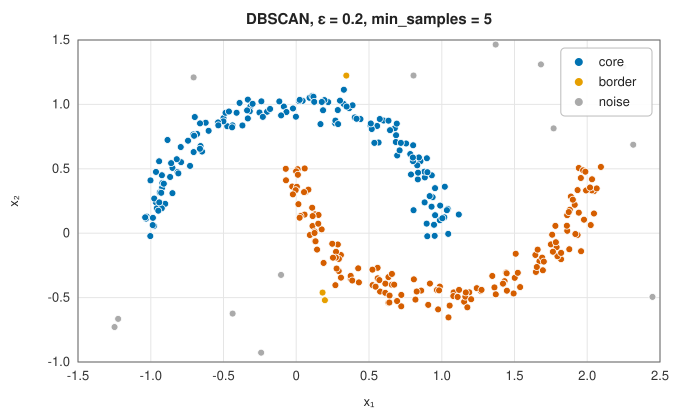
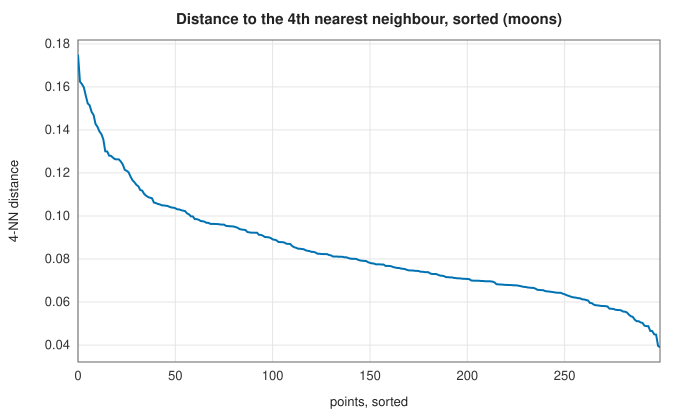
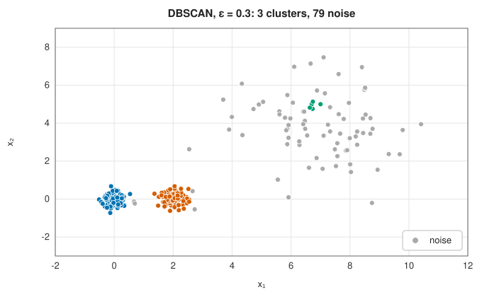
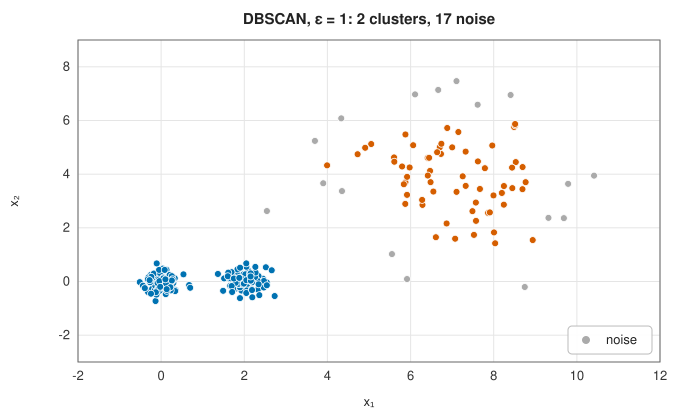
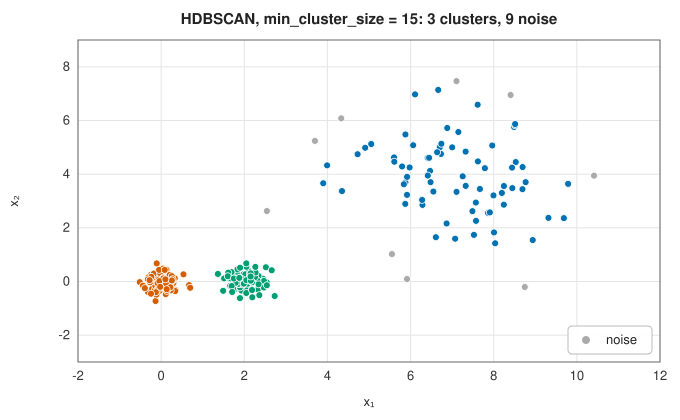

# Density-based clustering: DBSCAN and HDBSCAN

<div class="entry-summary">

| | |
|---|---|
| **Problem** | Find clusters as dense regions separated by sparse ones, of any shape, without fixing their number, and label isolated points as noise |
| **Devised by** | Martin Ester, Hans-Peter Kriegel, Jörg Sander and Xiaowei Xu (1996), DBSCAN; Mihael Ankerst, Markus Breunig, Kriegel and Sander (1999), OPTICS; Ricardo Campello, Davoud Moulavi and Sander (2013), HDBSCAN |
| **Accuracy** | Deterministic (DBSCAN up to the assignment of border points reachable from two clusters) |
| **Cost** | $O(n^2)$ time and memory with the dense distance matrix used here; $O(n\log n)$ with a spatial index in low dimensions |
| **API** | [`Dbscan`](../../api/lib_jsl_machine_learning/unsupervised/clustering/dbscan/struct.Dbscan.html) (`new(eps, min_samples)`, `core_points`), [`Hdbscan`](../../api/lib_jsl_machine_learning/unsupervised/clustering/hdbscan/struct.Hdbscan.html) (`new(min_cluster_size)`, `with_min_samples`, `cluster_stabilities`) |

</div>

## Overview

Centroid methods such as k-means describe a cluster by a centre and assume it is round. **Density-based** methods instead define a
cluster as a region where points are packed closely, separated from other clusters by regions of low density. Such clusters can
have any shape, their number is found rather than given, and points in sparse regions are labelled **noise** (`None`) rather than forced
into a cluster. **DBSCAN** uses one density threshold. **HDBSCAN** considers every threshold at once and keeps the clusters that
persist longest, which handles clusters of different densities.

## History

Martin Ester, Hans-Peter Kriegel, Jörg Sander and Xiaowei Xu at the University of Munich published DBSCAN in 1996 for spatial
databases; it received the KDD test-of-time award in 2014. Its weakness, a single global radius, led to OPTICS (Ankerst,
Breunig, Kriegel and Sander, 1999), which orders points by reachability so that clusters at every radius can be read off.
Ricardo Campello, Davoud Moulavi and Jörg Sander (2013) turned the idea into a complete algorithm, HDBSCAN, by condensing
the density hierarchy and selecting clusters by stability. Leland McInnes and John Healy's accelerated implementation (2017)
made it a popular default.

## The idea

### DBSCAN: core, border and noise points

DBSCAN has two parameters, a radius $\varepsilon$ and a count `min_samples`. The **ε-neighbourhood** of a point is the set of points within distance $\varepsilon$ of it, the point itself included.

- A **core point** has at least `min_samples` points in its ε-neighbourhood.
- A **border point** is not core but lies in the ε-neighbourhood of a core point.
- Every other point is **noise**.

Two core points within $\varepsilon$ of each other belong to the same cluster, and so, transitively, does every chain of such points.
A cluster is a connected set of core points together with their border points.



The two moons are found without being told there are two, and the 20 points scattered over the box are labelled noise. Border points
(yellow) sit at the thin ends of the moons. A border point within reach of two clusters joins whichever reaches it first, the only
order dependence in the method.

### Choosing ε

A common heuristic sorts the distances from each point to its $k$-th nearest neighbour, with $k$ = `min_samples` − 1, and looks for a knee:
points in clusters have small $k$-distances, and noise points large ones.



Here, without noise, there is no sharp knee. A value just above the bulk of the curve, such as the ε = 0.2 used above, works well.

### One radius cannot fit all densities

Two tight clusters next to one diffuse one:

| | | |
|:---:|:---:|:---:|
|  |  |  |

With a small ε the diffuse cluster dissolves into noise, apart from a fragment. With a large ε it is found, but the two tight clusters
merge. No single value gets all three:

{{#include ../generated/unsupervised/density_table.md}}

### HDBSCAN: every density at once

HDBSCAN replaces ε with a hierarchy over all values of it:

1. **Core distance.** $\text{core}(a)$ is the distance from $a$ to its `min_samples`-th nearest neighbour (counting $a$ itself). It is small in dense regions.
2. **Mutual reachability.** The distance $d_{\text{mr}}(a, b) = \max(\text{core}(a), \text{core}(b), d(a, b))$ leaves dense regions unchanged and pushes sparse points away from everything.
3. **Single-linkage tree.** A minimum spanning tree of $d_{\text{mr}}$, cut at every height, gives exactly the DBSCAN clusterings for every ε at once
   (with core points only). See [hierarchical clustering](hierarchical.md#chaining-and-compactness) for the link between single linkage and spanning trees.
4. **Condensing.** Walk down the tree, measuring density by $\lambda = 1/\text{distance}$. When a cluster splits and both parts have at least `min_cluster_size`
   points, two new clusters are born. When a smaller piece breaks off, its points simply leave the parent cluster at that $\lambda$.
5. **Stability.** A cluster born at $\lambda_{\text{birth}}$ whose points leave at $\lambda_p$ has stability $\sum_p(\lambda_p - \lambda_{\text{birth}})$, large for clusters that are dense and long-lived.
6. **Excess of mass.** Working up from the leaves, keep a cluster if its stability exceeds the total of the best selection among
   its descendants; otherwise keep the descendants.

A point takes the label of the selected cluster it fell out of, or of that cluster's nearest selected ancestor. Points that fell out
higher in the tree than every selected cluster are noise. HDBSCAN finds the three clusters, with a few noise points
in the diffuse cluster's tail. Its one main parameter, `min_cluster_size`, is a size rather than a distance, and the results
change slowly with it.

## Algorithm

**DBSCAN.** Input: the points, the radius $\varepsilon$ and `min_samples`.

1. **Neighbourhoods.** For every point, list the points within distance $\varepsilon$ of it
   (itself included). A point whose list has at least `min_samples` entries is a core point.
2. **Grow clusters.** Take each core point that has no label yet, in order. Give it a new
   cluster label and put it in a queue. While the queue is not empty: remove a point; give the
   cluster's label to each of its neighbours that has none; and add those of them that are core
   points to the queue. Border points receive a label but are not expanded.
3. **Noise.** Points still without a label are noise.

With neighbourhoods found by comparing all pairs, the cost is $O(n^2)$.

**HDBSCAN.** Input: the points, `min_samples` and `min_cluster_size`.

1. **Core distances.** For each point, the distance to its `min_samples`-th nearest neighbour.
2. **Spanning tree.** Build a minimum spanning tree of the complete graph whose edge weights
   are the mutual reachability distances, by Prim's algorithm on the dense matrix, $O(n^2)$.
3. **Single-linkage tree.** Sort the tree's edges by weight and merge their endpoints in that
   order, recording the hierarchy of merges.
4. **Condense.** Walk the hierarchy from the root down. At each split, compare the sizes of the
   two parts with `min_cluster_size`: two large parts are two new clusters; a small part is a
   set of points falling out of the cluster that continues.
5. **Stability.** For each cluster of the condensed tree, sum $\lambda_p - \lambda_{\text{birth}}$
   over its points.
6. **Select.** Working from the leaves upwards, keep a cluster if its stability exceeds the
   combined stability of the clusters selected among its descendants; otherwise keep those.
7. **Label** each point by the selected cluster it belongs to, or as noise.

## Implementation

```rust,ignore
{{#include ../../../crates/machine_learning/src/unsupervised/clustering/dbscan.rs:dbscan}}
```

```rust,ignore
{{#include ../../../crates/machine_learning/src/unsupervised/clustering/hdbscan.rs:mutual_reachability}}
```

```rust,ignore
{{#include ../../../crates/machine_learning/src/unsupervised/clustering/hdbscan.rs:excess_of_mass}}
```

- Both build the dense $n \times n$ distance matrix, which limits them to roughly $10^4$ points.
- HDBSCAN never returns the whole data set as one cluster (the root is excluded), matching the reference implementation's default.
- `min_samples` defaults to `min_cluster_size`. Raising it makes more points noise.
- Identical points give zero distances; $\lambda$ is capped at $10^{12}$ to keep the stabilities finite.

## In practice

```rust,ignore
{{#include ../../../crates/machine_learning/examples/ml_density.rs}}
```

```text
DBSCAN eps = 0.3: 3 clusters of sizes [78, 78, 5], 79 noise points (151 core points)
DBSCAN eps = 1: 2 clusters of sizes [160, 63], 17 noise points (217 core points)
HDBSCAN:          3 clusters of sizes [71, 80, 80], 9 noise points
cluster stabilities: ["27", "270", "225"]
```

The diffuse cluster has the smallest stability: it is found, but it is the least clear-cut of the three.

**Strengths**

- Arbitrary cluster shapes, no cluster count, and explicit noise.
- HDBSCAN handles varying densities with a single, intuitive parameter.

**Weaknesses**

- Distances lose contrast in high dimensions, and density becomes hard to estimate.
- DBSCAN's ε is hard to choose; neither method gives a model for assigning new points.
- The dense implementation needs $O(n^2)$ memory.

## Exercises

1. Show that the DBSCAN clusters of core points are the connected components of the graph joining core points within ε.
2. Show that $d_{\text{mr}}$ is a metric when $d$ is.
3. Explain why cutting the single-linkage tree of $d_{\text{mr}}$ at height ε gives DBSCAN's clustering of the core points with radius ε.
4. Use a k-d tree to find ε-neighbourhoods and measure the speed-up over the dense distance matrix for $n = 10^4$ points in the plane.
5. Compute the stabilities by hand for six points on a line at 0, 0.1, 0.2, 5, 5.1, 5.2 with `min_cluster_size` = 3.

## Further reading

- M. Ester, H.-P. Kriegel, J. Sander and X. Xu, "A density-based algorithm for discovering clusters in large spatial databases with noise",
  *Proceedings of the 2nd International Conference on Knowledge Discovery and Data Mining* (1996) 226–231.
- R. J. G. B. Campello, D. Moulavi and J. Sander, "Density-based clustering based on hierarchical density estimates", *Advances in Knowledge
  Discovery and Data Mining*, Lecture Notes in Computer Science 7819 (2013) 160–172.
- L. McInnes, J. Healy and S. Astels, "hdbscan: hierarchical density based clustering", *Journal of Open Source Software* 2 (2017) 205.
- E. Schubert, J. Sander, M. Ester, H.-P. Kriegel and X. Xu, "DBSCAN revisited, revisited", *ACM Transactions on Database Systems* 42 (2017) 19.
