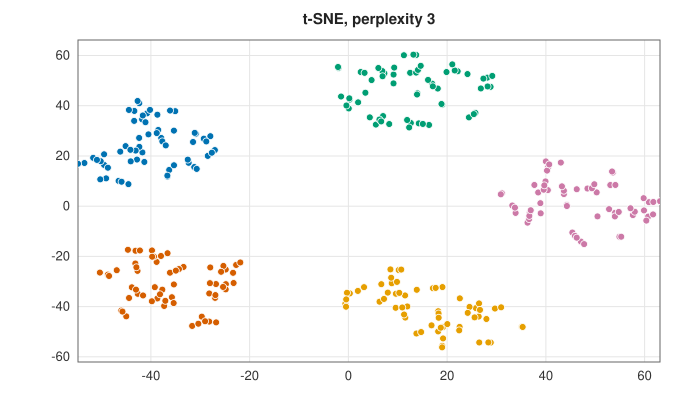
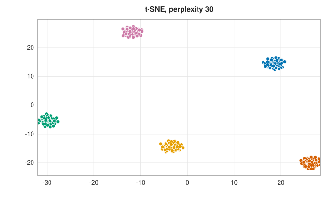
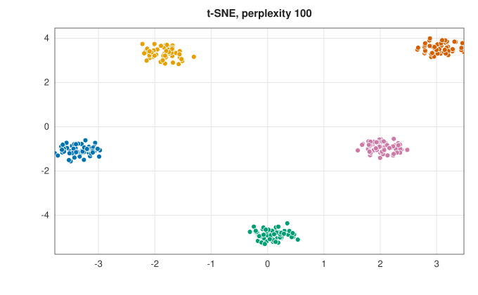
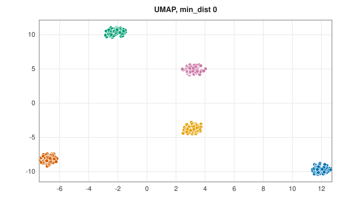
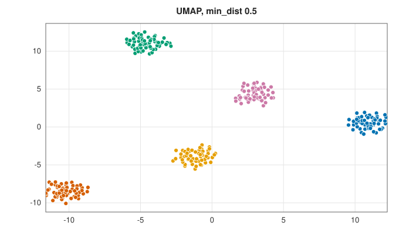
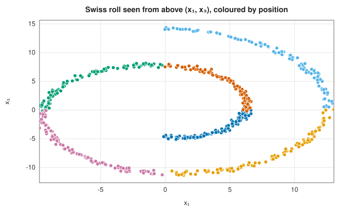
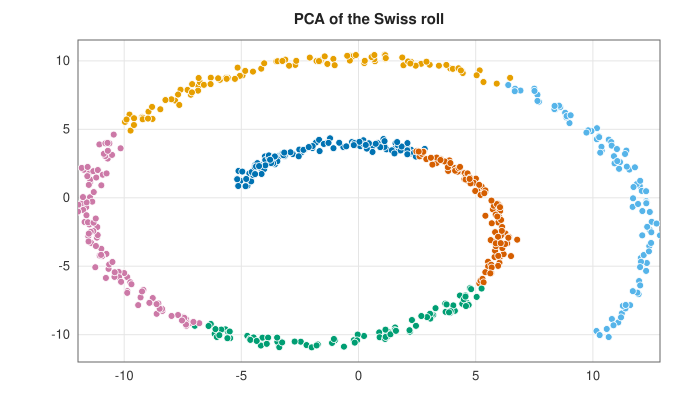
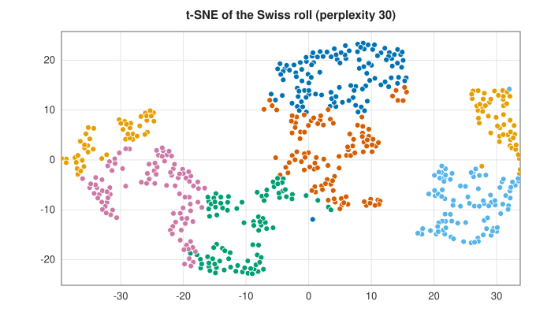
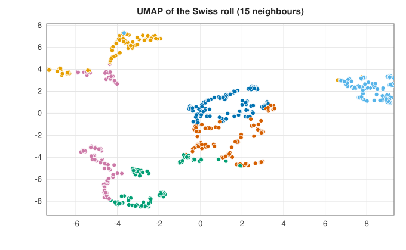

# Nonlinear embeddings: t-SNE and UMAP

<div class="entry-summary">

| | |
|---|---|
| **Problem** | Place high-dimensional points in two or three dimensions so that points that are neighbours stay neighbours, for visualisation |
| **Devised by** | Geoffrey Hinton and Sam Roweis (2002), stochastic neighbour embedding; Laurens van der Maaten and Hinton (2008), t-SNE; Leland McInnes, John Healy and James Melville (2018), UMAP |
| **Accuracy** | Nonconvex objectives: local minima, and results that depend on the initialisation and parameters |
| **Cost** | Exact t-SNE: $O(n^2)$ per iteration. UMAP: $O(n^2)$ for the exact neighbour graph, then $O(\text{edges})$ per epoch |
| **Read first** | [Principal component analysis and kernel PCA](pca.md), [Gradient descent and nonlinear conjugate gradients](../optimization/gradient-methods.md) |
| **API** | [`Tsne`](../../api/lib_jsl_machine_learning/unsupervised/reduction/t_sne/struct.Tsne.html) (`new(components, perplexity)`, `with_iterations`, `with_learning_rate`, `fit_transform`, `kl_divergence`), [`Umap`](../../api/lib_jsl_machine_learning/unsupervised/reduction/umap/struct.Umap.html) (`new(components, neighbors, min_dist, seed)`, `with_epochs`, `fuzzy_graph`, `fit_transform`), [`fit_ab`](../../api/lib_jsl_machine_learning/unsupervised/reduction/umap/fn.fit_ab.html) |

</div>

## Overview

[PCA](pca.md) can only rotate and flatten, so it cannot unroll a curved sheet or show clusters that are separated in ways no single plane
captures. **Neighbour embeddings** give up on preserving distances and keep only *who is near whom*. They define, for every pair
of points, a similarity in the original space and one in the embedding, and move the embedded points until the two agree.
**t-SNE** matches probability distributions over neighbours. **UMAP** matches fuzzy neighbourhood graphs. Both produce striking
pictures of clusters in data with hundreds of dimensions, such as cell types from gene expression or digits from images. They need
care in reading: sizes of clusters and distances between them carry little meaning.

## History

Geoffrey Hinton and Sam Roweis (2002) introduced stochastic neighbour embedding (SNE), in which each point picks neighbours
with Gaussian probabilities in both spaces. It suffered from the **crowding problem**: a two-dimensional map has too little room for the
moderately distant neighbours of high-dimensional points. Laurens van der Maaten and Hinton (2008) replaced the Gaussian in the
embedding with a heavy-tailed Student t distribution, and t-SNE became the standard visualisation tool; van der Maaten (2014)
made it fast with Barnes-Hut trees. Leland McInnes, John Healy and James Melville (2018) derived UMAP from a model of data on a
Riemannian manifold and fuzzy topology. In practice it optimises a similar objective faster, by stochastic gradient descent with
negative sampling.

## The idea

### t-SNE

**Input similarities.** For each point $i$, define conditional probabilities $p_{j \mid i} \propto e^{-\lVert\mathbf x_i - \mathbf x_j\rVert^2/2\sigma_i^2}$ of picking $j$ as a neighbour. The bandwidth $\sigma_i$ is chosen by bisection so that the
distribution's **perplexity** $2^{H(P_i)}$, an effective number of neighbours, equals a target (typically 5 to 50). Dense regions get small $\sigma_i$, sparse ones large.
Symmetrise: $p_{ij} = (p_{j \mid i} + p_{i \mid j})/2n$.

**Embedded similarities.** In the embedding use a Student t kernel with one degree of freedom,

$$
q_{ij} = \frac{(1 + \lVert\mathbf y_i - \mathbf y_j\rVert^2)^{-1}}{\sum_{k \ne l}(1 + \lVert\mathbf y_k - \mathbf y_l\rVert^2)^{-1}},
$$

whose heavy tails let moderately dissimilar points sit far apart, relieving the crowding.

**Objective.** Minimise the Kullback-Leibler divergence $\text{KL}(P\Vert Q) = \sum_{i \ne j}p_{ij}\log(p_{ij}/q_{ij})$, whose gradient is

$$
\frac{\partial\,\text{KL}}{\partial\mathbf y_i} = 4\sum_j(p_{ij} - q_{ij})(\mathbf y_i - \mathbf y_j)(1 + \lVert\mathbf y_i - \mathbf y_j\rVert^2)^{-1},
$$

an attraction along edges with $p_{ij} > q_{ij}$ and a repulsion otherwise. KL is asymmetric: placing true neighbours far apart (large $p$, small $q$) is expensive, but
placing non-neighbours close is cheap. So t-SNE preserves local structure and is free with global structure.

**Optimisation.** Gradient descent with momentum and per-coordinate adaptive gains, starting from a tiny PCA layout. For the
first quarter of the iterations (at most 250) the $p_{ij}$ are multiplied by 12, which is called **early exaggeration**. This pulls clusters into tight groups that can move
past each other before the fine structure forms.

### Perplexity

Perplexity sets the neighbourhood size, and changes the picture:

| | | |
|:---:|:---:|:---:|
|  |  |  |

These are five Gaussian clusters in 20 dimensions, all of the same size and spread, all equally far apart. With perplexity 3 each
point sees only a few neighbours, and every cluster breaks into loose fragments. At 30 and 100 the clusters are compact, but their
apparent sizes and the distances between them differ from panel to panel, and none of it reflects the data. Only the grouping is
meaningful.

### UMAP

UMAP builds a weighted graph of the data and finds a layout whose own graph matches it:

1. **Fuzzy neighbourhoods.** For each point take its $k$ nearest neighbours. Let $\rho_i$ be the distance to the nearest one, and choose $\sigma_i$ so that $\sum_{j=1}^ke^{-(d_{ij} - \rho_i)/\sigma_i} = \log_2k$.
   The directed membership is $v_{j \mid i} = e^{-(d_{ij} - \rho_i)/\sigma_i}$: the nearest neighbour always has membership 1, which keeps every point connected.
2. **Fuzzy union.** Symmetrise with the probabilistic OR, $w_{ij} = v_{j \mid i} + v_{i \mid j} - v_{j \mid i}v_{i \mid j}$.
3. **Embedding similarity** $(1 + a\lVert\mathbf y_i - \mathbf y_j\rVert^{2b})^{-1}$, with $a$ and $b$ fitted (by Levenberg-Marquardt, [`fit_ab`](../../api/lib_jsl_machine_learning/unsupervised/reduction/umap/fn.fit_ab.html)) to a curve equal to 1 up to `min_dist` and decaying
   exponentially beyond it. For `min_dist` = 0.1 the reference implementation uses $a \approx 1.58$ and $b \approx 0.90$, and the library's fit agrees closely.
4. **Cross-entropy** between the two graphs, minimised by stochastic gradient descent. Edges are sampled in proportion to their weight
   and pull their endpoints together. For each one, the first endpoint is pushed away from five random points (**negative sampling**), standing
   in for the repulsion of all non-edges.

`min_dist` controls how tightly points may pack:

| | |
|:---:|:---:|
|  |  |

### Unrolling the Swiss roll

A Swiss roll is a rectangle rolled up in three dimensions. The coloured bands mark position along the roll, and an ideal embedding
would lay them side by side in order:

| | |
|:---:|:---:|
|  |  |
|  |  |

PCA shows the roll as seen from its end, with neighbours across the turns overlapping. t-SNE and UMAP keep small neighbourhoods
intact, but neither unrolls the sheet in one piece. Both start from the PCA layout, which is the rolled-up spiral, and both tear it into
strips to relieve the strain rather than unrolling it. The reference UMAP implementation starts from a spectral embedding of the graph instead,
which is already unrolled. The fraction of each point's 10 nearest neighbours that remain among its 10 nearest in the embedding
measures what is kept:

<p class="caption" id="tab-12-13"><strong>Table 12.13.</strong> Neighbourhood preservation (fraction of 10 nearest neighbours kept) and time of PCA, t-SNE and UMAP.</p>

{{#include ../generated/unsupervised/embedding_table.md}}

Both methods keep far more neighbourhoods than PCA on the roll. In the 20-dimensional clusters, a point's nearest neighbours within its
own cluster are nearly arbitrary (the cluster is a round Gaussian cloud), so no two-dimensional map keeps many of them; t-SNE
and UMAP still keep the clusters apart. UMAP is an order of magnitude faster than exact t-SNE.

## Algorithm

**t-SNE.**

1. **Input similarities.** For each point $i$, find by bisection the bandwidth $\sigma_i$ whose
   conditional distribution $p_{j \mid i}$ has the target perplexity. Symmetrise to get
   $p_{ij}$.
2. **Initialise** the embedding with the first two principal components of the data, scaled
   down to a small spread.
3. **Iterate.** In each iteration:
   - compute all the $q_{ij}$ from the current positions;
   - compute the gradient for every point (using $12\,p_{ij}$ during early exaggeration);
   - update each coordinate's **gain**, a per-coordinate multiplier of the learning rate: add
     0.2 to it when the gradient and the current velocity have opposite signs (the coordinate
     is still being pushed the way it is already moving), and multiply it by 0.8 otherwise
     (the push has reversed);
   - update the velocity (the previous velocity times the momentum, minus the learning rate
     times the gain times the gradient) and add it to the position;
   - subtract the mean position, so that the embedding stays centred.

Every iteration computes all pairs, $O(n^2)$. This is "exact" t-SNE; tree-based approximations
reduce it to $O(n\log n)$.

**UMAP.**

1. **Graph.** For each point find its $k$ nearest neighbours, $\rho_i$ and, by bisection,
   $\sigma_i$. Form the directed memberships and combine them into the symmetric weights
   $w_{ij}$.
2. **Curve.** Fit $a$ and $b$ to the target curve for the chosen `min_dist`.
3. **Initialise** with the first two principal components, scaled to the range $\pm10$.
4. **Optimise** for a fixed number of epochs, with a learning rate that decreases linearly to
   zero. In each epoch, visit each edge $(i, j)$ with probability $w_{ij}/\max w$. For a
   visited edge:
   - move $\mathbf y_i$ and $\mathbf y_j$ towards each other by the attractive gradient, with each
     component of the step clipped to a fixed range;
   - choose five other points at random and move $\mathbf y_i$ away from each by the repulsive
     gradient, clipped likewise.

The cost per epoch is proportional to the number of edges, about $nk$.

## Implementation

```rust,ignore
{{#include ../../../crates/machine_learning/src/unsupervised/reduction/t_sne.rs:tsne_gradient}}
```

```rust,ignore
{{#include ../../../crates/machine_learning/src/unsupervised/reduction/umap.rs:umap_sgd}}
```

- Both use exact $O(n^2)$ neighbour computations, practical for a few thousand points. Production implementations use Barnes-Hut or FFT
  approximations (t-SNE) and approximate nearest-neighbour search (UMAP).
- t-SNE is deterministic, since it starts from PCA and uses no random numbers. UMAP is reproducible for a given `seed`.
- Neither provides a transform for new points: both are fitted to one data set.
- Gradient components are clipped to ±4 in UMAP, as in the reference implementation.

## In practice

```rust,ignore
{{#include ../../../crates/machine_learning/examples/ml_embeddings.rs}}
```

```text
t-SNE: KL divergence 0.335
t-SNE cluster centres: (-32.0, 1.1) (23.0, 16.6) (-11.5, -34.4) (28.7, -17.8) (-8.2, 34.6)
UMAP cluster centres: (9.2, 12.3) (-9.8, 2.0) (-1.2, 7.7) (6.4, -10.2) (-1.3, -3.1)
```

The five clusters are equally far apart in the data. t-SNE spreads their centres on a rough circle; UMAP's centres lie at
distances between 10 and 23 from each other. Neither arrangement means anything.

**Strengths**

- Reveal cluster structure in high-dimensional data that linear projections hide.
- UMAP is fast, keeps somewhat more global structure, and can embed into more than three dimensions as input to clustering.

**Weaknesses**

- Cluster sizes, distances between clusters and densities in the picture are unreliable; results depend on perplexity or the
  neighbour count, and on the initialisation.
- Nonconvex optimisation with no guarantee; no mapping for new points in these implementations.
- The exact methods here cost $O(n^2)$ memory and time.

## Exercises

1. Show that a perplexity of $k$ for a uniform distribution over $k$ neighbours corresponds to entropy $\log_2k$ bits.
2. Derive the t-SNE gradient from the KL divergence.
3. Show that a Gaussian kernel in two dimensions cannot place ten mutually equidistant neighbours of a point at equal distances, and explain the crowding problem.
4. Show that the fuzzy union $a + b - ab$ is the probability that at least one of two independent events with probabilities $a$ and $b$ occurs.
5. Start t-SNE from a random layout instead of PCA (by permuting the PCA scores), and compare the KL divergence reached on the Swiss roll.

<details>
<summary>Hints and answers</summary>

1. For a uniform distribution over $k$ neighbours $H = -\sum\tfrac1k\log_2\tfrac1k = \log_2k$ bits, and perplexity is $2^H = k$.
2. With $C = \sum p_{ij}\ln(p_{ij}/q_{ij})$ and $q_{ij} \propto(1 + \lVert\mathbf y_i - \mathbf y_j\rVert^2)^{-1}$, differentiate $-\sum p_{ij}\ln q_{ij}$ with respect to $\mathbf y_i$; the normalising constant contributes $\sum q$ terms and the result is $4\sum_j(p_{ij} - q_{ij})(\mathbf y_i - \mathbf y_j)(1 + \lVert\mathbf y_i - \mathbf y_j\rVert^2)^{-1}$.
3. At most 3 points in the plane can be mutually equidistant (the corners of an equilateral triangle), so ten equidistant neighbours need 9 dimensions. When a high-dimensional neighbourhood is squeezed into 2D, the neighbours crowd and are pushed together; the heavy tails of the $t$ distribution relieve this.
4. The union of two independent events has probability $a + b - ab$ by inclusion-exclusion.
5. Compare the final KL divergences over several seeds; initialising from PCA typically gives lower and more reproducible values and better global structure than a random start.

</details>

## Further reading

- L. van der Maaten and G. Hinton, "Visualizing data using t-SNE", *Journal of Machine Learning Research* 9 (2008) 2579–2605.
- L. McInnes, J. Healy and J. Melville, "UMAP: uniform manifold approximation and projection for dimension reduction", arXiv:1802.03426, 2018.
- M. Wattenberg, F. Viégas and I. Johnson, "How to use t-SNE effectively", *Distill* (2016).
- D. Kobak and G. C. Linderman, "Initialization is critical for preserving global data structure in both t-SNE and UMAP", *Nature
  Biotechnology* 39 (2021) 156–157.
