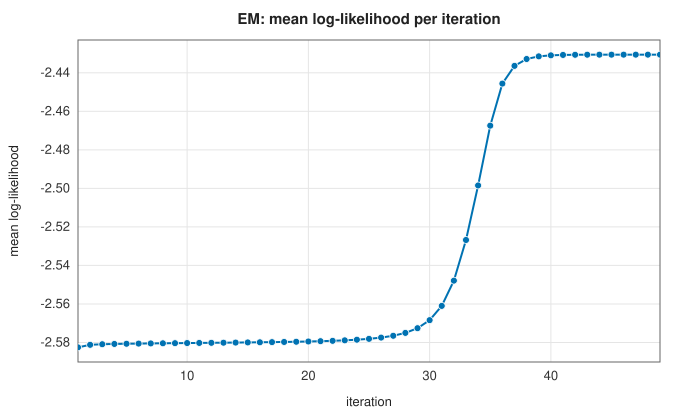
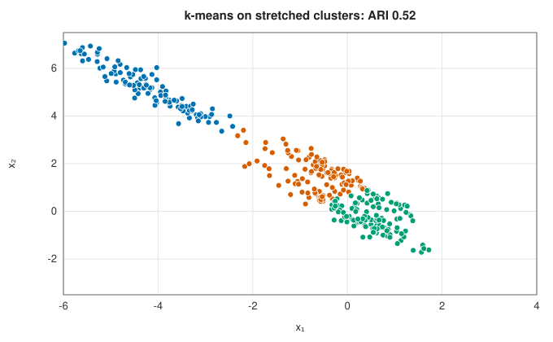
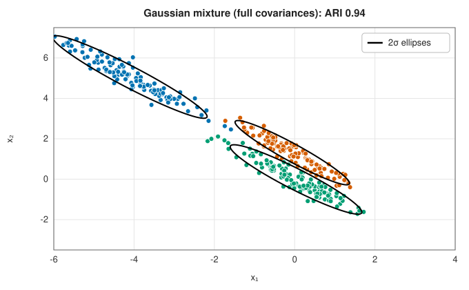
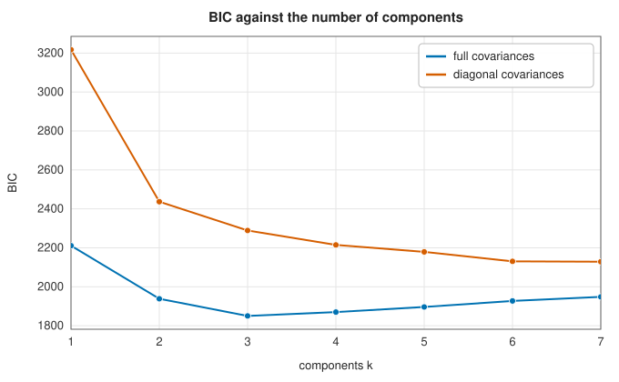

# Gaussian mixture models

<div class="entry-summary">

| | |
|---|---|
| **Problem** | Model data as a weighted sum of Gaussian densities; assign each point a probability of belonging to each component |
| **Devised by** | Karl Pearson (1894), mixtures of two normals; Arthur Dempster, Nan Laird and Donald Rubin (1977), the EM algorithm; Gideon Schwarz (1978), the Bayesian information criterion; Hirotugu Akaike (1974), AIC |
| **Accuracy** | EM increases the likelihood at every step and converges to a local maximum (or saddle point) |
| **Cost** | $O(nkp^2)$ per iteration with full covariances, plus $O(kp^3)$ for the Cholesky factors |
| **Read first** | [k-means and k-medoids](k-means.md) |
| **API** | [`GaussianMixture`](../../api/lib_jsl_machine_learning/unsupervised/clustering/gaussian_mixture_models/struct.GaussianMixture.html) (`new(k, covariance, seed)`, `predict_proba`, `score_samples`, `weights`, `means`, `covariances`, `bic`, `aic`), [`CovarianceType`](../../api/lib_jsl_machine_learning/unsupervised/clustering/gaussian_mixture_models/enum.CovarianceType.html) (`Full`, `Diagonal`) |

</div>

## Overview

A **Gaussian mixture model** (GMM) assumes each point was produced by first choosing one of $k$ components with probabilities $w_c$, and then
drawing from that component's normal distribution $N(\boldsymbol\mu_c, \Sigma_c)$. Fitting the model clusters the data, and more besides: each point gets **membership
probabilities** rather than a hard label (a **soft clustering**), clusters may be elliptical and of different sizes, and the fitted
density can score new points and compare models. The **expectation-maximisation** (EM) algorithm fits it. It alternates between
estimating the memberships and re-estimating the parameters, and k-means is its limit with equal, spherical, vanishing covariances.

## History

Karl Pearson (1894) fitted a mixture of two normal distributions to measurements of crab foreheads, by the method of moments,
solving a ninth-degree polynomial by hand. Maximum likelihood for mixtures had to wait for computers. Arthur Dempster, Nan
Laird and Donald Rubin (1977) unified many earlier special cases as the EM algorithm and proved that it never decreases the
likelihood; Jeff Wu (1983) corrected and completed the convergence proof. Information criteria for choosing the number of
components came from Hirotugu Akaike (1974) and Gideon Schwarz (1978).

## The idea

### The mixture likelihood

Under the model, the probability density of a point is a weighted sum of the component
densities,

$$
p(\mathbf x) = \sum_{c=1}^kw_c\,N(\mathbf x; \boldsymbol\mu_c, \Sigma_c), \qquad w_c \ge 0, \quad \sum_cw_c = 1 .
$$

The parameters, the weights $w_c$, means $\boldsymbol\mu_c$ and covariances $\Sigma_c$, are to be chosen
by **maximum likelihood**: make the observed data as probable as possible, by maximising the
log-likelihood $\sum_i\log p(\mathbf x_i)$.

For a single Gaussian this is easy, and the answer is the sample mean and covariance. For a
mixture it is hard, for three reasons.

- **No closed form.** The logarithm of a single Gaussian density is a simple quadratic. Here the
  logarithm is applied to a *sum* of densities and cannot be simplified, so setting the
  derivatives to zero gives equations with no explicit solution.
- **Local maxima.** The likelihood generally has many of them, so the result depends on the
  starting point.
- **It is unbounded.** Centre one component exactly on a data point and let its covariance
  shrink to zero. Its density at that point grows without limit, and so does the likelihood,
  although the fit is useless. The library adds `reg_covar` $= 10^{-6}$ to every covariance
  diagonal, which keeps the covariances from collapsing and rules this out.

### Expectation-maximisation

The difficulty comes from not knowing which component generated each point. If we knew, fitting
would be easy: collect the points of each component and compute their mean and covariance.
Conversely, if we knew the parameters, we could work out how likely each point is to belong to
each component. **Expectation-maximisation** (EM) breaks the circle by alternating between the
two, starting from a guess.

**E-step: assign points to components, softly.** With the current parameters, compute for each
point $i$ and component $c$ the **responsibility**

$$
r_{ic} = \frac{w_c\,N(\mathbf x_i; \boldsymbol\mu_c, \Sigma_c)}{\sum_{c'}w_{c'}\,N(\mathbf x_i; \boldsymbol\mu_{c'}, \Sigma_{c'})} .
$$

This is Bayes' rule: the prior probability $w_c$ of the component times the density it gives
the point, normalised so that the responsibilities of each point sum to 1. It is the posterior
probability that point $i$ came from component $c$. A point close to one component and far from
the others has a responsibility near 1 for it; a point between two components is shared.

**M-step: refit each component.** Treat $r_{ic}$ as the fraction of point $i$ that belongs to
component $c$, and compute weighted versions of the usual estimates:

$$
N_c = \sum_ir_{ic}, \qquad w_c = \frac{N_c}{n}, \qquad
\boldsymbol\mu_c = \frac{1}{N_c}\sum_ir_{ic}\mathbf x_i, \qquad
\Sigma_c = \frac{1}{N_c}\sum_ir_{ic}(\mathbf x_i - \boldsymbol\mu_c)(\mathbf x_i - \boldsymbol\mu_c)^{\mathsf T} .
$$

$N_c$ is the effective number of points in the component, and the mean and covariance are
averages in which each point counts in proportion to its responsibility.

The two steps are repeated until the log-likelihood stops increasing. This is the same
alternation as [k-means](k-means.md#lloyds-algorithm), assign and then refit, with soft
assignments in place of hard ones, and with covariances as well as means.

**Why it works.** Each iteration can be shown never to decrease the log-likelihood. The E-step
constructs a function of the parameters that lies below the log-likelihood everywhere and
touches it at the current parameters (a lower bound); the M-step moves to the maximum of that
function. Since the bound touches the likelihood at the old parameters and lies below it at the
new ones, the likelihood at the new parameters is at least as large as before. EM therefore
climbs steadily to a local maximum. Progress can be slow, though:



<p class="caption" id="fig-12-4"><strong>Figure 12.4.</strong> Log-likelihood by iteration.</p>

Starting from k-means, which split the two overlapping elongated clusters across rather than along their length, EM creeps along
a plateau for about 25 iterations while the components slowly rotate, then climbs quickly to the better maximum.

### Ellipses instead of circles

| | |
|:---:|:---:|
|  |  |

The three clusters are stretched and tilted, two of them almost touching. k-means draws straight boundaries between centroids and
cuts the clusters across. The mixture's full covariances follow the clusters' shapes and recover them; the remaining errors are in
the region where the two lower clusters overlap. The fitted parameters match the sample statistics of the generating clusters:

<p class="caption" id="tab-12-9"><strong>Table 12.9.</strong> Gaussian mixture fit: means and weights against the truth.</p>

{{#include ../generated/unsupervised/gmm_parameters.md}}

**Diagonal** covariances allow axis-aligned ellipses only, with $p$ instead of $p(p + 1)/2$ parameters per component. They are cheaper and more stable in high
dimensions, but cannot represent tilted clusters.

### Choosing the number of components

A model with more components always fits at least as well, so the likelihood alone cannot choose $k$. Information criteria charge for
the number of free parameters $m$:

$$
\text{BIC} = -2\log L + m\log n, \qquad \text{AIC} = -2\log L + 2m,
$$

with $m = k(p + p(p + 1)/2) + k - 1$ for full covariances. Lower is better.



<p class="caption" id="fig-12-5"><strong>Figure 12.5.</strong> BIC against k.</p>

With full covariances the BIC is smallest at the true $k = 3$. With diagonal covariances it keeps falling: several axis-aligned
components are needed to approximate each tilted ellipse, so the criterion chooses a different $k$ for a different model. BIC penalises
more heavily than AIC once $n > e^2 \approx 7$ and tends to choose fewer components.

## Algorithm

Input: the data, the number of components $k$ and the covariance type.

1. **Initialise.** Run [k-means](k-means.md) with $k$ clusters. Treat its assignments as
   responsibilities that are 1 for a point's own cluster and 0 for the others, and perform one
   M-step to obtain starting weights, means and covariances.
2. **E-step.** For each point and component, compute the logarithm of the weight times the
   Gaussian density, using the Cholesky factor of the covariance for the quadratic form and the
   determinant. The log of the mixture density at the point is the logarithm of the sum of the
   exponentials of these $k$ numbers; it is computed after subtracting their maximum (the
   **log-sum-exp** trick), so that densities too small to represent do not underflow to zero.
   The responsibilities are the exponentials of the differences.
3. **M-step.** Update the weights, means and covariances by the responsibility-weighted
   formulas. Add `reg_covar` to the diagonal of each covariance and compute its Cholesky
   factor for the next E-step.
4. **Test.** If the mean log-likelihood changed by less than the tolerance ($10^{-6}$), or 200
   iterations have been done, stop; otherwise go to 2.
5. **Label** each point by the component with the largest responsibility.

An iteration costs $O(nkp^2)$ with full covariances in $p$ dimensions.

**Model selection**: fit the model for each candidate $k$, compute the BIC from the final
log-likelihood and the number of parameters, and choose the smallest.

## Implementation

```rust,ignore
{{#include ../../../crates/machine_learning/src/unsupervised/clustering/gaussian_mixture_models.rs:em}}
```

- Densities are evaluated through the Cholesky factor $L$ of each covariance: $\log\det\Sigma = 2\sum_j\log L_{jj}$, and the Mahalanobis distance is $\lVert L^{-1}(\mathbf x - \boldsymbol\mu)\rVert^2$.
- Responsibilities are computed from log-densities with the maximum subtracted, so far-away points do not underflow to 0/0.
- `mean_log_likelihood` always describes the final parameters. (Before this chapter was written, a fit that stopped at the iteration
  limit reported the value from one step earlier.)

## In practice

```rust,ignore
{{#include ../../../crates/machine_learning/examples/ml_gaussian_mixture.rs}}
```

```text
k = 1: mean log-likelihood -4.1471, BIC  3763.0, 2 EM iterations
k = 2: mean log-likelihood -3.8495, BIC  3531.8, 11 EM iterations
k = 3: mean log-likelihood -3.6651, BIC  3402.4, 7 EM iterations
k = 4: mean log-likelihood -3.6627, BIC  3436.9, 22 EM iterations
k = 5: mean log-likelihood -3.6563, BIC  3467.9, 187 EM iterations
weights [0.338, 0.333, 0.329]
point [0.0, 0.0]: memberships [1.000, 0.000, 0.000], log density -2.75
point [2.0, 0.5]: memberships [0.474, 0.002, 0.523], log density -4.87
point [10.0, 10.0]: memberships [0.000, 1.000, 0.000], log density -73.46
```

The point between two components is split almost evenly between them. The far point at (10, 10) is assigned to one component
with certainty, yet its log density of −73 shows that it fits none: memberships are relative, and the density is the tool for
spotting outliers. Extra components barely raise the likelihood and take many more iterations to settle.

**Strengths**

- Soft, probabilistic clustering with elliptical clusters of different sizes and orientations.
- A density model: likelihoods for new points, outlier scores, and BIC or AIC for choosing $k$.

**Weaknesses**

- Local maxima and sensitivity to initialisation; EM can be slow when clusters overlap.
- Full covariances need $O(kp^2)$ parameters, too many in high dimensions without regularisation.
- Assumes Gaussian clusters; curved clusters need many components.

## Exercises

1. Derive the M-step updates by maximising the expected complete-data log-likelihood.
2. Show that EM never decreases the likelihood, using Jensen's inequality.
3. Show that with shared covariance $\sigma^2I$ and $\sigma \to 0$, EM becomes Lloyd's k-means algorithm.
4. Show that the likelihood is unbounded without regularisation, by centring a component on a data point.
5. Fit a mixture to data drawn from a single uniform square, and plot the BIC against $k$. What does it choose, and why?

<details>
<summary>Hints and answers</summary>

1. Maximise $\sum_i\sum_kr_{ik}\big[\ln\pi_k + \ln\mathcal N(\mathbf x_i|\boldsymbol\mu_k, \Sigma_k)\big]$ over the parameters with $\sum\pi_k = 1$: $\pi_k = \tfrac1n\sum r_{ik}$, $\boldsymbol\mu_k = \sum r_{ik}\mathbf x_i/\sum r_{ik}$, $\Sigma_k = \sum r_{ik}(\mathbf x_i - \boldsymbol\mu_k)(\mathbf x_i - \boldsymbol\mu_k)^{\mathsf T}/\sum r_{ik}$.
2. Jensen's inequality gives $\ln p(\mathbf x|\theta) \ge Q(\theta|\theta_t) + H$ with equality at $\theta = \theta_t$; maximising $Q$ therefore cannot decrease the likelihood.
3. With $\Sigma = \sigma^2I$ and $\sigma \to 0$ the responsibilities become 0 or 1 (each point goes to its nearest mean) and the means become cluster averages: Lloyd's algorithm.
4. Centre one component on a data point and let its covariance shrink to 0: its density at that point grows without bound while the other points keep a positive density from the other components, so the likelihood is unbounded.
5. A uniform square is not Gaussian, so BIC typically selects more than one component (several tile the square). It does not indicate several real clusters, only that the Gaussian shape assumption is wrong.

</details>

## Further reading

- A. P. Dempster, N. M. Laird and D. B. Rubin, "Maximum likelihood from incomplete data via the EM algorithm", *Journal of the Royal Statistical
  Society B* 39 (1977) 1–38.
- G. McLachlan and D. Peel, *Finite Mixture Models*, Wiley, 2000.
- C. M. Bishop, *Pattern Recognition and Machine Learning*, Springer, 2006, chapter 9.
- G. Schwarz, "Estimating the dimension of a model", *Annals of Statistics* 6 (1978) 461–464.
