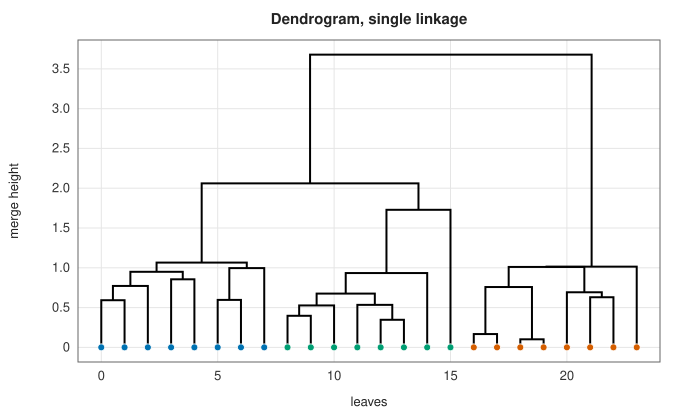
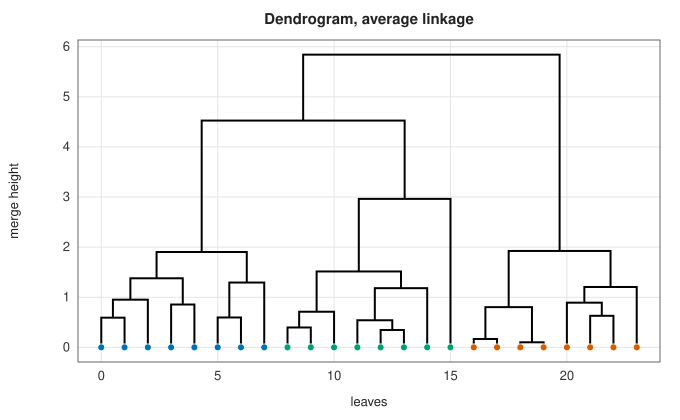
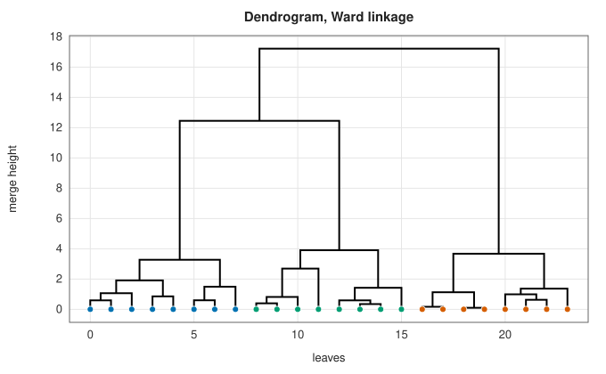
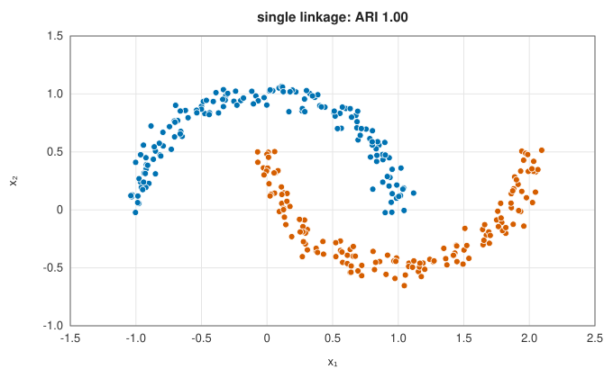
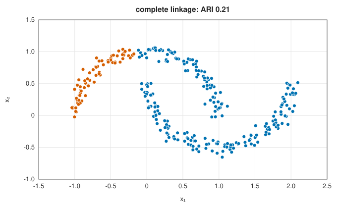
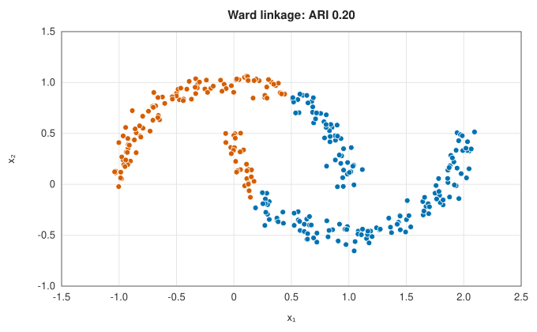

# Hierarchical clustering and phylogenetic trees

<div class="entry-summary">

| | |
|---|---|
| **Problem** | Build a tree of nested clusters by repeatedly merging the two closest groups; reconstruct evolutionary trees from distances between species |
| **Devised by** | Peter Sneath (1957), single linkage; Thorvald Sørensen (1948), complete linkage; Robert Sokal and Charles Michener (1958), average linkage (UPGMA); Joe Ward (1963), minimum variance; Godfrey Lance and William Williams (1967), the unified update; Naruya Saitou and Masatoshi Nei (1987), neighbour joining |
| **Accuracy** | Exact for the stated criteria. UPGMA recovers a tree exactly from ultrametric distances, neighbour joining from additive ones |
| **Cost** | $O(n^3)$ time and $O(n^2)$ memory, from a distance matrix |
| **API** | [`agglomerate`](../../api/lib_jsl_machine_learning/unsupervised/clustering/hierarchical/fn.agglomerate.html), [`Linkage`](../../api/lib_jsl_machine_learning/unsupervised/clustering/hierarchical/enum.Linkage.html), [`Dendrogram`](../../api/lib_jsl_machine_learning/unsupervised/clustering/hierarchical/struct.Dendrogram.html) (`cut_clusters`, `cut_distance`, `cophenetic_distances`), [`HierarchicalClustering`](../../api/lib_jsl_machine_learning/unsupervised/clustering/hierarchical/struct.HierarchicalClustering.html); [`upgma`](../../api/lib_jsl_machine_learning/supervised/classification/phylogenetic_trees/fn.upgma.html), [`neighbor_joining`](../../api/lib_jsl_machine_learning/supervised/classification/phylogenetic_trees/fn.neighbor_joining.html), [`PhylogeneticTree`](../../api/lib_jsl_machine_learning/supervised/classification/phylogenetic_trees/struct.PhylogeneticTree.html) |

</div>

## Overview

**Agglomerative hierarchical clustering** starts with every point in its own cluster and repeatedly merges the two closest clusters
until one remains. The record of merges is a binary tree, the **dendrogram**, in which each merge is drawn at the distance where it
happened. Cutting the tree at a height, or where it has $k$ branches, gives a flat clustering, so a single fit serves every $k$. The
**linkage** defines the distance between clusters, and it shapes the result as much as the data do.

The same procedure, read as a model of evolution, reconstructs **phylogenetic trees** from distances between species or gene
sequences. Average linkage is **UPGMA**, the classical method under a constant rate of evolution. **Neighbour joining** drops the
assumption of a constant rate and remains one of the most used tree-building methods in biology.

## History

Numerical taxonomy in the 1950s needed objective classifications of organisms. Thorvald Sørensen (1948) grouped plant
communities by complete linkage, Peter Sneath (1957) classified bacteria by single linkage, and Robert Sokal and Charles
Michener (1958) introduced average linkage, later named UPGMA. Joe Ward (1963) merged the pair that least increases the
within-cluster variance. Godfrey Lance and William Williams (1967) showed that all of these update the inter-cluster distances
by one formula. Naruya Saitou and Masatoshi Nei (1987) devised neighbour joining for molecular phylogenetics; James Studier and
Karl Keppler (1988) gave its $O(n^3)$ form.

## The idea

### Linkage criteria

Starting from point distances $d(i, j)$, the distance between clusters $A$ and $B$ is

- **single**: $\min_{i \in A, j \in B}d(i, j)$, the closest pair;
- **complete**: $\max_{i \in A, j \in B}d(i, j)$, the farthest pair;
- **average** (UPGMA): the mean of $d(i, j)$ over all pairs;
- **Ward**: the increase in the within-cluster sum of squares caused by merging, $\frac{|A||B|}{|A| + |B|}\lVert\bar{\mathbf x}_A - \bar{\mathbf x}_B\rVert^2$ (Euclidean data only).

There is no need to go back to the points after a merge. When $A$ and $B$ merge, the distance from the new cluster to any other
cluster $C$ follows from the old ones by the **Lance-Williams** update

$$
d(A \cup B, C) = \alpha_Ad(A, C) + \alpha_Bd(B, C) + \beta d(A, B) + \gamma|d(A, C) - d(B, C)|.
$$

Single linkage has $\alpha = \frac12$, $\gamma = -\frac12$ (giving the minimum), complete linkage $\gamma = +\frac12$, and average linkage $\alpha_A = |A|/(|A| + |B|)$. Ward's method applies
the update to squared distances with $\alpha_A = (|A| + |C|)/(|A| + |B| + |C|)$ and $\beta = -|C|/(|A| + |B| + |C|)$.

### Reading a dendrogram

The same 24 points from three blobs, clustered with three linkages (leaves coloured by their true blob):

| | | |
|:---:|:---:|:---:|
|  |  |  |

Long vertical branches mean well-separated clusters: cutting across the longest ones gives the natural number of groups.
Ward's tree shows three groups clearly. Single linkage merges at small heights everywhere and is the least decisive. Merge heights never
decrease for these four linkages, so the dendrogram has no inversions. The **cophenetic distance** between two points, the height
at which they first join, is then an **ultrametric**: $d(i, j) \le \max(d(i, k), d(k, j))$ for all $i, j, k$.

### Chaining and compactness

| | | |
|:---:|:---:|:---:|
|  |  |  |

Single linkage follows chains of close points, so it separates the two moons perfectly. The same property is a weakness:
a thin bridge of points between two blobs is enough to join them. Complete, average and Ward linkage prefer compact
clusters and are not fooled by the bridge, but they cut the moons like k-means:

<p class="caption" id="tab-12-5"><strong>Table 12.5.</strong> Columns: linkage, two moons (ARI), two blobs joined by a bridge of 20 points (ARI on the blobs).</p>

{{#include ../generated/unsupervised/linkage_table.md}}

### Checking against SciPy

Merge heights from the library agree with `scipy.cluster.hierarchy.linkage` to rounding error:

<p class="caption" id="tab-12-6"><strong>Table 12.6.</strong> Columns: data, compared with, merge heights or variances (largest relative difference), leading two principal axes (largest difference).</p>

{{#include ../generated/unsupervised/reference.md}}

The last row belongs to the [PCA entry](pca.md#testing-against-numpy).

### UPGMA and the molecular clock

If species evolve at a constant rate (a **molecular clock**), the distance between two species is twice the time since their common
ancestor. The distances are then ultrametric, and the tree has all leaves at the same depth. **UPGMA** is average linkage that
places each merge node at half the merge distance. Each branch length is the difference in height between a node and its child.
Given ultrametric distances, UPGMA rebuilds the tree exactly.

### Neighbour joining

Rates do vary between lineages. A fast-evolving species is far from everything, and UPGMA wrongly groups slow species together
because they are close to each other. Neighbour joining corrects for this using each taxon's net divergence $r_i = \sum_kd(i, k)$. With $m$
active taxa, it joins the pair minimising

$$
Q(i, j) = (m - 2)d(i, j) - r_i - r_j,
$$

which is the pair whose joining gives the shortest total tree length. The new node $u$ gets branch lengths
$\ell_i = \frac12d(i, j) + \frac{r_i - r_j}{2(m - 2)}$ and $\ell_j = d(i, j) - \ell_i$, and distances $d(u, k) = \frac12(d(i, k) + d(j, k) - d(i, j))$ to the others. If the distances are **additive**, meaning they are the path
lengths of some tree, neighbour joining recovers that tree exactly (Studier and Keppler; Atteson 1999 for noisy distances). The
tree is unrooted, since distances alone do not reveal where the root is.

On random trees with 12 leaves, the largest relative error in the reconstructed path lengths was:

<p class="caption" id="tab-12-7"><strong>Table 12.7.</strong> Columns: true tree (12 leaves, 50 random trees), UPGMA, neighbour joining.</p>

{{#include ../generated/unsupervised/phylogeny.md}}

With a clock, both methods are exact. Without one, UPGMA's errors exceed 100% while neighbour joining stays exact. With 5% noise in the
distances, neither tree fits exactly; neighbour joining's worst error over all pairs and trials is 18%, against UPGMA's 210%.

## Algorithm

**Agglomerative clustering.** Input: the $n \times n$ matrix of distances and a linkage.

1. Start with every point as its own cluster.
2. Find the closest pair of clusters $(A, B)$, by scanning the matrix.
3. Record the merge: the two clusters joined, the height $d(A, B)$ and the size of the new
   cluster.
4. Replace the rows and columns of $A$ and $B$ by a single one for $A \cup B$, whose distance
   to every other cluster $C$ comes from $d(A, C)$, $d(B, C)$ and $d(A, B)$ by the
   Lance-Williams formula.
5. Repeat from step 2 until one cluster remains, after $n - 1$ merges.

The list of merges is the dendrogram. Cutting it at a height, or into a given number of
clusters, gives a flat clustering. A scan of $m$ remaining clusters costs $O(m^2)$, so the whole
procedure is $O(n^3)$.

**UPGMA** is the same procedure with average linkage, recording each merge as a tree node at
height $\tfrac12d(A, B)$.

**Neighbour joining.** Input: a matrix of distances between $n$ taxa. While more than two
remain, with $m$ the number remaining:

1. compute the net divergence $r_i = \sum_kd(i, k)$ of each taxon;
2. find the pair $(i, j)$ minimising $Q(i, j) = (m - 2)d(i, j) - r_i - r_j$;
3. create a new node $u$ joined to $i$ and $j$ by branches of the lengths $\ell_i$ and $\ell_j$
   given above;
4. compute the distance from $u$ to every other taxon $k$,
   $d(u, k) = \tfrac12\big(d(i, k) + d(j, k) - d(i, j)\big)$, and replace $i$ and $j$ by $u$.

Finally join the last two nodes by a branch of length equal to their distance. This too is
$O(n^3)$.

## Implementation

```rust,ignore
{{#include ../../../crates/machine_learning/src/unsupervised/clustering/hierarchical.rs:lance_williams}}
```

```rust,ignore
{{#include ../../../crates/machine_learning/src/supervised/classification/phylogenetic_trees.rs:neighbor_joining}}
```

- Merges follow SciPy's numbering: merge $i$ creates cluster $n + i$.
- Ward heights are reported as $\sqrt{2\Delta W}$, where $\Delta W$ is the increase in the sum of squares, as in SciPy: two single points at distance $d$ merge at height $d$.
- `cut_clusters(k)` applies the first $n - k$ merges; `cut_distance(h)` applies every merge at height at most $h$.
- Neighbour joining can produce small negative branch lengths from non-additive data; they are kept as computed.
- `PhylogeneticTree::to_newick` writes the standard Newick format, which tree viewers read.

## In practice

```rust,ignore
{{#include ../../../crates/machine_learning/examples/ml_hierarchical.rs}}
```

```text
Single   merge heights [1.00, 1.00, 4.00, 14.00], three clusters [0, 0, 1, 1, 2]
Complete merge heights [1.00, 1.00, 6.00, 20.00], three clusters [0, 0, 1, 1, 2]
Average  merge heights [1.00, 1.00, 5.00, 17.00], three clusters [0, 0, 1, 1, 2]
Ward     merge heights [1.00, 1.00, 7.07, 21.50], three clusters [0, 0, 1, 1, 2]
neighbour joining: ((A:4.00000,B:5.00000):2.00000,C:1.00000,D:2.00000);
UPGMA:             ((A:3.75000,(C:1.50000,D:1.50000):2.25000):0.58333,B:4.33333);
largest path-length error: NJ 0.0e0, UPGMA 0.67
```

Neighbour joining recovers the true tree, with A and B as neighbours, from its additive distances. UPGMA groups A with the
slowly evolving C and D, because A is closer to them (7 and 8) than to its true sister B (9).

**Strengths**

- One fit gives clusterings at every scale, and the dendrogram shows how clear the grouping is.
- Works from any distance matrix; single linkage finds non-convex clusters, Ward finds compact ones.
- Neighbour joining is fast, needs no clock, and is exact for additive distances.

**Weaknesses**

- $O(n^2)$ memory and $O(n^3)$ time limit the method to a few thousand points.
- Merges are greedy and never undone; the result depends heavily on the linkage.
- Distance-based trees ignore the sequence data's details; likelihood and Bayesian methods are more accurate for phylogenetics.

## Exercises

1. Verify the Lance-Williams coefficients for single, complete and average linkage.
2. Show that single-linkage clustering is equivalent to building a minimum spanning tree and deleting its longest edges.
3. Show that Ward's merge cost equals $\frac{|A||B|}{|A| + |B|}\lVert\bar{\mathbf x}_A - \bar{\mathbf x}_B\rVert^2$.
4. Prove that UPGMA recovers an ultrametric tree exactly.
5. Show that the four-point condition $d(i, j) + d(k, l) \le \max(d(i, k) + d(j, l), d(i, l) + d(j, k))$ holds for path lengths in a tree.
6. Centroid linkage (distance between cluster means) can produce inversions. Find three points in the plane where it does.

<details>
<summary>Hints and answers</summary>

1. When clusters $A$ and $B$ merge, $d(A\cup B, C) = \alpha_Ad(A, C) + \alpha_Bd(B, C) + \beta d(A, B) + \gamma|d(A, C) - d(B, C)|$: single linkage has $\alpha = \tfrac12$, $\gamma = -\tfrac12$; complete has $\alpha = \tfrac12$, $\gamma = +\tfrac12$; average has $\alpha_A = |A|/(|A| + |B|)$ and $\beta = \gamma = 0$.
2. Kruskal's algorithm adds the lightest edges in order, and single linkage merges the two closest clusters in the same order; cutting into $k$ clusters removes the $k - 1$ longest MST edges.
3. The increase of the within-cluster sum of squares on merging $A$ and $B$ is $|A|\lVert\bar{\mathbf x}_A - \bar{\mathbf x}\rVert^2 + |B|\lVert\bar{\mathbf x}_B - \bar{\mathbf x}\rVert^2$, with $\bar{\mathbf x}$ the merged mean; substituting $\bar{\mathbf x} = (|A|\bar{\mathbf x}_A + |B|\bar{\mathbf x}_B)/(|A| + |B|)$ gives the stated formula.
4. In an ultrametric every triangle is isosceles with the two largest sides equal. By induction on the merges, UPGMA's average distance between the two merged groups equals every pairwise distance between them.
5. Along tree paths $d(i, j) + d(k, l)$ is the sum of two disjoint paths when $\{i, j\}\{k, l\}$ is the topology; the other two sums then share the middle edge and are equal and larger.
6. Take an equilateral triangle with side 1. Two vertices merge at distance 1, and the centroid at their midpoint is only $\sqrt3/2 \approx 0.87$ from the third vertex: the next merge height is smaller than the previous one.

</details>

## Further reading

- G. N. Lance and W. T. Williams, "A general theory of classificatory sorting strategies. 1. Hierarchical systems", *The Computer Journal* 9 (1967) 373–380.
- J. H. Ward, "Hierarchical grouping to optimize an objective function", *Journal of the American Statistical Association* 58 (1963) 236–244.
- N. Saitou and M. Nei, "The neighbor-joining method: a new method for reconstructing phylogenetic trees", *Molecular Biology and Evolution* 4 (1987) 406–425.
- J. Felsenstein, *Inferring Phylogenies*, Sinauer, 2004, chapter 11.
- D. Müllner, "Modern hierarchical, agglomerative clustering algorithms", arXiv:1109.2378, 2011.
