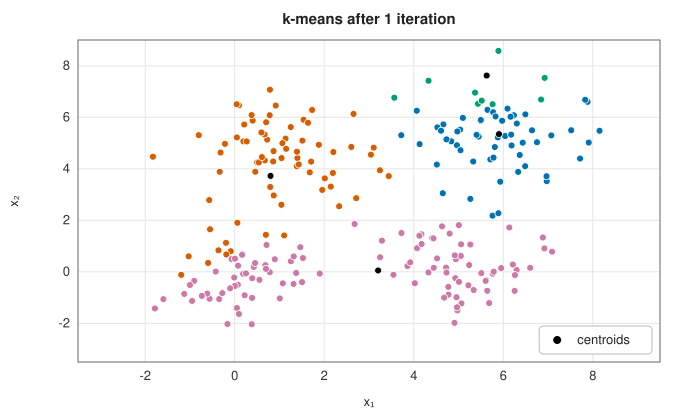
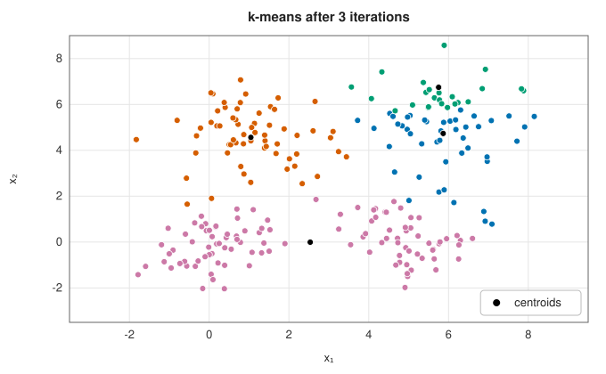
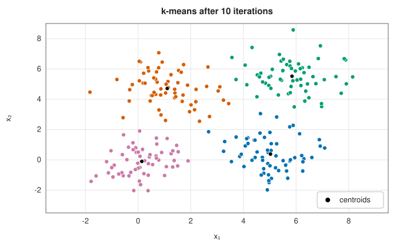
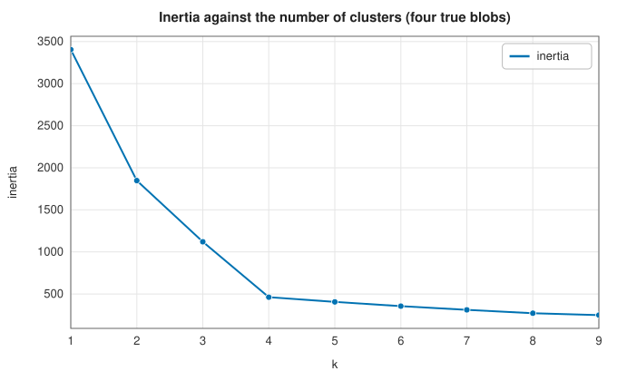
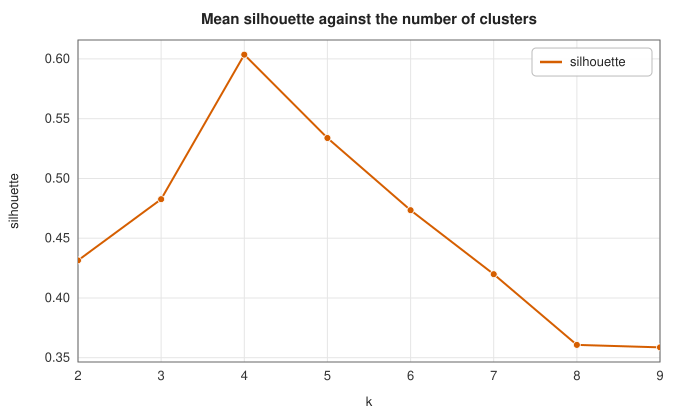
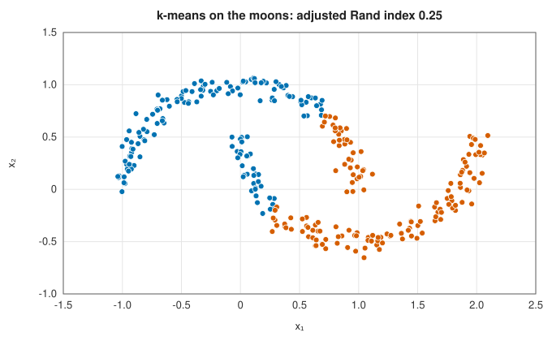
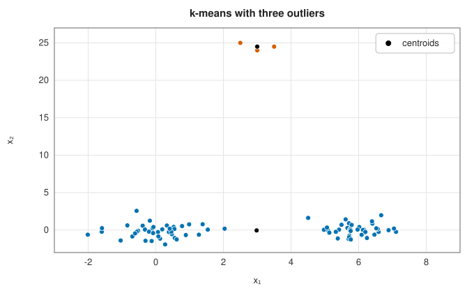
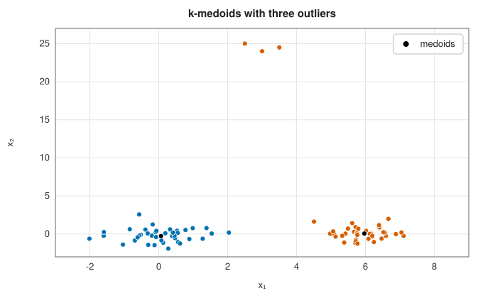

# k-means and k-medoids

<div class="entry-summary">

| | |
|---|---|
| **Problem** | Partition points into $k$ groups, each represented by a centre, minimising the total distance from points to their centres |
| **Devised by** | Hugo Steinhaus (1956); Stuart Lloyd (1957, published 1982), the alternating algorithm; James MacQueen (1967), the name k-means; Leonard Kaufman and Peter Rousseeuw (1987), k-medoids (PAM); David Arthur and Sergei Vassilvitskii (2007), k-means++ seeding |
| **Accuracy** | Lloyd's algorithm converges to a local minimum in finitely many steps; k-means++ seeding is within $O(\log k)$ of the optimum in expectation |
| **Cost** | Lloyd: $O(nkp)$ per iteration. PAM: $O(k^2n^2)$ per swap pass in this implementation |
| **API** | [`KMeans`](../../api/lib_jsl_machine_learning/unsupervised/clustering/k_means/struct.KMeans.html) (`new(k, seed)`, `with_restarts`, `with_limits`, `centroids`, `inertia`, `predict`), [`KMedoids`](../../api/lib_jsl_machine_learning/unsupervised/clustering/k_medoids/struct.KMedoids.html) (`new(k)`, `fit_distances`, `medoids`, `cost`) |

</div>

## Overview

**k-means** is the most widely used clustering method. It describes each of $k$ clusters by its mean, the **centroid**, and assigns
every point to the nearest centroid. Fitting alternates two easy steps, assigning points and recomputing means, each of which
lowers the total squared distance. The result depends on the starting centres, and the method assumes the clusters are
compact, round and of similar size. **k-medoids** replaces each mean by an actual data point, the **medoid**, and squared distances
by plain distances. This makes it robust to outliers and lets it work from any matrix of dissimilarities, at a higher cost.

## History

Hugo Steinhaus (1956) proposed dividing a body into parts by minimising the moment of inertia about their centres. Stuart
Lloyd devised the alternating algorithm at Bell Labs in 1957 for quantising signals (pulse-code modulation); it circulated as
a technical report and was published only in 1982. Edward Forgy (1965) described the same method, and James MacQueen (1967)
named it k-means and studied an online variant. Leonard Kaufman and Peter Rousseeuw introduced Partitioning Around Medoids
(PAM) in 1987 and popularised it in their book *Finding Groups in Data* (1990). David Arthur and Sergei Vassilvitskii's
k-means++ seeding (2007) gave the first practical initialisation with a guarantee, and is now the default almost everywhere.

## The idea

### Lloyd's algorithm

k-means minimises the **inertia**, the within-cluster sum of squares

$$
W = \sum_{c=1}^k\sum_{i \in C_c}\lVert\mathbf x_i - \boldsymbol\mu_c\rVert^2.
$$

For fixed centres, $W$ is smallest when each point joins its nearest centre; for fixed clusters, it is smallest when each centre
is the mean of its cluster. Lloyd's algorithm alternates the two. Neither step can increase $W$ and there are finitely many
partitions, so the algorithm stops, but at a local minimum: a fixed point where no single step helps.

| | | |
|:---:|:---:|:---:|
|  |  |  |

From an unlucky seeding with two centres in the top-right blob, the boundaries move step by step until each blob has its own
centre. The nearest-centre rule makes every boundary a straight line (the cells form a **Voronoi diagram**), so k-means can only
find convex clusters.

### k-means++ seeding and restarts

**k-means++** picks the first centre uniformly at random and each further centre with probability proportional to the squared
distance to the nearest centre already chosen. Points far from every existing centre are likely picks, so the seeds spread across
the data. The expected inertia of the seeding alone is within a factor $8(\ln k + 2)$ of the optimum, and Lloyd's iterations only
improve it. Even so, a single run can stop in a poor local minimum. The remedy is to run several seedings and keep the best.
On nine blobs in a 3 × 3 grid, over 200 seeds:

{{#include ../generated/unsupervised/kmeans_restarts.md}}

The library uses five restarts by default.

### Choosing k

$W$ always falls as $k$ grows, reaching zero when every point is its own cluster, so it cannot choose $k$ by itself. Two common
heuristics are the **elbow**, the $k$ beyond which $W$ falls slowly, and the mean **silhouette**, which compares each point's mean distance to
its own cluster with its distance to the nearest other cluster (see [Foundations](../machine_learning/foundations.md#metrics)):

| | |
|:---:|:---:|
|  |  |

Both point to the four blobs that generated the data. On real data the elbow is rarely this sharp. A probabilistic model with an
information criterion ([Gaussian mixtures](gaussian-mixtures.md)) or a density method that needs no $k$ ([DBSCAN](density.md)) are the alternatives.

### What k-means cannot do



Straight boundaries cannot follow curved clusters. k-means cuts the two moons across the middle. Clusters of very different
sizes or elongated shapes suffer in the same way, because the squared-distance objective prefers round clusters of equal spread.

### k-medoids

**k-medoids** restricts each centre to be one of the data points and minimises the sum of plain distances,
$\sum_c\sum_{i \in C_c}d(\mathbf x_i, \mathbf m_c)$. Two consequences follow:

- Any dissimilarity $d$ can be used, even one with no coordinates behind it: edit distances between strings, or
  1 − correlation between time series. The method needs only the $n \times n$ matrix.
- Outliers matter less. Squared distances make a far point's pull grow quadratically. A medoid must be a real point, and
  plain distances grow only linearly.

| | |
|:---:|:---:|
|  |  |

Three outliers far above two clusters are enough to make k-means spend a centre on them and merge the two real clusters.
k-medoids keeps the clusters and attaches the outliers to the nearer one.

Kaufman and Rousseeuw's **PAM** algorithm has two phases. **BUILD** chooses the medoids greedily: first the point with the smallest total distance to the
others, then repeatedly the point that most reduces the cost. **SWAP** then tries every exchange of a medoid with a non-medoid and makes the
best improving one, until no exchange helps. Each SWAP pass examines $k(n - k)$ exchanges, which makes PAM much slower than k-means:

{{#include ../generated/unsupervised/kmedoids_time.md}}

## Algorithm

**k-means++ seeding.**

1. Choose the first centre uniformly at random from the data points.
2. For each data point, compute $D(\mathbf x_i)$, its distance to the nearest centre chosen so far.
3. Choose the next centre from the data points with probability proportional to
   $D(\mathbf x_i)^2$.
4. Repeat steps 2 and 3 until there are $k$ centres.

**Lloyd's algorithm**, from a set of centres.

1. **Assign** each point to its nearest centre.
2. **Update** each centre to the mean of the points assigned to it. If a cluster has become
   empty, place its centre on the point that is currently farthest from its own centre.
3. If no centre moved by more than the tolerance, stop; otherwise go to 1.

Each iteration costs $O(nkp)$ for $n$ points in $p$ dimensions.

**The complete method**: run the seeding and Lloyd's algorithm `n_init` times with different
random numbers, and keep the run with the smallest inertia.

**k-medoids** (PAM), on a matrix of pairwise dissimilarities.

1. **BUILD.** Choose as the first medoid the point with the smallest total distance to all the
   others. Then, until there are $k$ medoids, add the point whose addition reduces the total
   distance from every point to its nearest medoid the most.
2. **SWAP.** For every pair of a medoid and a non-medoid, compute the change in the total
   distance if the two exchanged roles. If the best exchange lowers the total, make it and
   repeat; otherwise stop.

## Implementation

```rust,ignore
{{#include ../../../crates/machine_learning/src/unsupervised/clustering/k_means.rs:kmeanspp}}
```

```rust,ignore
{{#include ../../../crates/machine_learning/src/unsupervised/clustering/k_means.rs:lloyd}}
```

```rust,ignore
{{#include ../../../crates/machine_learning/src/unsupervised/clustering/k_medoids.rs:pam}}
```

- All restarts draw from one random stream seeded by `seed`, so a fit is reproducible.
- `predict` assigns new points to the nearest fitted centroid; k-medoids has no `predict`, since its medoids are indices into the
  training data.
- The SWAP phase recomputes the full cost for every trial exchange. Faster variants (FastPAM, CLARA) update costs
  incrementally or work on samples.

## In practice

```rust,ignore
{{#include ../../../crates/machine_learning/examples/ml_kmeans.rs}}
```

```text
k = 2: inertia  1847.7, silhouette 0.431
k = 3: inertia  1120.9, silhouette 0.483
k = 4: inertia   462.5, silhouette 0.604
k = 5: inertia   406.3, silhouette 0.534
k = 6: inertia   355.9, silhouette 0.473
centroids:
[[5.85, 5.52],
 [1.11, 4.71],
 [0.14, -0.10],
 [5.03, 0.38]]
medoids ["cat", "dig"], labels [0, 0, 0, 0, 1, 0, 1, 1], total distance 7
```

The word example clusters by the Hamming distance between three-letter words. "dot" differs from both medoids in two letters.
The tie goes to the first medoid, a reminder that ties are common with integer-valued dissimilarities.

**Strengths**

- k-means is simple and fast, scales to millions of points, and gives centroids that summarise each cluster.
- k-medoids works with any dissimilarity, resists outliers, and its centres are real, interpretable examples.

**Weaknesses**

- Both need $k$ in advance and find only convex, roughly equal clusters.
- k-means is sensitive to feature scales, outliers and initialisation; PAM costs $O(n^2)$ memory and is slow beyond a few thousand points.

## Exercises

1. Show that, for a fixed cluster, the mean minimises $\sum_i\lVert\mathbf x_i - \boldsymbol\mu\rVert^2$, and that the median minimises $\sum_i|x_i - m|$ in one dimension.
2. Prove that Lloyd's algorithm terminates in finitely many iterations.
3. Construct four points in the plane and a seeding from which Lloyd's algorithm converges to a clustering with twice the optimal inertia.
4. Show that $W = \frac12\sum_c\frac{1}{|C_c|}\sum_{i, j \in C_c}\lVert\mathbf x_i - \mathbf x_j\rVert^2$, so k-means also minimises within-cluster pairwise distances.
5. Implement MacQueen's online update, which moves the nearest centre a step $1/n_c$ towards each new point, and compare it with Lloyd's algorithm.

## Further reading

- S. P. Lloyd, "Least squares quantization in PCM", *IEEE Transactions on Information Theory* 28 (1982) 129–137.
- D. Arthur and S. Vassilvitskii, "k-means++: the advantages of careful seeding", *Proceedings of the 18th ACM-SIAM Symposium on Discrete
  Algorithms* (2007) 1027–1035.
- L. Kaufman and P. J. Rousseeuw, *Finding Groups in Data: An Introduction to Cluster Analysis*, Wiley, 1990, chapter 2.
- A. K. Jain, "Data clustering: 50 years beyond K-means", *Pattern Recognition Letters* 31 (2010) 651–666.
