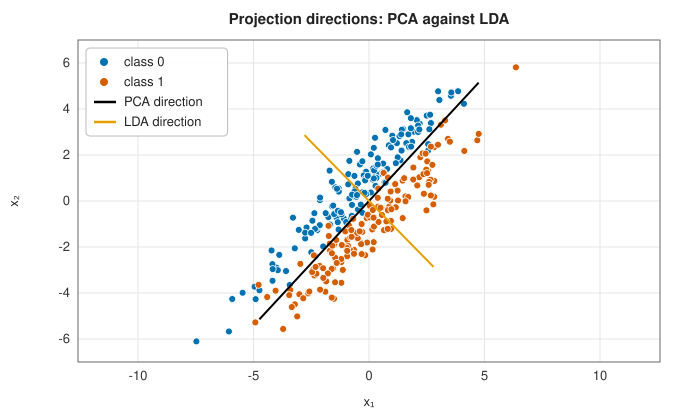
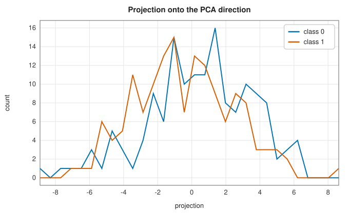
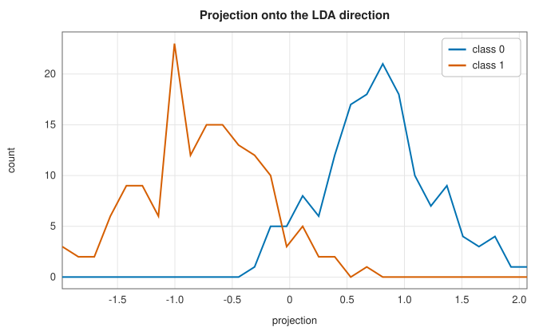
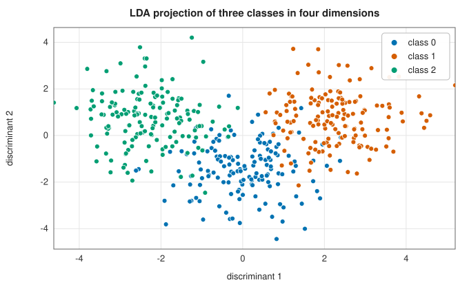
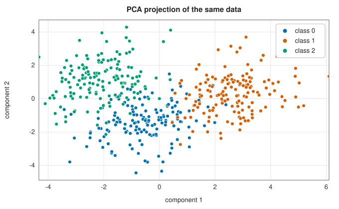

# Linear discriminant analysis

<div class="entry-summary">

| | |
|---|---|
| **Problem** | Find the projection that best separates labelled classes, maximising between-class scatter relative to within-class scatter; classify in that projection |
| **Devised by** | Ronald Fisher (1936), the linear discriminant; C. R. Rao (1948), several classes |
| **Accuracy** | The Bayes-optimal classifier when the classes are Gaussian with a shared covariance |
| **Cost** | $O(np^2 + p^3)$: two scatter matrices, a Cholesky factorisation and a symmetric eigenproblem |
| **API** | [`Lda`](../../api/lib_jsl_machine_learning/unsupervised/reduction/lda/struct.Lda.html) (`new(components)`, `with_shrinkage`, `fit_labelled`, `transform`, `directions`, `eigenvalues`); implements [`Classifier`](../../api/lib_jsl_machine_learning/common/trait.Classifier.html) |

</div>

## Overview

PCA looks for directions of large variance, but the variance may have nothing to do with the classes. **Linear discriminant
analysis** (LDA) is the supervised counterpart. It looks for directions along which the class means are far apart *relative to the
spread within each class*. With $K$ classes there are at most $K - 1$ such directions, so LDA reduces the data to a few dimensions chosen for
classification. The same model is a classifier: a Gaussian model with one covariance shared by all classes, whose decision
boundaries are hyperplanes. It sits in this chapter as a dimensionality reduction method, though, unlike the others here,
it needs labels.

## History

Ronald Fisher (1936) introduced the linear discriminant to distinguish three species of iris from four measurements of their
flowers, a data set still used as a first example. His aim was the linear combination of measurements that best separated two
species. C. R. Rao (1948) extended it to several classes. The method became standard in statistics and pattern recognition, for
example as "Fisherfaces" for face recognition (Peter Belhumeur, João Hespanha and David Kriegman, 1997).

## The idea

### Fisher's criterion

For classes $c = 1, \ldots, K$ with $n_c$ points, means $\boldsymbol\mu_c$ and overall mean $\boldsymbol\mu$, define the **within-class** and **between-class scatter**

$$
S_w = \frac1n\sum_c\sum_{i \in c}(\mathbf x_i - \boldsymbol\mu_c)(\mathbf x_i - \boldsymbol\mu_c)^{\mathsf T}, \qquad S_b = \sum_c\frac{n_c}{n}(\boldsymbol\mu_c - \boldsymbol\mu)(\boldsymbol\mu_c - \boldsymbol\mu)^{\mathsf T}.
$$

Projected onto $\mathbf w$, the classes have between-class variance $\mathbf w^{\mathsf T}S_b\mathbf w$ and within-class variance $\mathbf w^{\mathsf T}S_w\mathbf w$. Fisher maximised the ratio

$$
J(\mathbf w) = \frac{\mathbf w^{\mathsf T}S_b\mathbf w}{\mathbf w^{\mathsf T}S_w\mathbf w},
$$

whose stationary points satisfy the **generalised eigenproblem** $S_b\mathbf w = \lambda S_w\mathbf w$. The eigenvalue $\lambda = J(\mathbf w)$ measures how well the direction separates the classes.
$S_b$ is a sum of $K$ rank-one terms whose weighted vectors sum to zero, so its rank is at most $K - 1$, and so is the number of useful directions.
For two classes the solution is explicit: $\mathbf w \propto S_w^{-1}(\boldsymbol\mu_1 - \boldsymbol\mu_0)$.

### PCA against LDA

Two elongated classes lie side by side, offset across their long axis:



<p class="caption" id="fig-12-10"><strong>Figure 12.10.</strong> PCA and LDA directions.</p>

| | |
|:---:|:---:|
|  |  |

The direction of greatest variance runs along both classes, and projecting onto it mixes them completely. LDA's direction runs across
them, where they differ, and separates them with little overlap. A method that discards labels can discard exactly the
information a classifier needs.

### Solving the generalised eigenproblem

The library reduces $S_b\mathbf w = \lambda S_w\mathbf w$ to an ordinary symmetric eigenproblem. Factor $S_w = LL^{\mathsf T}$ by [Cholesky](../linear_algebra/cholesky.md) and substitute $\mathbf w = L^{-\mathsf T}\mathbf v$:

$$
L^{-1}S_bL^{-\mathsf T}\mathbf v = \lambda\mathbf v.
$$

This **whitens** the within-class scatter: in coordinates $L^{-1}\mathbf x$, every class has identity within-class covariance, and LDA becomes PCA of the class
means. The directions $\mathbf w = L^{-\mathsf T}\mathbf v$ are then normalised to unit length. When features are nearly collinear or there are more features than samples, $S_w$
is singular, so a ridge (`with_shrinkage`, a fraction of the mean diagonal, $10^{-6}$ by default) is added before factorising.

### LDA as a classifier

If each class is Gaussian with mean $\boldsymbol\mu_c$ and a covariance $\Sigma$ shared by all classes, Bayes' rule gives the score

$$
\delta_c(\mathbf x) = \log\pi_c - \tfrac12(\mathbf x - \boldsymbol\mu_c)^{\mathsf T}\Sigma^{-1}(\mathbf x - \boldsymbol\mu_c),
$$

where $\pi_c$ is the prior probability of class $c$. The quadratic terms in $\mathbf x$ cancel between classes, so the boundaries are linear. With all $K - 1$ directions kept, this is the same as
choosing the nearest class mean in the projected space, measured in within-class standard deviations, with a log-prior
adjustment. The library classifies this way, using the directions it keeps. On three overlapping classes in four dimensions:

| | |
|:---:|:---:|
|  |  |

<p class="caption" id="tab-12-12"><strong>Table 12.12.</strong> Columns: classifier (450 training, 900 test points), test accuracy.</p>

{{#include ../generated/unsupervised/lda_accuracy.md}}

LDA matches logistic regression here, as expected: the data are Gaussian with a shared covariance. Keeping only the first
discriminant costs six points of accuracy.

## Algorithm

**Fit.**

1. **Scatter matrices.** Compute the mean of each class and the overall mean, and from them
   $S_w$ and $S_b$. Add the ridge to the diagonal of $S_w$.
2. **Whiten.** Compute the Cholesky factor $S_w = LL^{\mathsf T}$. Form $M = L^{-1}S_bL^{-\mathsf T}$ by
   two sets of triangular solves, and replace $M$ by $\tfrac12(M + M^{\mathsf T})$ to remove the
   slight asymmetry that rounding introduces.
3. **Eigenvectors.** Compute the eigenvectors $\mathbf v$ of $M$ belonging to its largest
   eigenvalues, at most $K - 1$ of them.
4. **Map back.** Solve $L^{\mathsf T}\mathbf w = \mathbf v$ for each discriminant direction, normalise it
   to unit length, and fix its sign so that its largest entry is positive.
5. **Prepare the classifier.** Store the projections of the class means onto the directions,
   the logarithms of the class priors, and the within-class variance along each direction.

**Transform** a point: take its dot product with each direction.

**Classify** a point: project it; for each class, compute the squared distance from the
projected class mean, with each direction divided by its within-class variance; subtract twice
the log prior; return the class with the smallest result.

## Implementation

```rust,ignore
{{#include ../../../crates/machine_learning/src/unsupervised/reduction/lda.rs:lda_whiten}}
```

- The projected within-class covariance is diagonal by construction ($\mathbf w_i^{\mathsf T}S_w\mathbf w_j = 0$ for $i \ne j$), so per-direction variances are enough for the classifier.
- `Lda` lives with the reduction methods but implements `Classifier`, so it can be used wherever a classifier is expected.

## In practice

```rust,ignore
{{#include ../../../crates/machine_learning/examples/ml_lda.rs}}
```

```text
Fisher ratios [4.255, 0.838]
directions (columns):
[[0.806, 0.061],
 [-0.180, 0.978],
 [-0.475, 0.140],
 [0.303, -0.142]]
projected test data: (900, 2)
test accuracy 0.912
```

**Strengths**

- Supervised reduction to at most $K - 1$ dimensions, chosen for separating the classes.
- A fast, closed-form classifier, optimal for Gaussian classes with a shared covariance, and robust with little data.

**Weaknesses**

- Linear boundaries only; classes with different covariances need quadratic discriminant analysis.
- Class means that coincide give no direction, even if the classes differ in spread.
- Needs shrinkage when features outnumber samples.

## Exercises

1. Show that the maximiser of $J(\mathbf w)$ for two classes is $\mathbf w \propto S_w^{-1}(\boldsymbol\mu_1 - \boldsymbol\mu_0)$.
2. Show that $\operatorname{rank}S_b \le K - 1$.
3. Show that the eigenvectors $\mathbf w_i$ of the generalised problem satisfy $\mathbf w_i^{\mathsf T}S_w\mathbf w_j = 0$ for $i \ne j$.
4. Derive the linear discriminant scores from Gaussian class densities with a shared covariance, and show that the boundaries are hyperplanes.
5. For two classes, show that the LDA direction is proportional to the least-squares regression coefficients for a ±1 class indicator.

## Further reading

- R. A. Fisher, "The use of multiple measurements in taxonomic problems", *Annals of Eugenics* 7 (1936) 179–188.
- T. Hastie, R. Tibshirani and J. Friedman, *The Elements of Statistical Learning*, 2nd ed., Springer, 2009, section 4.3.
- P. N. Belhumeur, J. P. Hespanha and D. J. Kriegman, "Eigenfaces vs. Fisherfaces: recognition using class specific linear projection",
  *IEEE Transactions on Pattern Analysis and Machine Intelligence* 19 (1997) 711–720.
