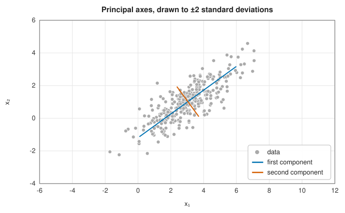
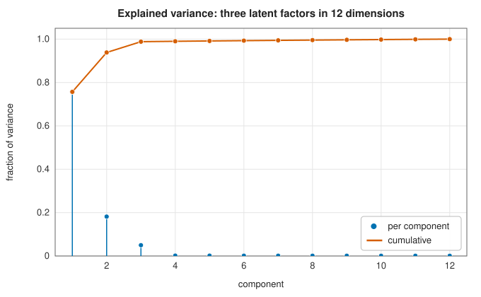
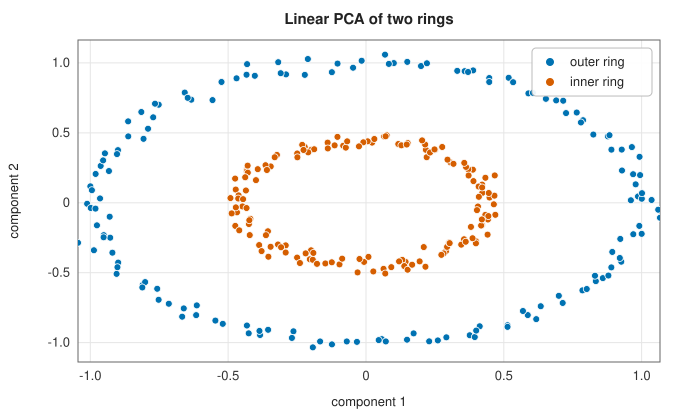
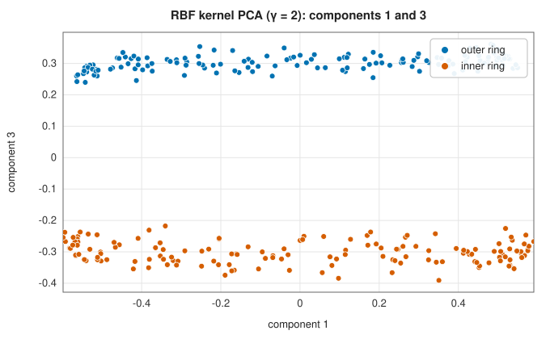
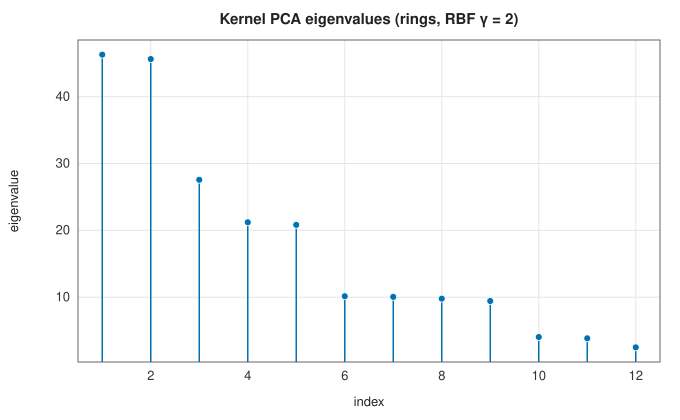

# Principal component analysis and kernel PCA

<div class="entry-summary">

| | |
|---|---|
| **Problem** | Find the orthogonal directions of greatest variance and project data onto the first few; extend this to nonlinear structure through a kernel |
| **Devised by** | Karl Pearson (1901), lines of closest fit; Harold Hotelling (1933), principal components; Kari Karhunen (1946) and Michel Loève (1955), the continuous expansion; Bernhard Schölkopf, Alexander Smola and Klaus-Robert Müller (1998), kernel PCA |
| **Accuracy** | Exact up to the eigensolver; the variances agree with NumPy's SVD to $10^{-13}$ (table below) |
| **Cost** | PCA: $O(np^2 + p^3)$ via the covariance matrix. Kernel PCA: $O(n^2p + n^3)$ via the Gram matrix |
| **API** | [`Pca`](../../api/lib_jsl_machine_learning/unsupervised/reduction/principal_component_analysis/struct.Pca.html) (`new(components)`, `components`, `explained_variance`, `explained_variance_ratio`, `inverse_transform`), [`KernelPca`](../../api/lib_jsl_machine_learning/unsupervised/reduction/kernel_pca/struct.KernelPca.html) (`new(kernel, components)`, `eigenvalues`); both implement [`Transformer`](../../api/lib_jsl_machine_learning/common/trait.Transformer.html) |

</div>

## Overview

Measured features are often redundant: height and weight, or the prices of related stocks, move together. **Principal component
analysis** (PCA) rotates the data to new axes, the **principal components**, ordered so that the first captures as much variance as
possible, the second as much of the rest, and so on. Keeping the first few gives a lower-dimensional summary that loses the least
variance, for visualisation, compression, denoising or as input to another model. **Kernel PCA** does the same in the feature space of
a kernel, where curved structure in the original space can become linear.

## History

Karl Pearson (1901) sought the line and plane of closest fit to a cloud of points. Harold Hotelling (1933), analysing
psychological test scores, introduced the name principal components and the eigenvector formulation. The same expansion for random processes
is the Karhunen-Loève transform (Kari Karhunen, 1946; Michel Loève), and in other fields PCA is known as empirical orthogonal
functions (meteorology) or proper orthogonal decomposition (fluid mechanics). Bernhard Schölkopf, Alexander Smola and
Klaus-Robert Müller (1998) expressed PCA through inner products only, so that a kernel could replace them.

## The idea

### Directions of greatest variance

Centre the data, $\tilde{\mathbf x}_i = \mathbf x_i - \bar{\mathbf x}$, and form the sample covariance $C = \frac{1}{n - 1}\sum_i\tilde{\mathbf x}_i\tilde{\mathbf x}_i^{\mathsf T}$. The variance of the projections onto a unit vector $\mathbf u$ is $\mathbf u^{\mathsf T}C\mathbf u$, and
maximising this Rayleigh quotient gives the eigenvector of $C$ with the largest eigenvalue. The next direction, constrained to be orthogonal to the first,
is the next eigenvector. So

$$
C = U\Lambda U^{\mathsf T}, \qquad \text{scores } \mathbf z_i = U_q^{\mathsf T}\tilde{\mathbf x}_i,
$$

where $U_q$ holds the first $q$ eigenvectors and $\lambda_j$ is the variance along the $j$-th axis. The scores are uncorrelated.



### Best low-rank reconstruction

The same axes solve a second problem: among all $q$-dimensional subspaces, the span of $U_q$ minimises the sum of squared distances from the points
to their projections (the Eckart-Young theorem). The reconstruction $\hat{\mathbf x}_i = \bar{\mathbf x} + U_q\mathbf z_i$ has mean squared error equal to the sum of the discarded
eigenvalues (times $(n - 1)/n$, divided by $p$ for a per-feature mean):

{{#include ../generated/unsupervised/pca_reconstruction.md}}

The last two columns agree to every printed digit.

### How many components?

The **explained variance ratio** $\lambda_j/\sum_k\lambda_k$ shows how much each component matters. For data generated from three hidden factors in 12
dimensions plus noise:



The first three components carry 98.8% of the variance, and the remaining nine share the noise equally. A **scree plot** like this,
or a target fraction such as 95%, is the usual way to choose $q$. PCA depends on the units: a feature measured in millimetres
dominates one in metres, so features on different scales should be standardised first, which amounts to PCA of the correlation matrix.

### Testing against NumPy

On 200 points in five dimensions driven by two factors, the library's variances agree with those from NumPy's SVD of the centred
data to $8 \times 10^{-14}$ relative, and the two leading axes (up to sign) to $7 \times 10^{-16}$; see the [reference table](hierarchical.md#checking-against-scipy). The trailing axes span
nearly equal noise variances and are only defined up to rotation, so they are not compared.

### Kernel PCA

PCA only finds linear structure. Two concentric rings have no direction of high variance that separates them. Kernel PCA maps
each point to features $\varphi(\mathbf x)$ and performs PCA there, using only inner products $k(\mathbf x, \mathbf x') = \varphi(\mathbf x)^{\mathsf T}\varphi(\mathbf x')$ ([kernels](../machine_learning/support-vector-machines.md#the-dual-problem-and-kernels)). Every principal axis is a combination of the
mapped training points, $\mathbf v = \sum_i\alpha_i\varphi(\mathbf x_i)$, and the coefficients solve an eigenproblem of the **centred Gram matrix**

$$
\tilde K = K - \mathbf 1_nK - K\mathbf 1_n + \mathbf 1_nK\mathbf 1_n, \qquad \tilde K\boldsymbol\alpha = \lambda\boldsymbol\alpha,
$$

where $\mathbf 1_n$ is the matrix with every entry $1/n$, which centres the features. The scores of a new point are $\sum_i\alpha_i\tilde k(\mathbf x, \mathbf x_i)$, with $\boldsymbol\alpha$ scaled to $1/\sqrt\lambda$ so that the axis has
unit length in feature space.

| | |
|:---:|:---:|
|  |  |

Linear PCA only rotates the rings. With an RBF kernel, the first two components describe the angle around the rings (a degenerate
pair, like a sine and a cosine), and the third separates the inner ring from the outer one. The eigenvalues come in such pairs:



The centred Gram matrix always has the eigenvalue zero (the constant vector) and, for smooth kernels, many tiny ones. That
rank deficiency exposed a convergence bug in the library's [symmetric eigensolver](../linear_algebra/eigensolvers.md#implementation), fixed while the previous
chapter was written.

## Algorithm

1. **PCA**: subtract the column means; form $C = \tilde X^{\mathsf T}\tilde X/(n - 1)$; compute its eigendecomposition; keep the eigenvectors of the $q$ largest
   eigenvalues, with the largest entry of each made positive.
2. **Kernel PCA**: form the Gram matrix $K$ and double-centre it; compute its eigendecomposition; keep the $q$ largest, scaling each
   eigenvector by $1/\sqrt\lambda$. To transform new points, centre their kernel rows with the stored training means.

## Implementation

```rust,ignore
{{#include ../../../crates/machine_learning/src/unsupervised/reduction/principal_component_analysis.rs:pca_fit}}
```

```rust,ignore
{{#include ../../../crates/machine_learning/src/unsupervised/reduction/kernel_pca.rs:kpca_fit}}
```

- PCA works through the $p \times p$ covariance matrix, which is efficient when $n \gg p$. For wide data ($p > n$), or for the best accuracy, the SVD of
  the centred data matrix is preferable: forming $C$ squares the condition number.
- Kernel PCA stores the training data and needs a cross-kernel row per new point. With the linear kernel its scores equal `Pca`'s up
  to sign: both are $\sqrt\lambda\,\mathbf v$ for the eigenpairs of $\tilde X\tilde X^{\mathsf T}$.

## In practice

```rust,ignore
{{#include ../../../crates/machine_learning/examples/ml_pca.rs}}
```

```text
explained variance ratio [0.6842, 0.3046, 0.0042, 0.0035, 0.0035]
two components: reconstruction RMS error 0.228 (noise level 0.3)
first axis [0.776, 0.247, -0.012, 0.519, -0.261]
kernel PCA eigenvalues [30.85, 30.23, 18.68]; component 3 means: outer 0.304, inner -0.304
```

Two components explain 99% of the variance. The reconstruction error is below the noise level, because the part of the noise
that lies in the two-dimensional subspace is kept.

**Strengths**

- Fast, exact and parameter-free; uncorrelated scores; the optimal linear compression.
- Kernel PCA finds nonlinear structure with the same linear algebra.

**Weaknesses**

- Linear PCA misses curved structure; the components need not be interpretable or relevant to a later prediction task.
- Sensitive to feature scales and outliers.
- Kernel PCA costs $O(n^3)$, keeps the training set, and has no simple inverse mapping back to the inputs.

## Exercises

1. Show that the first principal axis maximises $\mathbf u^{\mathsf T}C\mathbf u$ subject to $\lVert\mathbf u\rVert = 1$, using a Lagrange multiplier.
2. Show that the principal axes are the right singular vectors of the centred data matrix, and relate the singular values to the eigenvalues of $C$.
3. Prove that the reconstruction error with $q$ components is $\frac{n - 1}{n}\sum_{j > q}\lambda_j$ per point.
4. Show that kernel PCA with the linear kernel reproduces the PCA scores exactly, up to sign.
5. Derive the double-centring formula from $\tilde\varphi(\mathbf x) = \varphi(\mathbf x) - \frac1n\sum_j\varphi(\mathbf x_j)$.

## Further reading

- I. T. Jolliffe, *Principal Component Analysis*, 2nd ed., Springer, 2002.
- H. Hotelling, "Analysis of a complex of statistical variables into principal components", *Journal of Educational Psychology* 24 (1933) 417–441, 498–520.
- B. Schölkopf, A. Smola and K.-R. Müller, "Nonlinear component analysis as a kernel eigenvalue problem", *Neural Computation* 10 (1998) 1299–1319.
- I. T. Jolliffe and J. Cadima, "Principal component analysis: a review and recent developments", *Philosophical Transactions of the Royal Society A* 374 (2016) 20150202.
