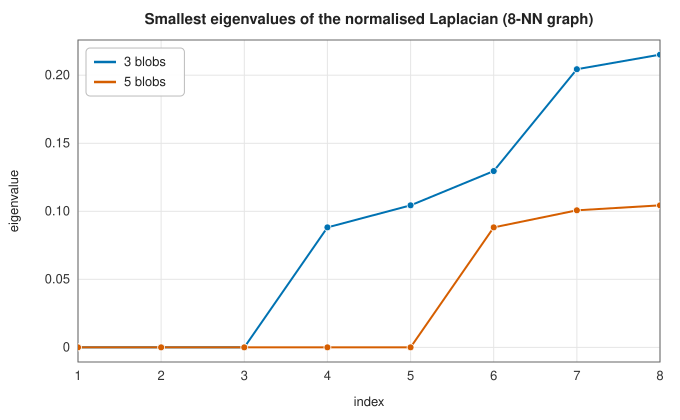
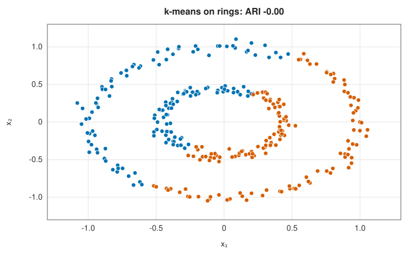
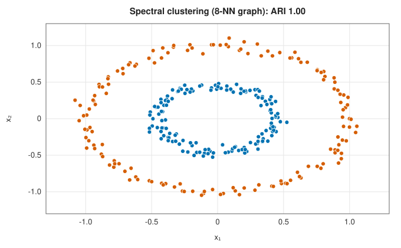

# Spectral clustering

<div class="entry-summary">

| | |
|---|---|
| **Problem** | Cluster points by the connectivity of a similarity graph, using eigenvectors of its Laplacian |
| **Devised by** | Miroslav Fiedler (1973), algebraic connectivity; William Donath and Alan Hoffman (1973), graph partitioning by eigenvectors; Jianbo Shi and Jitendra Malik (2000), normalised cuts; Andrew Ng, Michael Jordan and Yair Weiss (2002), the normalised embedding used here |
| **Accuracy** | Exact for graphs with $k$ disconnected components; a relaxation of the normalised-cut problem otherwise |
| **Cost** | $O(n^2p)$ to build the graph and $O(n^3)$ for the dense eigendecomposition |
| **API** | [`SpectralClustering`](../../api/lib_jsl_machine_learning/unsupervised/clustering/spectral_clustering/struct.SpectralClustering.html) (`new(k, affinity, seed)`, `eigenvalues`), [`Affinity`](../../api/lib_jsl_machine_learning/unsupervised/clustering/spectral_clustering/enum.Affinity.html) (`Rbf { gamma }`, `NearestNeighbors { k }`) |

</div>

## Overview

**Spectral clustering** turns the data into a graph, with points as vertices and edges between similar points, and looks for groups of
vertices that are well connected inside and weakly connected to each other. The eigenvectors of the graph's **Laplacian**
matrix with the smallest eigenvalues give each point new coordinates in which such groups are compact and well separated, and
k-means finishes the job. Because it clusters by connectivity rather than by distance to a centre, it separates rings, moons and
other shapes that defeat centroid methods.

## History

Miroslav Fiedler (1973) showed that the second-smallest eigenvalue of a graph's Laplacian measures how well connected the
graph is, and that its eigenvector, the **Fiedler vector**, splits the graph. William Donath and Alan Hoffman (1973) used eigenvectors
to partition circuits. In image segmentation, Jianbo Shi and Jitendra Malik (2000) relaxed the NP-hard **normalised cut** to an
eigenproblem. Andrew Ng, Michael Jordan and Yair Weiss (2002) gave the simple algorithm with row normalisation used here, and
Ulrike von Luxburg's tutorial (2007) set out the theory.

## The idea

### The similarity graph

The method first builds a symmetric weight matrix $W$ with $W_{ij} \ge 0$ large for similar points. The library offers two choices:

- **RBF**: $W_{ij} = e^{-\gamma\lVert\mathbf x_i - \mathbf x_j\rVert^2}$, a dense graph whose reach is set by $\gamma$.
- **$k$-nearest neighbours**: $W_{ij} = 1$ if either point is among the other's $k$ nearest, else 0. Only nearby points are connected, so the graph
  follows the shape of the data.

### The Laplacian and its null space

Think of the points as the vertices of a graph, with $W_{ij}$ the weight of the edge between
points $i$ and $j$. A clustering assigns a label to each vertex, and a good one seldom gives
different labels to strongly connected vertices. That requirement can be expressed with a
matrix. Let the **degree** of vertex $i$ be the total weight of its edges,
$D_{ii} = \sum_jW_{ij}$, collected in a diagonal matrix $D$. The **graph Laplacian** is
$L = D - W$. For any vector $\mathbf f$ that assigns a number $f_i$ to each vertex, expanding
$\mathbf f^{\mathsf T}D\mathbf f - \mathbf f^{\mathsf T}W\mathbf f = \sum_iD_{ii}f_i^2 - \sum_{i,j}W_{ij}f_if_j$ and
using the symmetry of $W$ gives

$$
\mathbf f^{\mathsf T}L\mathbf f = \tfrac12\sum_{i,j}W_{ij}(f_i - f_j)^2 \ge 0,
$$

This quantity adds up, over all edges, the squared difference of $\mathbf f$ across the edge,
weighted by the edge's strength. It is small when $\mathbf f$ is nearly constant across strongly
weighted edges, which is exactly what we want of a labelling.

It is zero only if $f_i = f_j$ wherever $W_{ij} > 0$, that is, if $\mathbf f$ is constant on each
connected component of the graph. Since $\mathbf f^{\mathsf T}L\mathbf f \ge 0$ always, such vectors are
eigenvectors of $L$ with eigenvalue 0, the smallest possible. So a graph with $k$ components has
the eigenvalue 0 with multiplicity $k$, and the corresponding eigenvectors are combinations of
the **indicator vectors** of the components (1 on one component, 0 elsewhere). The clusters can
be read off from the eigenvectors of smallest eigenvalue. That is the whole idea of spectral
clustering; the rest is about making it robust when the clusters are not perfectly separated.
Clusters that are almost disconnected give $k$ eigenvalues near zero and a jump, the **eigengap**, after them:



<p class="caption" id="fig-12-6"><strong>Figure 12.6.</strong> Laplacian eigenvalues.</p>

With three blobs, three eigenvalues are zero and the fourth jumps to 0.09; with five blobs the jump comes after the fifth. The
eigengap is a natural guide to the number of clusters.

### Normalised cuts and the embedding

Splitting a graph by the minimum total weight of cut edges tends to cut off single points. The **normalised cut** divides the cut
weight by the total degree of each side, which favours balanced parts. Finding the best normalised cut is NP-hard, but allowing
the cluster indicators to take real values turns it into an eigenproblem for the **normalised Laplacian**

$$
L_{\text{sym}} = I - D^{-1/2}WD^{-1/2}.
$$

Ng, Jordan and Weiss take the $k$ eigenvectors of $L_{\text{sym}}$ with the smallest eigenvalues as the columns of an $n \times k$ matrix. They scale each row to unit
length and cluster the rows with k-means. For disconnected clusters the rows of each cluster coincide on one point of the unit
sphere, orthogonal to the other clusters' points. The clusters are then trivially separable, and k-means with sensible
seeding finds them (Lloyd's algorithm can still stop in a poor local optimum if two initial centres fall in the same cluster). Weak connections only perturb this picture.

| | |
|:---:|:---:|
|  |  |

k-means cuts the rings in half. The 8-nearest-neighbour graph has no edges between the rings, so spectral clustering separates
them perfectly.

### The graph decides

Everything depends on building a graph whose components are the clusters:

<p class="caption" id="tab-12-10"><strong>Table 12.10.</strong> Spectral clustering with different similarity graphs.</p>

{{#include ../generated/unsupervised/spectral_graphs.md}}

With 3 neighbours the graph falls into many small pieces, and the eigenvectors describe those pieces instead of the clusters; with 40
it connects the two moons. An RBF graph needs $\gamma$ large enough (a reach $1/\sqrt\gamma$ below the gap between clusters) to cut the weak links. The
nearest-neighbour graph adapts to the local density and works over a wide range of $k$.

## Algorithm

Input: the data, the number of clusters $k$ and the choice of graph.

1. **Build the graph.** Compute the weight matrix $W$: either the RBF similarities, or the
   $k$-nearest-neighbour graph made symmetric by joining two points if either is among the
   other's nearest neighbours. Set its diagonal to zero. Compute the degrees $D_{ii}$.
2. **Form the normalised Laplacian** $L_{\text{sym}} = I - D^{-1/2}WD^{-1/2}$.
3. **Eigenvectors.** Compute the eigendecomposition of $L_{\text{sym}}$ with the
   [symmetric eigensolver](../linear_algebra/eigensolvers.md), and take the eigenvectors of the
   $k$ smallest eigenvalues as the columns of an $n \times k$ matrix.
4. **Normalise the rows.** Scale each row of that matrix to unit length. Row $i$ is now the
   image of point $i$ in a $k$-dimensional space in which the clusters are compact.
5. **Cluster the rows** with k-means, using 10 restarts.

The cost is dominated by the dense eigendecomposition, $O(n^3)$, which limits the method to a
few thousand points.

## Implementation

```rust,ignore
{{#include ../../../crates/machine_learning/src/unsupervised/clustering/spectral_clustering.rs:spectral}}
```

- The dense symmetric eigensolver ([`eigh`](../linear_algebra/eigensolvers.md)) computes all $n$ eigenpairs, so the method suits up to a few thousand points. Large
  problems use sparse graphs and Lanczos iterations for the few eigenvectors needed.
- An isolated vertex (degree zero) gets a zero row in the embedding instead of a division by zero.

## In practice

```rust,ignore
{{#include ../../../crates/machine_learning/examples/ml_spectral.rs}}
```

```text
rings: k-means ARI -0.003, spectral ARI 1.000
smallest Laplacian eigenvalues for three blobs: [-0.0000, 0.0000, 0.0000, 0.0882, 0.1044, 0.1296]
```

**Strengths**

- Finds clusters of any shape that are connected in the graph; the eigengap suggests $k$.
- Works from any similarity matrix, including graphs with no coordinates at all.

**Weaknesses**

- The result depends on the graph construction ($k$ or $\gamma$), which needs tuning.
- The dense eigendecomposition costs $O(n^3)$ time and $O(n^2)$ memory; new points cannot be assigned without refitting.

## Exercises

1. Prove the identity $\mathbf f^{\mathsf T}L\mathbf f = \frac12\sum_{i,j}W_{ij}(f_i - f_j)^2$, and deduce that $L$ is positive semidefinite.
2. Show that the multiplicity of the eigenvalue 0 of $L$ equals the number of connected components.
3. Compute the Laplacian eigenvalues of a path graph and of a cycle graph with $n$ vertices.
4. Show that the eigenvalues of $L_{\text{sym}}$ lie in $[0, 2]$.
5. Relate the second eigenvector of $L$ (the Fiedler vector) to the ratio-cut problem for $k = 2$.

<details>
<summary>Hints and answers</summary>

1. $\mathbf f^{\mathsf T}L\mathbf f = \sum_id_if_i^2 - \sum_{ij}W_{ij}f_if_j = \tfrac12\sum_{ij}W_{ij}(f_i - f_j)^2 \ge 0$ since $d_i = \sum_jW_{ij}$.
2. $L\mathbf f = 0$ implies $\mathbf f^{\mathsf T}L\mathbf f = 0$, so $f_i = f_j$ whenever $W_{ij} > 0$: $\mathbf f$ is constant on each connected component, giving a null space of dimension equal to the number of components.
3. The path graph has eigenvalues $2 - 2\cos(\pi k/n)$ for $k = 0, \ldots, n - 1$ and the cycle graph $2 - 2\cos(2\pi k/n)$ for $k = 0, \ldots, n - 1$.
4. $L_{\mathrm{sym}} = I - D^{-1/2}WD^{-1/2}$ and the eigenvalues of $D^{-1/2}WD^{-1/2}$ lie in $[-1, 1]$ because it is similar to the random-walk matrix $D^{-1}W$, whose rows sum to 1 with non-negative entries.
5. Ratio cut minimises $\mathrm{cut}(A, \bar A)(1/|A| + 1/|\bar A|)$. Relaxing the discrete indicator vector to a real vector orthogonal to $\mathbf 1$ turns the problem into minimising $\mathbf f^{\mathsf T}L\mathbf f/\mathbf f^{\mathsf T}\mathbf f$, whose solution is the Fiedler vector.

</details>

## Further reading

- A. Y. Ng, M. I. Jordan and Y. Weiss, "On spectral clustering: analysis and an algorithm", *Advances in Neural Information Processing Systems* 14 (2002).
- J. Shi and J. Malik, "Normalized cuts and image segmentation", *IEEE Transactions on Pattern Analysis and Machine Intelligence* 22 (2000) 888–905.
- U. von Luxburg, "A tutorial on spectral clustering", *Statistics and Computing* 17 (2007) 395–416.
- M. Fiedler, "Algebraic connectivity of graphs", *Czechoslovak Mathematical Journal* 23 (1973) 298–305.
